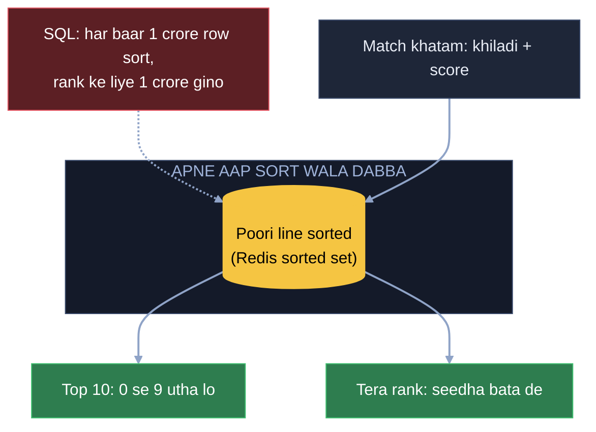
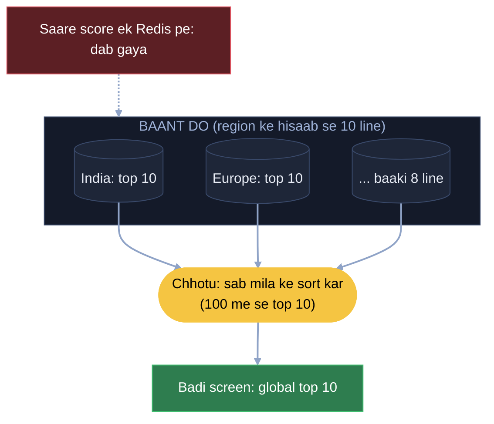
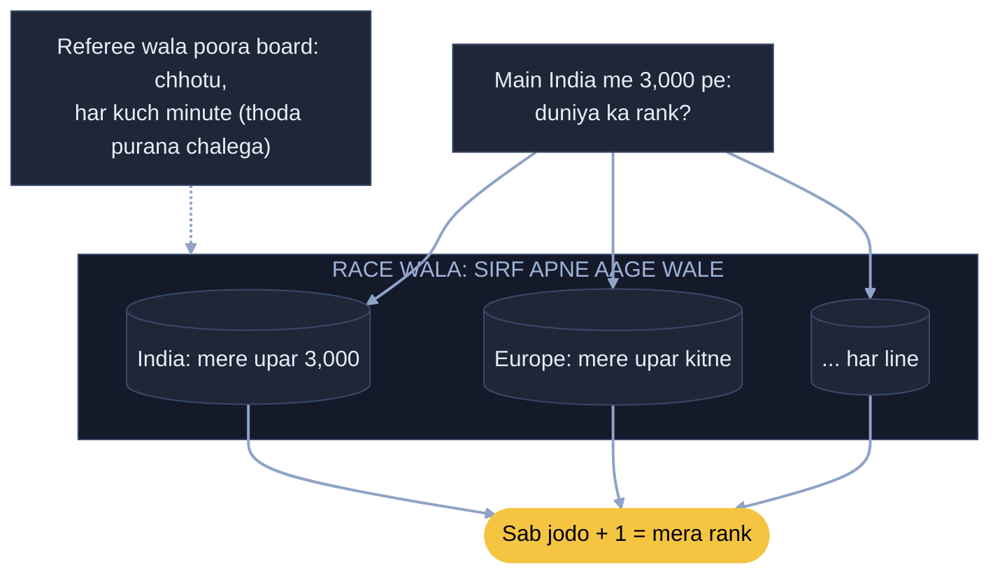
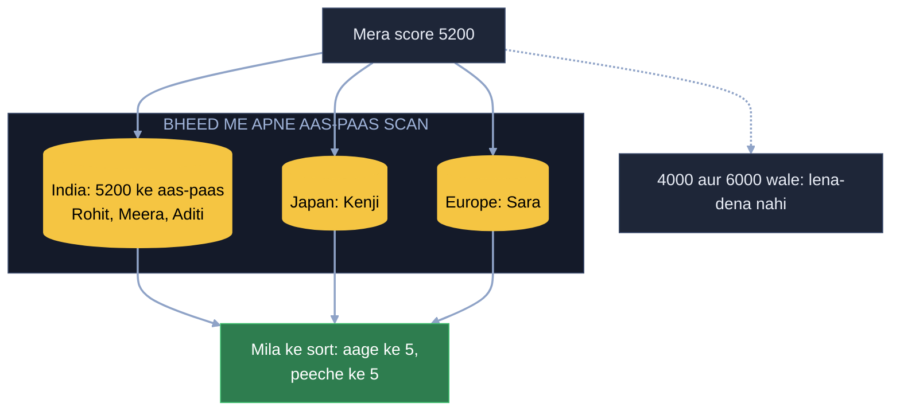
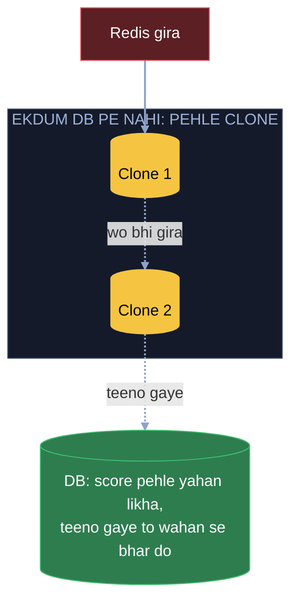

# Leaderboard: 1 crore khiladi, ek line ki kahani

Ek game hai, 1 crore khiladi, aur har match ke baad kisi ka score badalta hai. Screen pe teen cheez chahiye: top 10
abhi ke abhi, "tera rank 4,52,318", aur tere aage ke 5 aur peeche ke 5 khiladi. Kaam: ye sab bina 1 crore sort kiye,
aur har second lakhon match khatam hon tab bhi.

Har kadam = **kahani** (dikkat aur hal, bolne wali bhasha) -> **Asli naam** (interview me yahi shabd) -> tasveer
(kahani ka shabd, bracket me asli naam).

---

## FR / NFR / Numbers (interview me pehle 2 minute)

```
FR      score update · top 10 · mera rank · mere aage-peeche ke 5 · aaj / hafta / all-time board
        · score barabar to pehle pahuncha wo upar
NFR     top 10 aur rank turant (milli second) · naya score kuch second me board pe · thoda purana referee board chalega · Redis gira to score na khoye
Numbers 1 crore khiladi · har second lakhon match khatam -> likhai bahut · board dekhne wale usse bhi zyada
        -> har baar 1 crore sort / ginti nahi chal sakti
```

---

## 1. 1 crore sort kiye bina top 10 aur rank (apne aap sort wala dabba)

SQL me top 10 ke liye har baar `ORDER BY score DESC LIMIT 10`, jabki score har second lakhon baar badal rahe. Aur mera
rank = "kitne log mere se upar", to har baar 1 crore row gino. To ek aisa dabba rakho jisme khiladi aur score daalte
jao, aur wo apne aap sort karke rakhe. Top 10 chahiye to upar se 10 utha lo, rank chahiye to wo seedha bata de ki tu
kaunse number pe khada hai. Ye priority queue jaisa hi hai, bas wahan sirf upar wala pakka hota (parent-child), yahan
poori line sorted hai.

**Asli naam:** apne aap sort wala dabba = Redis sorted set. Score daalna / badalna (`ZINCRBY`), top 10 (`ZRANGE 0 9 REV`),
mera rank (`ZREVRANK`) teeno log N: 1 crore me ~24 kadam. Commands interview me bolni nahi padti, bas "sorted set,
score ke kram me".



## 2. Ravi aur Priya dono 9800 (score phir time, ek number me)

LeetCode jaisa: score barabar ho to jisne pehle banaya, chahe 0.01 milli second pehle, wo upar. Pehle score dekho,
same ho to time, jaise streams me thenComparing. Par dabba har khiladi ke saath sirf EK number rakhta hai. To dono
cheez ek number me pack karo: aage ka hissa score, point ke baad ka hissa time, aur jo pehle aaya uska ye hissa bada.

```
Ravi   9800, 10:00 pe  ->  9800.95
Priya  9800, 10:05 pe  ->  9800.90      line: Ravi -> Priya
```

**Asli naam:** composite score (score + earlier-time fraction). Score pehle tolta, fraction sirf barabari pe.

## 3. Har second lakhon update ek Redis pe (baant do, phir milao)

Saare score ek hi Redis pe ja rahe, wo dab gaya. Ek Redis kyun? Baant do, jaise region ke hisaab se: India ke, Europe
ke, aise 10 line. Top 10 ke liye har line se uske top 10 lo, aur ek chhotu ko do: "ye sab mila ke sort kar aur badi
screen pe laga de". 10 line ke top 10 = 100 log, unme se sabka top 10. Sab badi screen dekhein, har dekhne wala 10
dabbe na khatkhataye.

**Asli naam:** baantna = shard (har khiladi ek hi dabbe me), har dabbe se le ke milana = scatter-gather, chhotu =
aggregator, badi screen = global top 10 ka cache.

**Maan lo match ka +50 retry se do baar pahuncha:** Match id hi key: is match ka score pehle jud chuka to dobara mat jodo. +100 nahi, +50.



## 4. India me 3,000 pe hoon, duniya ka rank chahiye (race wala aur referee wala)

Do nazar hain. Race me bhaagne wala sirf apne aage wale dekhta, peeche wale nahi: mera rank = har line me mere upar
kitne log, sab jodo, +1. Sabko ek line me khada nahi karna padta, har dabba bas ginti batata hai: India me 3,000 upar,
Europe me 1,20,000 upar, ... jodo, rank nikal aaya. Referee sabko dekhta, ek ko nahi: poora 1 crore ka scoreboard =
chhotu ka kaam, har kuch minute me sab dabbe mila ke ek bada board. Referee ke liye thoda purana chalega.

**Asli naam:** mera rank = har shard se count (mere score se upar, `ZCOUNT`), jod ke +1. Poora board = background job
jo snapshot banata.



## 5. Aaj, is hafte, all-time; raat 12 baje aaj wala khaali (alag register)

Teeno board ka kram alag: aaj koi aur upar, hafte me koi aur, all-time me koi aur. Alag se sort nahi chalana: match
jeeta to score ek saath teeno dabbon me jod do, teeno khud khisaka denge. Raat 12 baje 1 crore ka score ek-ek karke
zero karne ka koi matlab nahi (aaj 20 lakh khele to 80 lakh ko chhuna padta). To har din ka alag register: naya din,
naya register, aur kal wala poora register discard.

```
Arpan +50 -> board:5-Nov +50 · board:week-45 +50 · board:all-time +50
board:4-Nov  -> umar poori, apne aap hat jaata
```

**Asli naam:** alag register = key me tareekh / hafta (time-bucketed key), discard = purane dabbe pe TTL.

**Maan lo Priya aaj khelti hi nahi:** agar requirement hai ki naam dikhe to 0 ke saath dikha do, nahi hai to wo aaj
ke register me hi nahi.
**Asli naam:** FR ka faisla; aaj ke key me na ho = score 0.

## 6. Mere aage ke 5, peeche ke 5 (bheed me aas-paas scan, paas ka petrol pump)

Main 4,52,318 pe hoon, top 10 me kabhi nahi aaunga, to screen mere aas-paas wale dikhaye. Par wo alag dabbon me baithe:
Kenji Japan me, Sara Europe me, India wale dabbe me sirf Rohit, Meera, Aditi. Mera score 5200, to mujhe 10,000 wale se
kya lena-dena. Bheed me main apne aas-paas scan karta, poori bheed nahi dekhta: har dabbe se sirf 5200 ke aas-paas
wale maango, 4000 aur 6000 wale nahi. Jaise highway pe gaadi 300-350 km jaayegi to petrol pump usi area me dhoondhta hoon. Sab dabbon
se aaye log mila ke sort, mere upar ke 5 aur neeche ke 5. (Yahi soch cache kadam 4 me: key ring pe paas ke dabbe me.)

**Asli naam:** har shard se score range query (mere score ke thoda upar aur neeche, `ZRANGE BYSCORE REV`), merge, 5 + 5.



## 7. Redis gira to saare score? (clone, phir DB)

Saare board Redis me hain, aur Redis gira. Ekdum DB pe nahi bhaagunga. Pehle koshish ki gire hi na; gira to uska
clone kaam sambhale, wo bhi gira to ek aur clone. Teeno gir gaye tab DB pe jaao, kyunki har match ka score pehle DB me
likha hai, wahan se dobara bhar do.

**Asli naam:** clone = Redis replica (primary gira to replica primary banti, failover). Teeno gaye to DB = sach, Redis
wahan se rebuild.



---

Notes (Arpan ke shabd) = [LEADERBOARD_HAND_NOTES.md](LEADERBOARD_HAND_NOTES.md)
