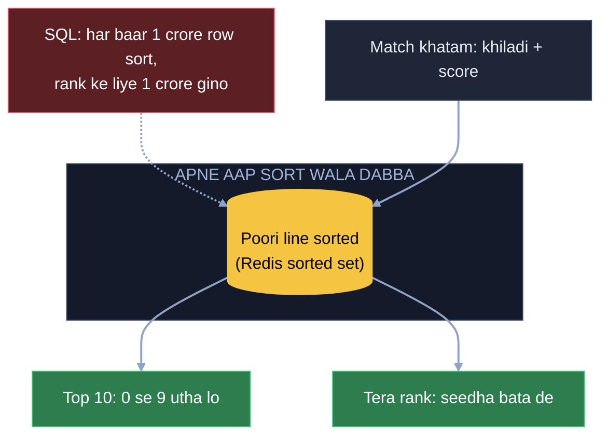
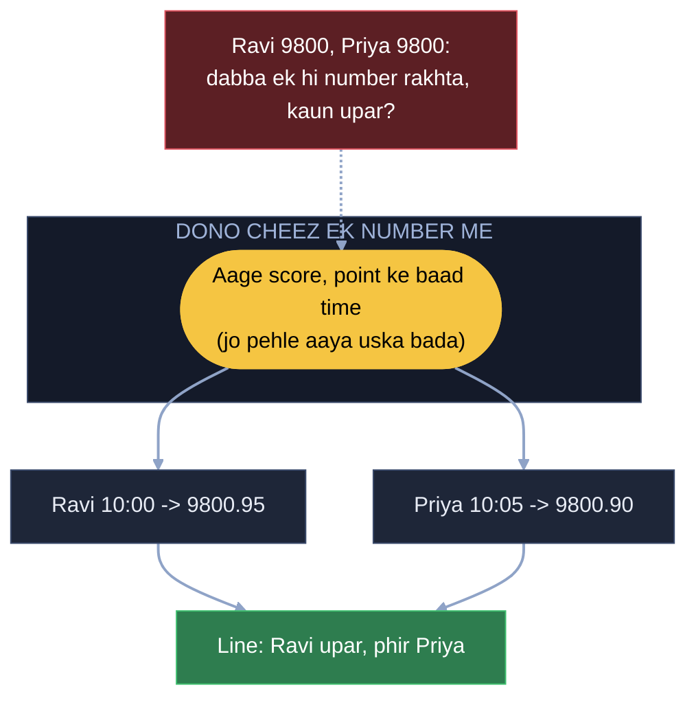
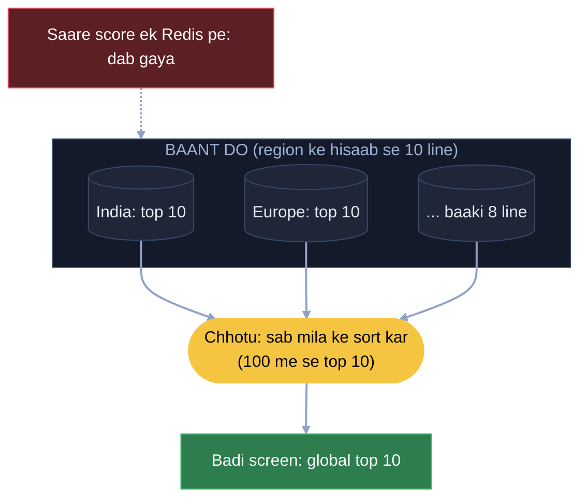
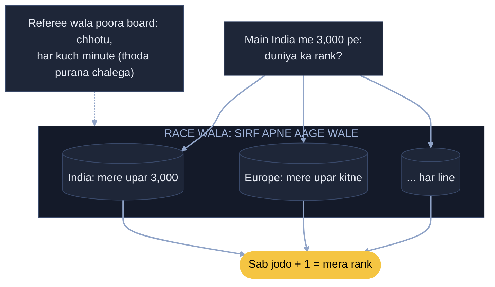
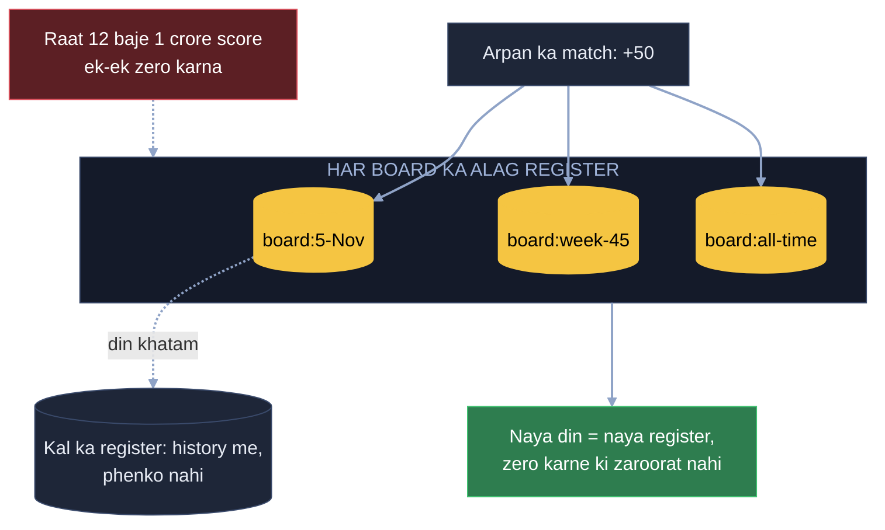
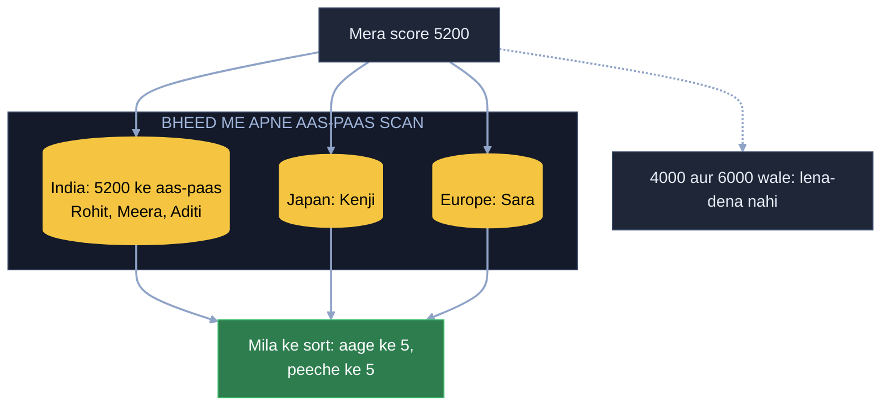
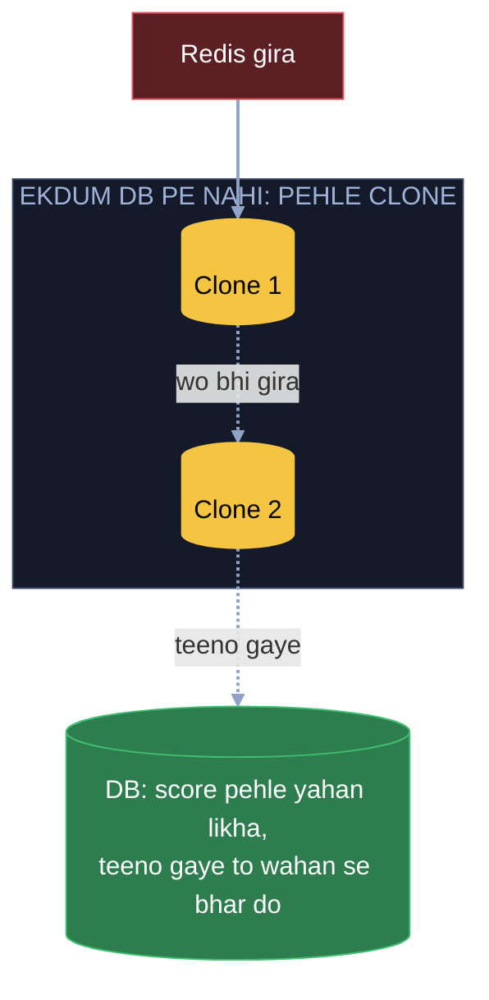
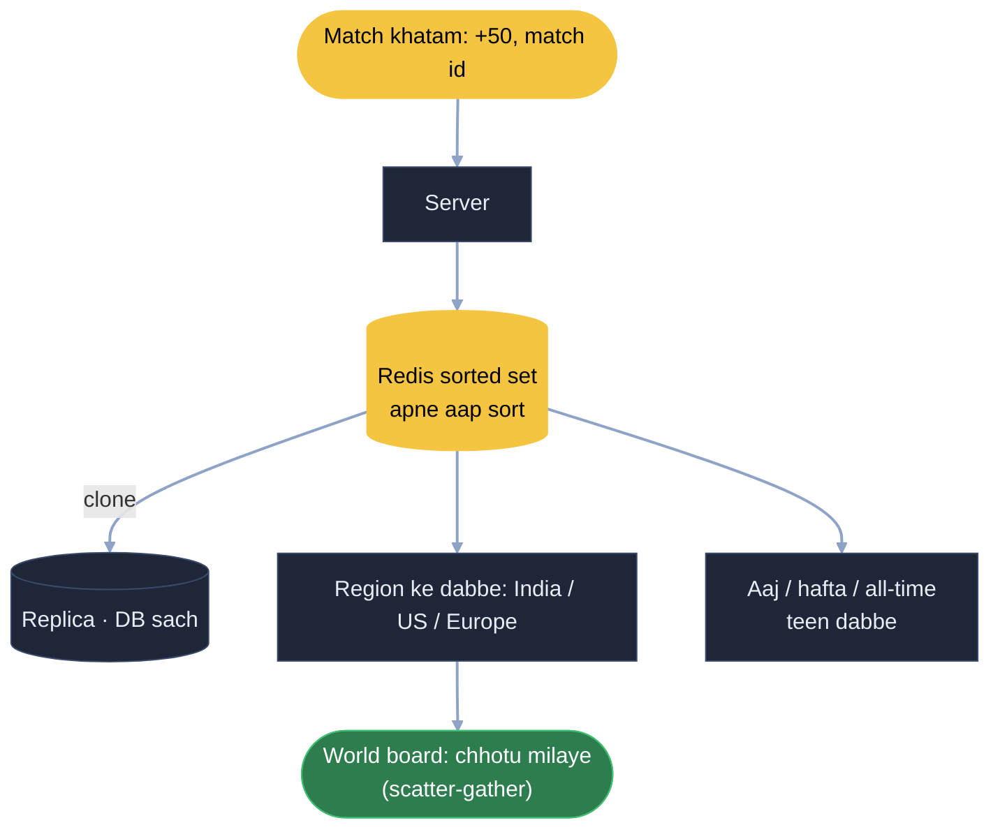

# Leaderboard: 1 crore khiladi, ek line ki kahani

Ek game hai, 1 crore khiladi, aur har match ke baad kisi ka score badalta hai. Roz ke match ke alawa game me LeetCode
jaisa contest bhi hota hai (sab ek saath shuru, 5 level / sawaal, contest ki apni rank). Screen pe teen cheez chahiye: top 10
abhi ke abhi, "tera rank 4,52,318", aur tere aage ke 5 aur peeche ke 5 khiladi. Kaam: ye sab bina 1 crore sort kiye,
aur har second lakhon match khatam hon tab bhi.

Har kadam = **kahani** (dikkat aur hal, bolne wali bhasha) -> **Asli naam** (interview me yahi shabd) -> tasveer
(kahani ka shabd, bracket me asli naam).

---

**Ek nazar: dhaancha + dikkat chain (round me sabse pehle ye, phir FR / NFR isi se):**
```
match khatam (+50, match id)  -->  server  -->  Redis sorted set (apne aap sort)  --clone-->  replica, DB sach
                                                   |
                         region ke dabbe (India / US / Europe), chhotu mila ke world board (scatter-gather)
                         aaj / hafta / all-time = teen alag dabbe (key me tareekh) · referee board = snapshot job

 1   1 crore sort kiye bina top 10 + rank        ->  apne aap sort wala dabba (Redis sorted set)
 1b  score pe index laga do                      ->  rank = ginna, har likhai pe index badle; write-heavy
 2   Ravi, Priya dono 9800                       ->  score phir time, ek number me (composite score)
 3   lakhon update ek Redis pe                   ->  region se baanto, chhotu mila ke (shard, scatter-gather)
 3b  match ka +50 do baar                        ->  match id se ek baar (idempotency)
 4   India me 3,000, duniya ka rank              ->  har line me mere upar kitne, jodo; poora board = snapshot job
 5   raat 12 baje aaj wala khaali                ->  key me tareekh, kal wala side me; teeno dabbe alag
 5b  11:59:58 ka match, score 12:00:02 pe        ->  khatam hone ka waqt, usi din ka register (event time)
 6   mere aage-peeche ke 5, alag dabbon me       ->  aas-paas scan, merge (score range)
 6b  world ke aas-paas 5 + 5                     ->  poora world board; UTC, sawaal, waqt, ms, naam
 6c  chalte contest me aage-peeche 10            ->  dabbe score range se, coordinator seedha sahi dabba
 6d  1 crore contest aur tez                     ->  availability > consistency; pehle pata kitne, jagah baanto
 7   Redis gira                                  ->  clone, clone, teeno gaye to DB se (replica, DB sach)
```

**FR / NFR kahan se:** upar ki dikkat chain dekh ke nikale; har line ke aage likha hai wo kis kadam se aayi.
Arpan: Score update FR hai. Top 10 FR nahi ho sakta, scoreboard aise kaam nahi karta: poochho top 10, 50 ya 100. "Mere aage-peeche ke 5" FR nahi, board sabke hisaab se banta, ye kisi ek user ka hai. Aaj / hafta / all-time, UTC, world ya India ka board: ye sab FR se pehle sawaal hain, pehle requirement clear kar lo, phir uske hisaab se FR me daalo. Score barabar to pehle wala upar = NFR. Rank milli second, score kuch second, Redis gira: inka yahan matlab nahi; asli rank to contest khatam hone ke baad hi pata chalti, beech me thodi purani chalegi.
Technical me: pehle sawaal = scope / requirement clarification, FR = score update + top N, NFR = tie-break + eventual consistency (contest ke beech).
Arpan (FR pakka): Top 10 FR nahi ho sakta; LeetCode me top 10 / top 15 jaisa koi feature nahi, wo rank pe chalta, top 10 pe koi inaam nahi. Top 10 feature to top 11, top 100 bhi feature, iska matlab nahi. Feature = scoreboard: sab usi board pe dikhte, apni rank bhi usi me.
Technical me: FR = score update + scoreboard (har user usi board me apni rank dekhe); "top kitne dikhane" sirf pehle sawaal (a), FR nahi.

FR / NFR ki doosri kahani (Arpan): world hi hoga, time zone UTC; "upar ke 5, neeche ke 5" sawaal nahi banta (board sabka, kisi ek ki nazar se nahi). FR: contest diya to rank dikhe; weekly, biweekly, mahine ka top. NFR: barabar score pe time, low latency, consistency, crash na ho.
Dhaancha (Arpan): user -> CDN (static) -> LB -> kai server -> local cache -> Redis -> AWS RDS Postgres + replica. DB me user id, naam, score, contest id: row wala consistent data, isliye SQL / Postgres.

## FR / NFR / Numbers (interview me pehle 2 minute)

```
PEHLE SAWAAL (FR se pehle interviewer se poochho, jawab se FR badle):
        a  top kitne dikhane: 10, 50 ya 100?
        b  board kis hisaab se: har contest (weekly, biweekly), mahina, all-time?  -> kadam 5, 5b
        c  board poori duniya ka ya ek desh (India) ka?                           -> kadam 3, 4, 6b
        d  contest hai to waqt kis time zone me (UTC)?                            -> kadam 5, 6b

FR      1  score update                                                     -> kadam 3
        2  scoreboard: sab ek board pe, har user usme apni rank dekhe     -> kadam 1, 4, 5

NFR     1  score barabar to jisne pehle banaya wo upar (contest me: pehle khatam wala, phir milli second, phir naam)  -> kadam 2, 6b
        2  board / rank thodi der purana chalega; asli rank contest khatam hone ke baad   -> kadam 4, 6c, 6d
        3  ek match ka score ek hi baar jude (match id)                    -> kadam 3b
Numbers 1 crore khiladi · har second lakhon match khatam -> likhai bahut · board dekhne wale usse bhi zyada
        -> har baar 1 crore sort / ginti nahi chal sakti
API     (Arpan: "API ki aisi koi zaroori baat nahi")
        GET  contests                 -> kaunse contest hain (weekly, biweekly)
        POST submit                   -> ek sawaal submit, uska score                  (FR score update)
        POST contest submit           -> poora contest submit
        GET  world board / world rank -> board aur apni rank                          (FR board)
```

---

## 1. 1 crore sort kiye bina top 10 aur rank (apne aap sort wala dabba)

SQL me top 10 ke liye har baar `ORDER BY score DESC LIMIT 10`, jabki score har second lakhon baar badal rahe. Aur mera
rank = "kitne log mere se upar", to har baar 1 crore row gino. To ek aisa dabba rakho jisme khiladi aur score daalte
jao, aur wo apne aap sort karke rakhe. Top 10 chahiye to upar se 10 utha lo, rank chahiye to wo seedha bata de ki tu
kaunse number pe khada hai. Ye priority queue jaisa hi hai, bas wahan sirf upar wala pakka hota (parent-child), yahan
poori line sorted hai.

**Asli naam:** apne aap sort wala dabba = Redis sorted set. Score daalna / badalna (`ZADD`; kadam 2 ke baad naya pack kiya number `ZADD` se, `ZINCRBY` nahi, kyunki time wala hissa bhi badalna hai), top 10 (`ZRANGE 0 9 REV`),
mera rank (`ZREVRANK`) teeno log N: 1 crore me ~24 kadam. (Andar se sorted set = skip list + hash table: highway ki express lane jaisa, upar ki lane se bhaago, sahi jagah neeche utro.) Commands interview me bolni nahi padti, bas "sorted set,
score ke kram me".
(Redis khud chhote se bade ke kram me rakhta; leaderboard me ulta (reverse) padhte, bade se chhote, taaki sabse zyada score upar.)

**Doosri kahani (index laga do?):** score pe SQL index lagaya to top 10 turant, par rank ke liye har block me jaake
"mere upar kitne" gin-na padta, 1 crore me time badhta. Aur score har second badal raha, to har likhai pe index bhi
badlega; jahan likhai zyada wahan index ka utna fayda nahi. Isliye sorted set, jo andar hi sort rakhta.
**Asli naam:** index se bhi count scan, write-heavy pe index ka bojh, isliye Redis sorted set (log N).

**Teesri kahani:** contest me log dheere-dheere aate (3, 10, 100, 1000); Postgres ko har baar "ab 100 sort
kar, ab 2000" bolo to thak jaata, isliye tez sort karne wala chhotu (dabba).



## 2. Ravi aur Priya dono 9800 (score phir time, ek number me)

LeetCode jaisa: score barabar ho to jisne pehle banaya, chahe 0.01 milli second pehle, wo upar. Pehle score dekho,
same ho to time, jaise streams me thenComparing. Par dabba har khiladi ke saath sirf EK number rakhta hai. To dono
cheez ek number me pack karo: aage ka hissa score, point ke baad ka hissa time, aur jo pehle aaya uska ye hissa bada.

```
Ravi   9800, 10:00 pe  ->  9800.95
Priya  9800, 10:05 pe  ->  9800.90      line: Ravi -> Priya
```

**Asli naam:** composite score (score + earlier-time fraction). Score pehle tolta, fraction sirf barabari pe.
Time na jodo to barabar score pe Redis khud member naam ke alphabet (lexicographic) se kram lagata, pehle pahuncha wala nahi; isliye time jodte hain.

**Doosri kahani:** pehle score, barabar to time, pehle khatam wala upar; LeetCode andar kaunsa hisaab lagata public nahi,
number jodo, ghatao ya ulta karo, andar ki baat.

**Maan lo (Claude ka nitpick) pooche:** time ka number jodo to baad wale ka bada: Ravi 10:00 = 9805, Priya 10:05 = 9805.15,
Redis bade ko upar rakhta to Priya upar? Arpan: Ravi upar hi aayega; number sirf misaal tha, jodo, ghatao ya sorted ulta (reverse)
kar do. **Asli naam:** pehle aaye ka hissa bada (ya time ulta karke jodo) = composite score; misaal ka number sirf misaal.



## 3. Har second lakhon update ek Redis pe (baant do, phir milao)

Saare score ek hi Redis pe ja rahe, wo dab gaya. Ek Redis kyun? Baant do, jaise region ke hisaab se: India ke, Europe
ke, aise 10 line. Top 10 ke liye har line se uske top 10 lo, aur ek chhotu ko do: "ye sab mila ke sort kar aur badi
screen pe laga de". 10 line ke top 10 = 100 log, unme se sabka top 10. Sab badi screen dekhein, har dekhne wala 10
dabbe na khatkhataye.

**Asli naam:** baantna = shard (har khiladi ek hi dabbe me), har dabbe se le ke milana = scatter-gather, chhotu =
aggregator, badi screen = global top 10 ka cache.

**Doosri kahani:** 10 lakh register, aate maan lo 1 lakh, 1-2 Redis kaafi; region se baanto: EU, USA + Canada,
Russia + Belarus, India, Australia + NZ; India bada to aur baanto. Top 10: har dabbe se 10, 5 dabbe = 50, unme se top 10
(5 priority queue jaisa). **Asli naam:** shard, scatter-gather, merge k sorted (heap).

**Maan lo match ka +50 retry se do baar pahuncha:** Match id hi key: is match ka score pehle jud chuka to dobara mat jodo. +100 nahi, +50.
**Asli naam:** idempotency key (wahi ID dobara aaye to chhodo).

**Doosri kahani:** sawaal ki ID saath bhejo; server atka to parchi pe likh ke baad me bhejo; retry me wahi ID to dobara nahi
judega. **Asli naam:** idempotency key + outbox / retry.



## 4. India me 3,000 pe hoon, duniya ka rank chahiye (race wala aur referee wala)

Do nazar hain. Race me bhaagne wala sirf apne aage wale dekhta, peeche wale nahi: mera rank = har line me mere upar
kitne log, sab jodo, +1. Sabko ek line me khada nahi karna padta, har dabba bas ginti batata hai: India me 3,000 upar,
Europe me 1,20,000 upar, ... jodo, rank nikal aaya. Referee sabko dekhta, ek ko nahi: poora 1 crore ka scoreboard =
chhotu ka kaam, har kuch minute me sab dabbe mila ke ek bada board. Referee ke liye thoda purana chalega.

**Asli naam:** mera rank = har shard se count (mere score se upar, `ZCOUNT`), jod ke +1. Poora board = background job
jo snapshot banata.

**Doosri kahani:** world rank ekdum nahi niklegi; pehle andaze wali (maan lo 5000), jaise-jaise US, EU wale khatam karte,
board pe judte, rank hilti, sab khatam hone ke 5-10 minute baad theek. Board sabka banta, kisi ek ka nahi. LeetCode andar
kaise karta nahi pata, galat nahi bolunga. **Asli naam:** estimated rank, aggregator, eventual consistency.

**Khiladi alag region me (Arpan):** FR ke hisaab se poora world board (kadam 6 ke neeche "Maan lo dabbe region ke hisaab se") se. Hum Arpan ki
nazar se nahi, leaderboard ki nazar se soch rahe: sabka dekhna hai, US me Pablo ka bhi.



## 5. Aaj, is hafte, all-time; raat 12 baje aaj wala khaali (alag register)

Teeno board ka kram alag: aaj koi aur upar, hafte me koi aur, all-time me koi aur. Alag se sort nahi chalana: match
jeeta to score ek saath teeno dabbon me jod do, teeno khud khisaka denge. Raat 12 baje 1 crore ka score ek-ek karke
zero karne ka koi matlab nahi (aaj 20 lakh khele to 80 lakh ko chhuna padta). To har din ka alag register: naya din,
naya register, aur kal wala register side me rakh do, phekna nahi (history).

```
Arpan +50 -> board:5-Nov +50 · board:week-45 +50 · board:all-time +50
board:4-Nov  -> live se hata, history me (dekhna ho to wahi register khol do)
```

**Asli naam:** alag register = key me tareekh / hafta (time-bucketed key), side me rakhna = purana dabba live Redis se TTL se hat sakta, par board history me (DB / sasti jagah) rehta.

**Doosri kahani (contest ke board):** contest 437 ka board alag, DB me pada; agla Sunday 438 naya. UI pe link: "437 ki rank
yahan, 438 me register yahan". Mahine ka board = har contest ka score jod ke formula se rank; contest nahi diya to +0.
**Asli naam:** key me contest id, purana = history, mahina = sab contest ka jod (aggregate).

**Maan lo Priya aaj khelti hi nahi:** agar requirement hai ki naam dikhe to 0 ke saath dikha do, nahi hai to wo aaj
ke register me hi nahi.
**Asli naam:** FR ka faisla; aaj ke key me na ho = score 0.

**Maan lo Ravi ka match 11:59:58 pe khatam, score 12:00:02 pe pahuncha, server ne 9 Nov ke register me daal diya:** LeetCode jaisa: Arpan ne contest diya, main parchi pe sab likh deta hoon: contest 137, Arpan ki rank, aur kis waqt khatam hua. Request server tak late aayi to koi baat nahi, parchi me sab likha hai: ye is din ka contest tha, itne baje khatam hua, to usi din ke register me daalo. Jo register kar ke aaye nahi, unka 0. Beech me LeetCode crash bhi ho jaaye to parchi hamare paas hai, wapas aate hi mote register me daal do. Purana register phekna nahi, side me rakh do; Ravi ko 7 Nov ka dekhna hai to wahi register khol ke dikha do. Agar Ravi aaj ka (10 tarikh ka) board khol ke baitha hai, to UI pe saaf likh do "ye 10 tarikh ka contest hai, kal wale ka result is link pe".
**Asli naam:** "parchi pe contest id + khatam hone ka waqt" = event time, "usi din ke register me" = event time se bucket (pahunchne ke waqt se nahi), "purana register side me" = har din ka board history me rakho (discard nahi). "register kar ke aaye nahi" = contest ka sign-up; "mota register" = DB (kadam 7, score pehle DB me).

**Doosri kahani (12:59:59 submit, server tak 1:00:03):** parchi pe submit ka waqt likh lo; server gira to wapas aate hi parchi se
bhejo, ya doosre server pe. Bahut bheed ho to beech me Kafka, worker ek-ek karke uthaye (Kafka disk pe rakhta); itna data na ho
to Kafka ka matlab nahi. **Asli naam:** event time, Kafka = buffer / queue.

**Doosri kahani:** mita mat, overwrite; aaj nahi aaya to 0; ya naya register, purana discard.

**Maan lo contest 11 baje shuru, 1-3 baje khatam:** contest ka din = shuru wala din (9 tareekh). Leaderboard duniya bhar ke
online contest ka, to ek hi time zone UTC, IST / Europe alag-alag nahi (ek room wala elite contest alag cheez, yahan nahi).
**Asli naam:** reset = naya key / overwrite, contest date = start date, ek time zone.



## 6. Mere aage ke 5, peeche ke 5 (bheed me aas-paas scan, paas ka petrol pump)

Main 4,52,318 pe hoon, top 10 me kabhi nahi aaunga, to screen mere aas-paas wale dikhaye. Par wo alag dabbon me baithe:
Kenji Japan me, Sara Europe me, India wale dabbe me sirf Rohit, Meera, Aditi. Mera score 5200, to mujhe 10,000 wale se
kya lena-dena. Bheed me main apne aas-paas scan karta, poori bheed nahi dekhta: har dabbe se sirf 5200 ke aas-paas
wale maango, 4000 aur 6000 wale nahi. Jaise highway pe gaadi 300-350 km jaayegi to petrol pump usi area me dhoondhta hoon. Sab dabbon
se aaye log mila ke sort, mere upar ke 5 aur neeche ke 5. (Yahi soch cache kadam 4 me: key ring pe paas ke dabbe me.)

**Asli naam:** har shard se score range query (mere score ke thoda upar aur neeche, `ZRANGE BYSCORE REV`), merge, 5 + 5.

**Khiladi alag region me (Arpan):** FR ke hisaab se poora world board se (neeche wala "Maan lo dabbe region ke hisaab se"); leaderboard ki
nazar se sochna, sirf Arpan ki nahi.



**Maan lo dabbe region ke hisaab se (India, US, Europe), is Sunday ke world contest me Arpan ki rank 50,000 (game wali 4,52,318 alag), world me upar ke 5 aur neeche ke 5:**
Jaisa FR me tay kiya, kaam **poora world leaderboard** banana hai; Arpan ke aas-paas wale isi board ka hissa. Contest duniya bhar
me online (India, US, Europe), sabka waqt ek time zone, UTC. Bada bhai sab region ka result likhe. Pehle gino kisne kitne sawaal kiye: 5 me se
paanchon wale (50,000 me 20,000) pehle, unki rank pehle; baaki 30,000 baad me alag. Ek jitne sawaal walon me UTC me pehle khatam
wala upar, barabar to milli second, wo bhi barabar to naam. Result aate jaayein, line me judte jaayein; rank dheere-dheere theek
(Arpan ko thodi der 5,000, phir 50,000). Har baar region se "aas-paas" maangna bhaari, isliye ek board.
Arpan ke upar ke 5 / neeche ke 5 seedha tay nahi hote, time se hote: ranking upar se dheere-dheere tay hoti, thodi der galat dikhe to farak
nahi (LeetCode bhi time poora hone pe theek karta). Happy New Year film ka board: jab tak time poora nahi Team India neeche, result aate-aate
upar. Rassi jaisa: chhoti baandhi, phir badi, dheere-dheere apne aap lambi.
**Contest me aage-peeche (Arpan):** contest chal raha ho to "aage ke 5, peeche ke 5" ka alag feature ka matlab nahi; rank hilti rahegi,
ye sabko pata. Contest poora hua to board bana, usme upar-neeche wale apne aap. (Game alag: chalta rehta, wahan aage-peeche har waqt, kadam 6.)
Chalte contest me Arpan ne khatam kiya to bhi dikhana ho: dabbe **score ki range se** baanto (naam shehar ke: Bangalore = 10,000 wali range,
Mumbai = 50,000, Delhi = 5,000). Har desh ka coordinator har dabbe pe thappa lagata ki isme kahan se kahan tak; US, Europe same. Arpan 5200 ke
aas-paas, to seedha Delhi, New York, Stockholm wale dabbe; Bangalore, Mumbai ko poochha bhi nahi. Wahan se upar ke 10, neeche ke 10, Arpan beech me.
Ye andaze wali rank, galat hogi; rank sirf time se nahi, galat jawab / retry bhi ginte (pehle khatam par 3 galat < 1 minute baad bina galti).
Sabka khatam hote-hote rank theek, asli rank contest poora hone pe.
**Asli naam:** range partitioning (score range pe shard), coordinator = shard map / router, sirf matching shard pe range query, estimated rank, penalty (LeetCode: har galat submission pe 5 minute).
**Aur tez (Arpan):** chalte contest me availability zyada, consistency kam (sahi rank waise bhi ant me). Sign-up pehle hota, to pehle se pata India 50,000,
US 30,000, Europe 20,000: usi hisaab se jagah baant do (ye rank nahi, bas baantna, jaise URL me server ko counter ki range). Desh ke andar IP se shehar, har desh ka
coordinator; ek dabbe pe kai thappe ho sakte. Query 1 crore nahi dekhti. Asli rank world board pe.
**Asli naam:** AP + eventual consistency, capacity planning / pre-partition (sign-up count se), jagah ke hisaab se gole (geo partitioning: Delhi ke gole me Haryana, UP bhi; dabbe pe range ka thappa, query seedha us dabbe pe), shard map me har shard ki kai range, partition key != rank.

**Doosri kahani (baantne ka matlab saaf):** India se 10 lakh log, meri rank 5,000 dekhni hai to 10 lakh me kahan dhoondhoge.
Map pe gole: Delhi ka gola (Haryana, UP wale bhi), Mumbai ka (Pune bhi), Bangalore, Chennai, Gujarat. Har dabbe pe range ka
thappa: Delhi pe 4,000 se 5,000, to seedha Delhi ke dabbe pe; Bangalore, Mumbai se lena-dena nahi. (Pehle "IP" shabd bola
tha, matlab tha jagah ke hisaab se gola.)
**Asli naam:** geo partitioning (location se shard), shard map (kis shard me kaunsi range), query sirf us ek shard pe.
Bolne ki line: "FR ke hisaab se poora world board. Ek time zone (UTC). Pehle sawaal gino, paanchon wale pehle; ek jitne sawaal me jo pehle
khatam kare wo upar, phir milli second, phir naam. Result aate jaayein, board banta jaaye, rank thodi der me theek."
**Asli naam:** global leaderboard (aggregator, sab region mila ke ek sorted board), sort key = solved desc, finish time asc, ms, naam (composite score, kadam 2), solved count ke hisaab se bucket, rank thodi der purani = eventual consistency.

## 7. Redis gira to saare score? (clone, phir DB)

Saare board Redis me hain, aur Redis gira. Ekdum DB pe nahi bhaagunga. Pehle koshish ki gire hi na; gira to uska
clone kaam sambhale, wo bhi gira to ek aur clone. Teeno gir gaye tab DB pe jaao, kyunki har match ka score pehle DB me
likha hai, wahan se dobara bhar do.

**Asli naam:** clone = Redis replica (primary gira to replica primary banti, failover). Teeno gaye to DB = sach, Redis
wahan se rebuild.

**Doosri kahani:** Redis ki copy saath; peeche job Redis se DB me likhti rahe (contest ka data nahi khona). Bilkul pakka chahiye
to pehle parchi, phir Redis, phir 2-3 copy; thoda chhoot sakta to ek Redis + ek copy. **Asli naam:** replica, DB sach,
log / outbox, consistency ka faisla.



---

## Poora dhaancha ek nazar me



---

Notes (Arpan ke shabd) = [LEADERBOARD_HAND_NOTES.md](LEADERBOARD_HAND_NOTES.md)
