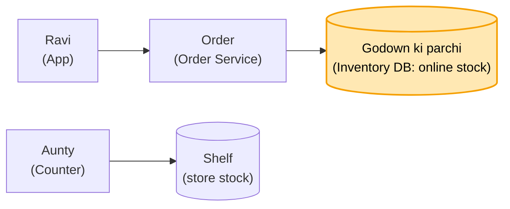
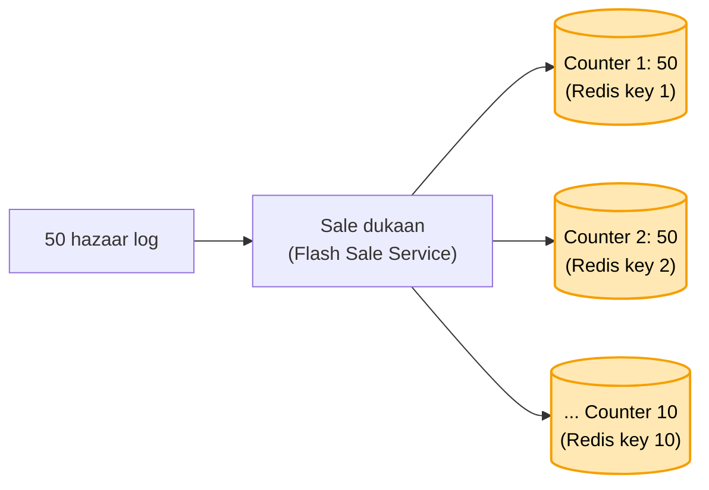
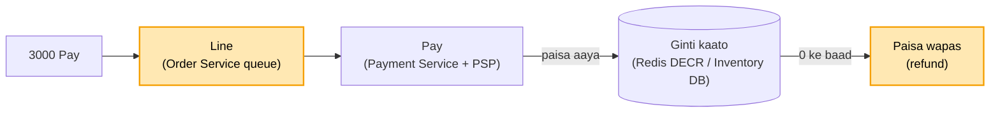
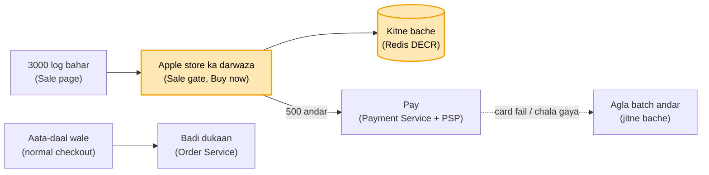
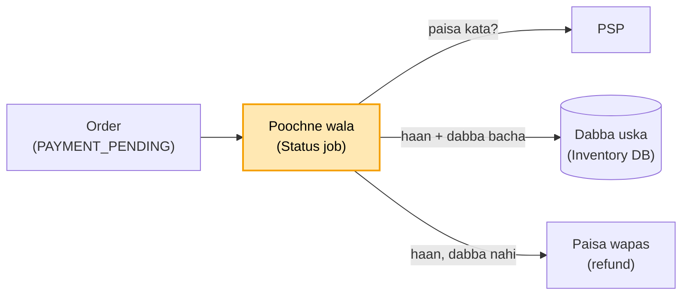

# E-commerce: mausi ka mart, ek stock do raaste

Mausi ka mart (Reliance Smart jaisa) ab online bhi bechta hai: dukaan ka counter bhi chal raha, app se ghar delivery
bhi. Stock ek hi hai, wahi shelf aur wahi godown. Kaam: ek dabba kabhi do logon ko na bike, aur Diwali sale ke din 50
hazaar ki bheed me bhi baaki dukaan (aata-daal) chalti rahe.

Har kadam = **kahani** (dikkat aur hal, bolne wali bhasha) -> **Asli naam** (interview me yahi shabd) -> tasveer
(kahani ka shabd, bracket me asli naam).

---

## FR / NFR / Numbers (interview me pehle 2 minute)

```
FR      cart me daalo · pay karo · order pakka · stock dekho (paas wale store ka) · sale (seemit maal, aadhe daam)
NFR     ek dabba do logon ko kabhi nahi (consistency) · sale me 500 hai to 500 ko hi, baaki "out of stock"
        (availability nahi, ye FR me hi cut off) · sale ki bheed se normal orders na atkein
Numbers Diwali 8 baje: 50 hazaar log, ghee sirf 500 · zyadatar log dekhne / cart me daalne aate, pay kam
```

**Faisla FR se:** interview me pehle hi bol do ki sale ka maal seemit hai, to yahan consistency chahiye (500 se ek bhi
zyada na bike), sabko milna zaroori nahi. Ye CAP wali baat hai: jo nahi milega use "out of stock", aur design usi
hisaab se.

**Arpan ka nichod:** e-commerce me sabse bada kaam inventory management hai. Wo kar liya to 90% design wahin sort,
baaki to frontend pe dikhana hai.

---

## 1. Aakhri ghee, aunty aur Ravi ek saath (online aur counter ka alag stock)

Shelf pe aakhri ek ghee. Shaam 7 baje Ravi app pe order karta hai, app pe "In stock". Usi minute dukaan me aunty wahi
dabba counter pe le jaati hai. Ab aunty ke haath se cheen to nahi sakte. To shelf ka maal app pe dikhao hi mat. Ravi
ko godown ka dikhao, aunty ko shelf ka. ATM jaisa: ATM me paisa khatam hua to duniya ka paisa khatam nahi hua, gaadi
se phir aa jaata hai. Godown me dabba hai to Ravi ko dikhega, nahi to out of stock.

**Asli naam:** har raaste (channel) ka alag stock. Online = godown ki ginti, counter = shelf ki. Dono kabhi ek dabbe
pe nahi takraate.

**Maan lo Lucknow ka store khaali, Kanpur me 20 dabbe:** Lucknow wale ko Lucknow ka store dikhega. Dark store ka
matlab hi aas-paas ka store. Whitefield me baithe ko Koramangala wala dikhta.
**Asli naam:** har store ka apna stock (store_id + item), app location dekh ke paas wala store chunta.



## 2. Ladka 10 dabbe utha ke bhool gaya (uthana aur likhna ek hi kaam)

Raviwaar ki bheed, shelf khaali. Staff ka ladka godown se 10 dabbe shelf pe le gaya, kahin likha nahi. Godown me sach
me 30 bache, app pe abhi bhi 40. Shaam tak 40 order, 10 ka ghee hai hi nahi. To godown se uthaya to parchi pe kaat ke
likho, aur ye ek hi kaam bana do: uthana aur parchi update karna alag kaam nahi. To bhoolne ka mauka hi nahi.

**Asli naam:** parchi = Inventory DB. Maal hilaana (godown -> shelf) aur ginti badalna ek hi transaction me (atomic):
`godown - 10` aur `shelf + 10` dono ya koi nahi.

## 3. Diwali sale, aata-daal bhi atka (sale ki alag dukaan)

8 baje "ghee aadhe daam, sirf 500" ka message, 50 hazaar log ek saath app pe. App atak gaya, aur jo aata-daal lene
aaye the wo bhi atke. Bheed sale wale maal ki wajah se hai. To use bagal wali khaali dukaan me le jaao: jo sale ke
liye aaya wo wahin aaye, wahin se nikle, badi dukaan me ghuse hi nahi.

**Asli naam:** sale ka alag raasta / alag service (Flash Sale Service, apne server). Uski bheed normal orders tak nahi
pahunchti, ek gira to doosra chalta.

## 4. Ek parchi pe 50 hazaar (10 counter, tez kaatne wala)

Sale dukaan me ek counter, ek parchi "ghee: 500". Ek waqt me ek hi aadmi parchi chhoo sakta, line 50 hazaar ki. To 10
counter bana do, har counter pe 50 ghee, line baant do. Har counter pe ek bechne wala, ek kaatne wala, aur kaatna haath
chalane jitna tez, millisecond bhi nahi.

**Asli naam:** ek row pe sab toot pade = hot row (ek row ek waqt me ek UPDATE, baaki lock ke liye line me). Ginti 10
tukdon me todo (har tukda ek row / key). Kaatna tez jagah pe: Redis me ginti, `DECR` (ek thread, ek ke baad ek, lakhon
per second). DB tak sirf jinka mila.



## 5. Counter 3 khatam, counter 7 pe 30 pade (khaali counter band, baaki khule)

8:02 pe counter 3 ke 50 khatam, uski line me 2000 log, unhe "khatam" bola. Counter 7 pe abhi 30 pade. To jiska khatam
hua wo counter band, aur uski line ko bolo jahan ghee bacha wahan jaao. "Khatam" tab bolo jab sabka zero.

**Asli naam:** ek tukda (key) 0 ho gaya to agla tukda try karo. Sold out tabhi jab saare tukde 0.

## 6. 500 kate, 60 ne pay hi nahi kiya (cart = list, ginti pay pe)

8:05 tak 500 kat gaye, "sold out" aa gaya, par 8:20 tak sirf 440 ne pay kiya. 60 dabbe kisi ke nahi, aur bahar 49
hazaar log. To jab tak pay nahi hua, ginti nahi kategi. Cart me daalna sirf list hai, aur cart kabhi khaali mat karo:
Myntra pe joota daal ke mahine baad aao to bhi wahin, Blinkit pe mummy se list banwa rahe to 5 minute me sab gaayab
nahi hona chahiye. Galle pe panni le ke khada aadmi: jab tak paisa nahi diya aur bill nahi bana, maal uska nahi.

**Asli naam:** cart = sirf list, koi reserve / TTL nahi. Stock pay ke waqt katta. Pay fail to ginti wapas (atomic DB
query). Cart purana ho to checkout pe abhi ka daam + abhi ka stock dobara check ("price changed / out of stock").

**Maan lo ek order me ghee, aata, daal, aur aata khatam:** poora order mat roko. Jo hai wo bhejo, aate pe out of
stock dikha do. Wo chahe to baaki do le le.
**Asli naam:** har cheez alag check, adhoora (partial) order chalta.

## 7. 3000 ek second me Pay (server pe line, 500 ke baad rollback)

8:00-8:01 me 3000 log Pay dabaate, sabko 500 dikh raha. Pay ki request pehle hamare server pe aati hai, to wahan line
lagao: jo pehle aaya wo pehle paaya. Jiska paisa aaya, ginti kaato, dabba uska. 500 khatam hone ke baad jiska paisa
aaya uska turant rollback, do minute me paisa wapas, aur "out of stock". Out of stock to dikhna hi hai, pehle dikhe
chahe baad me. Asli hal business ka: sale ke liye stock pehle se zyada mangwao (500 nahi, 10-20 hazaar).

**Asli naam:** server pe queue, paisa aane pe ek-ek karke `DECR`. 500 ke baad aaye paise = refund (rollback, PSP refund
API). Doosra raasta: Pay dabaate hi dabba ghadi (10 min) ke saath rok do (BMS jaisa hold), Pay page tabhi khule jab
dabba mila; refund kam, par dabba ghadi tak kisi ke kaam nahi aata. Dono ki keemat: refund ya ruka dabba.



## 7b. Rollback me bhi pech, ghadi me bhi (Apple store jaisa sale gate)

Rollback me bhi pech hai aur 10 minute wale me bhi, to koi screwdriver? Apple store dekho: 500 iPhone, bahar 3000
log. Jitne phone utne log andar, baaki bahar. Kisi ka card decline hua ya koi chala gaya to agla batch bulao, jitne
bache utne. 3000 ko andar bula ke kya fayda. App pe poora app to rok nahi sakte, aata-daal wale bhi hain. To ghee ke
liye ek alag counter lagao: sale wala maal us gate se guzrega, normal checkout chalta rahega. Us counter se sirf 500
ghee guzarne hain, to dikkat hi khatam.

**Asli naam:** sale gate. Sale item ka "Buy now" (normal cart me nahi jaata). Gate sirf utne logon ko Pay tak jaane
deta jitna stock (Redis DECR), card fail / chala gaya = agla batch. Gate ke bahar walon ka paisa kabhi katta hi nahi,
aur koi dabba bina bike nahi padta. Gate ek baar banta, har sale pe sirf list badalti (item + ginti + waqt).

**Maan lo Ravi Pay page pe jaake chai peene chala gaya, na pay na cancel:** pay nahi kiya to phone bika nahi. Dukaandar
jaisa: "ya pay kar ke le ja, ya wapas rakh de". Andar aate hi 5 minute ki ghadi; pay kiya to uska, nahi to wapas line me,
agla andar.
**Asli naam:** reservation expiry (TTL), release (Redis INCR) + agla batch.

**Maan lo ghadi 10:05 pe khatam, phone Priya ko gaya, Ravi 10:05 + 1 second pe Pay dabaye:** 5 minute ka time, code ke liye
1-2 second upar, zyada nahi; uske baad phone Priya ka (BookMyShow me bhi timer khatam to seat kisi aur ki). Time ke
andar Pay daba diya aur PSP dheema to hamari zimmedari.
**Asli naam:** Pay pe reservation zinda hai ya nahi check (expiry check), chhota grace period, andar dabaya to
PAYMENT_PENDING aur hold ruk jaata (kadam 8 / BMS jaisa).



## 8. Net gaya / PSP chup (PAYMENT_PENDING, PSP se poochte raho)

Ravi ko laga pay ho gaya, par PSP tak request pahunchi hi nahi, ya paisa kata aur PSP anjaan. Design har jagah se
thoda toot-ta hai: chahe 10 minute rok lo, chahe paisa aane pe kaato, kinaare pe dikkat rehti hai. Aakhri second pe pay
kiya to wahan BMS wali cheez hi leni padegi. Paisa kata to zimmedari hamari, PSP se hum baat karenge.

**Asli naam:** PAYMENT_PENDING (BMS jaisa) + status job PSP se poochta rahe. Paisa kata mila to dabba uska; dabba na
bacha ho to refund. Perfect design koi nahi, bas kitne refund.



---

Notes (Arpan ke shabd) = [ECOMMERCE_HAND_NOTES.md](ECOMMERCE_HAND_NOTES.md)
