# E-commerce: mausi ka mart, ek stock do raaste

Mausi ka mart (Reliance Smart jaisa) ab online bhi bechta hai: dukaan ka counter bhi chal raha, app se ghar delivery
bhi. Stock ek hi hai, wahi shelf aur wahi godown. Kaam: ek dabba kabhi do logon ko na bike, aur Diwali sale ke din 50
hazaar ki bheed me bhi baaki dukaan (aata-daal) chalti rahe.

Har kadam = **kahani** (dikkat aur hal, bolne wali bhasha) -> **Asli naam** (interview me yahi shabd) -> tasveer
(kahani ka shabd, bracket me asli naam).

---

**Ek nazar: dhaancha + dikkat chain (round me sabse pehle ye, phir FR / NFR isi se):**
```
Ravi  -->  LB  -->  normal dukaan (aata, daal)          sale ki alag dukaan (ghee 500)
                         |                                     |
              DB (order, ek hi kaam me uthana + parchi)   Redis ginti (10 counter, DECR), sale gate: stock jitne hi Pay tak
                         |                                     |  5 min ghadi, phir wapas line me
                    PSP: PAYMENT_PENDING + status job + webhook, fail pe cart wahi, kata to refund
                    paas ka store (location), DB sach, banda Redis aur DB milaye

 -   sale ka maal seemit                         ->  FR me hi cut off: 500 ko hi, baaki out of stock
 1   aakhri ghee, aunty + Ravi ek saath          ->  online ko godown, counter ko shelf (alag stock)
 1b  Lucknow ka store khaali, Kanpur me 20       ->  location se paas ka store (dark store)
 2   ladka uthake likhna bhool gaya              ->  uthana + parchi ek kaam (atomic transaction)
 3   sale ki bheed, aata-daal bhi atka           ->  sale ki alag dukaan (alag service)
 4   ek parchi pe 50 hazaar                      ->  10 counter, Redis DECR (hot row todo)
 4b  Redis me ginti kati, DB me order nahi       ->  DB sach, banda milaye (reconciliation)
 5   counter 3 khatam, counter 7 pe 30           ->  khaali counter band, sold out tab jab sab 0
 6   60 ne pay nahi kiya                         ->  cart sirf list, ginti pay pe
 6b  order me aata khatam                        ->  jo hai wo bhejo, aate pe out of stock
 7   3000 ek second me Pay                       ->  server pe line, 500 ke baad rollback (ya ghadi wala hold)
 7b  rollback + ghadi dono me pech               ->  Apple store jaisa sale gate
 7c  4 tab, Buy now 4 baar                       ->  user id pe ek (idempotency)
 7d  andar gaya, chai peene chala gaya           ->  5 min ghadi, phir wapas (expiry)
 7e  ghadi khatam ke 1 sec baad Pay              ->  1-2 sec grace, andar dabaya to PSP hamari zimmedari
 8   net gaya / PSP chup                         ->  PAYMENT_PENDING + status job, refund
 8b-e  PSP 50 sec chup, kata kaise pata, success do baar, fail pe cart  ->  ghadi, webhook, payment id, cart wahi
 9   sale pe cart ki almari B, C giri           ->  ring pe aage wali chalti almari pe likho (sloppy quorum)
 9b  B, C wapas, iPhone D, E pe                  ->  D ka chhotu lauta de + sync job (hinted handoff, anti-entropy)
```

**FR / NFR kahan se:** upar ki dikkat chain dekh ke nikale; har line ke aage likha hai wo kis kadam se aayi.
Arpan: E-commerce ka matlab: stock dekho aur screen pe dikhao, phir cart me daalo, pay karo, order pakka. Stock pehle aana chahiye. "Ek order me kai cheez, ek khatam to baaki bhejo" FR me nahi, usse design nahi badalta (Hello Interview: FR / NFR me wahi jo design me farak laaye); sale wale se badalta hai. Sale me 500 hai to 500 ko hi (Apple store wali kahani, apni banayi isliye aaj bhi yaad).
Technical me: FR = browse / stock -> cart -> checkout -> order; NFR = consistency (oversell nahi), alag sale service, payment latka na rahe.

**Isi pe ek aur raasta (round me FR / NFR):** E-com me sabse badiya kaam: stock dekho, cart me daalo (add karo), pay karo; aur kabhi sale aaye to sale ki bheed sambhaalni padegi. Main kaam do-teen: cart me kaise daalenge aur order kaise hoga. DB me stock hai to app pe dikhao, warna mat dikhao, kahan se doge. NFR: do log ek hi cart na dekhein, Arpan aur Ravi ka cart alag-alag ho, har user ka apna; aur ek hi stock bacha ho to do log use na le paayein. Asli dhyaan inventory aur shelf pe. Har shehar ka alag system: Lucknow, Bangalore, Mumbai, Pune, Goa, Delhi; Lucknow wale Lucknow se lenge, Delhi wale Delhi se. Ye Amazon nahi, Blinkit wala dark store jaisa, usi din delivery; bas Blinkit sab bechta (iPhone bhi), hamara area usse kaafi chhota, aur hamara apna physical store bhi hai. Dhaancha: user aaya -> CDN -> LB -> kai server (ek nahi) -> DB me stock dekha -> cart me add -> alag pay service -> PSP (Razorpay) ya COD.
**Asli naam:** cart user id pe (har user ka alag), dark store = paas ka store, pay = alag service + PSP, COD = payment method.

**API (Arpan):** API app pe hi, shelf pe koi nahi. Ye 4-5 main, aage aur bhi hongi.
```
API     GET  /stocks         -> saara stock, paas wale store ka (app me sab dikhe)
        GET  /stocks/{id}    -> ek cheez ka stock (ghee ki id -> 500)
        POST /cart           -> cart me +1
        POST /pay            -> PSP ko; stock -1 tab jab paisa kate
```

## FR / NFR / Numbers (interview me pehle 2 minute)

```
FR      1  stock dekho (paas wale store ka), screen pe dikhe                -> kadam 1, 1b
        2  cart me daalo                                                    -> kadam 6
        3  pay karo                                                         -> kadam 8
        4  order pakka                                                      -> kadam 2
        5  sale: seemit maal; sale me ek user ko ek hi                      -> Faisla FR se, kadam 3, 7, 7c
        (pehle sawaal: Pay PSP (Razorpay jaisa) se hota; uska andar ka kaam design ka hissa nahi. Interviewer
         se poochho: PSP ka timeout kitna, ya PSP scope se bahar? Wo bole "30-60 sec bahut" to wahi timeout, uske baad
         FAILED aur alag column "kitni der baad kata" (BMS 6c jaisa))

NFR     1  ek dabba do logon ko kabhi nahi; sale me 500 maal to 500 ko hi, baaki "out of stock"
           (consistency)                                                    -> kadam 1, 2, 4, 5, 7, 7b
        2  sale ki bheed se normal orders na atkein                         -> kadam 3
        3  paisa kata to maal ya refund, net / PSP chup ho to bhi order latka na rahe  -> kadam 8, 8b-8e
Numbers Diwali 8 baje: 50 hazaar log, ghee sirf 500 · zyadatar log dekhne / cart me daalne aate, pay kam
```

**Faisla FR se:** interview me pehle hi bol do ki sale ka maal seemit hai, to yahan consistency chahiye (500 se ek bhi
zyada na bike), sabko milna zaroori nahi: jo nahi milega use "out of stock", aur design usi hisaab se. Ye CAP wali
baat nahi: CAP tab aata hai jab kai system hon aur beech ka taar toote; yahan stock ki ginti ek hi jagah hai (Koramangala
aur Whitefield ki alag dukaan ho to unka stock bhi alag).

**Arpan ka nichod:** e-commerce me sabse bada kaam inventory management hai. Wo kar liya to 90% design wahin sort,
baaki to frontend pe dikhana hai.

---

## 1. Aakhri ghee, aunty aur Ravi ek saath (online aur counter ka alag stock)

Shelf pe aakhri ek ghee. Shaam 7 baje Ravi app pe order karta hai, app pe "In stock". Usi minute dukaan me aunty wahi
dabba counter pe le jaati hai. Ab aunty ke haath se cheen to nahi sakte. To shelf ka maal app pe dikhao hi mat. Ravi
ko godown ka dikhao, aunty ko shelf ka. ATM jaisa: ATM me paisa khatam hua to duniya ka paisa khatam nahi hua, gaadi
se phir aa jaata hai. Godown me dabba hai to Ravi ko dikhega, nahi to out of stock. App sirf inventory dikhata: inventory me 100 aur shelf pe 1, to app pe 100. Ravi le to inventory se jaayega, shelf se nahi. Aunty ko inventory se matlab nahi, use kya pata inventory, wo shelf pe dekhegi.

**Asli naam:** har raaste (channel) ka alag stock. Online = godown ki ginti, counter = shelf ki. Dono kabhi ek dabbe
pe nahi takraate.

**Maan lo Lucknow ka store khaali, Kanpur me 20 dabbe:** Lucknow wale ko Lucknow ka store dikhega. Dark store ka
matlab hi aas-paas ka store. Whitefield me baithe ko Koramangala wala thodi dikhega.
**Asli naam:** har store ka apna stock (store_id + item), app location dekh ke paas wala store chunta.

**Aur neeche (shelf khaali ho gayi to):** Shelf pe ek hi tha aur aunty le gayi, shelf khaali. Aunty ko mana nahi karenge: inventory me pada hai to laake de denge. Shelf khaali ho to alert laga do; inventory me hai to chhotu wahan se laake shelf pe rakh de, nahi hai to koi dikkat nahi. Shelf pe isliye chahiye kyunki dukaan me maal tabhi bikta jab shelf pe ho, warna grahak chala jaayega.
**Asli naam:** shelf khaali = alert (restock), inventory se shelf pe laana + likhna = kadam 2 wala ek kaam.

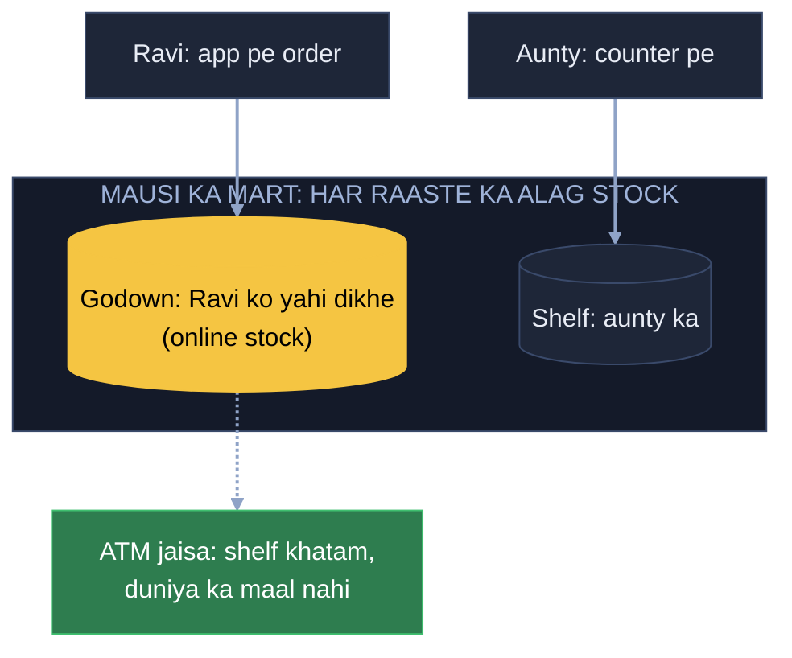

## 2. Ladka 10 dabbe utha ke bhool gaya (uthana aur likhna ek hi kaam)

Raviwaar ki bheed, shelf khaali. Staff ka ladka godown se 10 dabbe shelf pe le gaya, kahin likha nahi. Godown me sach
me 30 bache, app pe abhi bhi 40. Shaam tak 40 order, 10 ka ghee hai hi nahi. To godown se uthaya to parchi pe kaat ke
likho, aur ye ek hi kaam bana do: uthana aur parchi update karna alag kaam nahi. To bhoolne ka mauka hi nahi. Jaise inventory me 100 the, chhotu 50 laake shelf pe rakh gaya: register me 100 me se 50 kaat ke 50 likhe, app pe bhi 50 dikhe. Laana, le jaana, kaatna sab ek hi kaam me, taaki chhotu bhoole tab bhi dikkat na ho.

**Asli naam:** parchi = Inventory DB. Maal hilaana (godown -> shelf) aur ginti badalna ek hi transaction me (atomic):
`godown - 10` aur `shelf + 10` dono ya koi nahi.

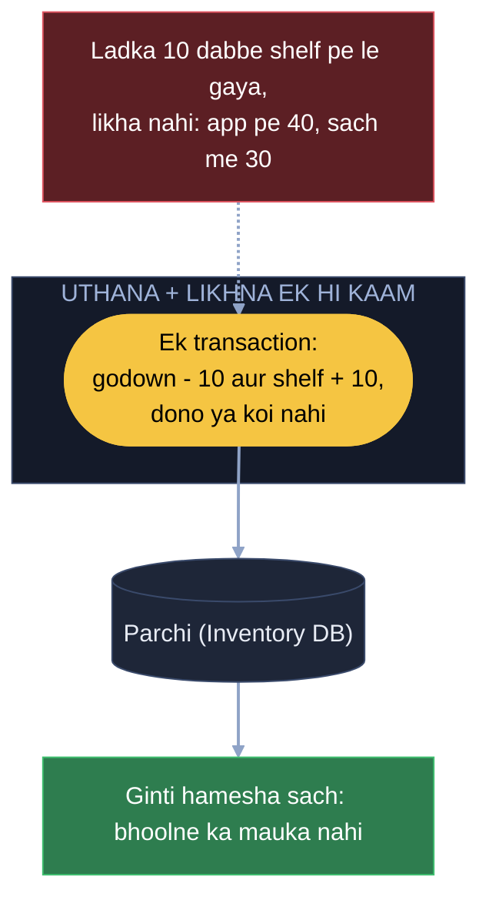

## 3. Diwali sale, aata-daal bhi atka (sale ki alag dukaan)

8 baje "ghee aadhe daam, sirf 500" ka message, 50 hazaar log ek saath app pe. App atak gaya, aur jo aata-daal lene
aaye the wo bhi atke. Bheed sale wale maal ki wajah se hai. To use bagal wali khaali dukaan me le jaao: jo sale ke
liye aaya wo wahin aaye, wahin se nikle, badi dukaan me ghuse hi nahi.

**Asli naam:** sale ka alag raasta / alag service (Flash Sale Service, apne server). Uski bheed normal orders tak nahi
pahunchti, ek gira to doosra chalta.

**Isi pe ek aur misaal (iPhone 50,000 ka 25,000 me):** Maine dukaan kholi, iPhone 50,000 ka 25,000 me. Socha 100-200 log aayenge, aa gaye 1000, dukaan chhoti. Jisko TV lena tha wo bhi bheed me atka. Dukaan me 150 log, unme 100 iPhone ke liye khade. Manager ko bola: iPhone alag dabbe me, alag dukaan me le jao, wahan becho; yahan TV, fridge bikega. Koi iPhone maange to bol do wahan hai, ya board laga do "iPhone lena hai to is gali me". Mausi ke mart me ghee pe yahi: ghee ki alag line, line aati jaaye, paise dete jaayein, nikalte jaayein; aata-daal wale normal me, faltu bheed nahi. Har bikri pe -1 ek hi transaction me, beech me race nahi: aakhri dabba pe do log aaye to jo pehle aaya usko, doosre ko "stock nahi". Customer naraaz hoga, ye mat bolna: 500 hai to 500 hi bikenge, 1000 ya 20,000 kahan se laayenge.
**Asli naam:** board / gali = sale traffic ko alag service pe route · -1 ek transaction me = atomic decrement.

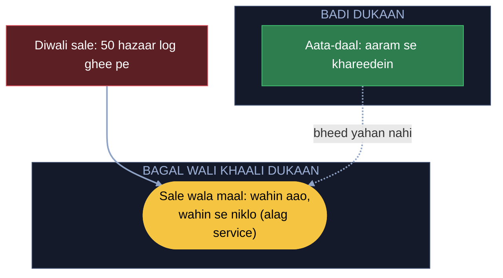

## 4. Ek parchi pe 50 hazaar (10 counter, tez kaatne wala)

Sale dukaan me ek counter, ek parchi "ghee: 500". Ek waqt me ek hi aadmi parchi chhoo sakta, line 50 hazaar ki. To 10
counter bana do, har counter pe 50 ghee, line baant do. Har counter pe ek bechne wala, ek kaatne wala, aur kaatna haath
chalane jitna tez, millisecond bhi nahi.

**Asli naam:** ek row pe sab toot pade = hot row (ek row ek waqt me ek UPDATE, baaki lock ke liye line me). Ginti 10
tukdon me todo (har tukda ek row / key). Kaatna tez jagah pe: Redis me ginti, `DECR` (ek thread, ek ke baad ek, lakhon
per second). DB tak sirf jinka mila.

**Maan lo Redis me ghee ki ginti kat gayi (Ravi gate ke andar aaya), par DB me order likhne se pehle server gir gaya:** Ab Redis kehta ek ghee kam hai, aur DB me koi order hi nahi. Sach DB hai, jaise Cache aur Banking me kaha tha. Ek banda peeche se Redis aur DB ko milata rahe: Redis me jitni ginti kati, utne order DB me hain ya nahi. Koi kati ginti bina order ke gate ki ghadi (5 minute) se zyada purani hai, matlab wo banda na pay kar paaya na order bana, to wo ghee wapas ginti me jod do, taaki doosra le sake. Jiska paisa aa gaya, uska dabba uska hi rahega.
**Asli naam:** banda milata rahe = reconciliation job, DB sach = Redis sirf tez ginti, ghadi se purani bina order wali kati ginti wapas = compensation (gate ki 5 min ki ghadi ke baad hi, chalte hue pay ko nahi chhedna).

**Isi pe ek aur raasta (5 line, main peeche hisaab ke saath):** Ek hi aadmi parchi kaat raha to 500 ko 100-100 me baant do, 5 line. Har line ko bolo tere paas 100. Har line apna kaat-ti jaaye: 99, 98, 97. Main peeche 500 ki asli parchi lekar khada, poochhta rahunga kitne bike aur apna kaat-ta rahunga; kahin gadbad hui to asli parchi mere paas, main dekh lunga. Har line pe 1 bacha to mere paas total 5; agle aaye, sabke 0, khatam. Jaise 200 iPhone: 50-50, 4 line; tere kitne bike? 50 ke 50; tere? 40; tere? 30. Ya apne paas computer rakh lun: jahan bill kata, mere 500 me se bhi -1, 499, aur har line ka bacha dikhe.
**Asli naam:** sharded counter (5 tukde) · peeche asli parchi / computer = DB sach + milaan (reconciliation).

**Aur neeche (ek phone wapas aaya to kis dabbe me):** 1000 iPhone 5 line me isliye baante ki bheed kam ho, hai to 1000 hi. Ek phone wapas aaya (pay fail ya lauta) to mere stock me wapas, kisi ek dabbe ka nahi; jo pehle pay kare uska.
**Asli naam:** wapas aaya maal common pool me; sold out tabhi jab har tukda 0.

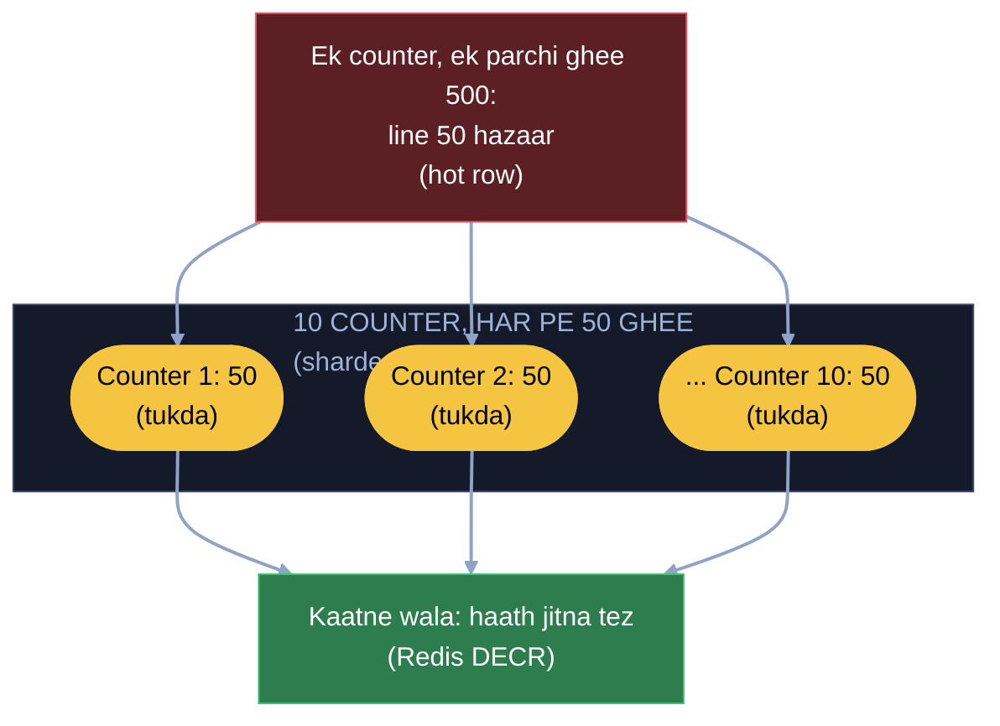

## 5. Counter 3 khatam, counter 7 pe 30 pade (khaali counter band, baaki khule)

8:02 pe counter 3 ke 50 khatam, uski line me 2000 log, unhe "khatam" bola. Counter 7 pe abhi 30 pade. To jiska khatam
hua wo counter band, aur uski line ko bolo jahan ghee bacha wahan jaao. "Khatam" tab bolo jab sabka zero. Counter 3 ke 0 hone pe sold out nahi: mere 500 me se 400 bache, sold out tab jab saare counter 0. Counter 3 wala aaya ki mere aage 50 aur khade hain, to unhe us line me bhejo jahan maal bacha (counter 7, counter 5). Wahan peeche lagna padega, ye trade-off hai: maal kam aur log zyada to ye hoga hi; doosre counter se maal utha ke nahi la sakte, wahan bhi bheed. Counter 7 pe 30 dabbe aur aage 10 log: 10 ko milega, 20 bachenge, aur counter 3 wale peeche lag ke apni baari ka intezaar karenge.

**Asli naam:** ek tukda (key) 0 ho gaya to agla tukda try karo. Sold out tabhi jab saare tukde 0. Keemat = doosri line me peeche lagna (trade-off).

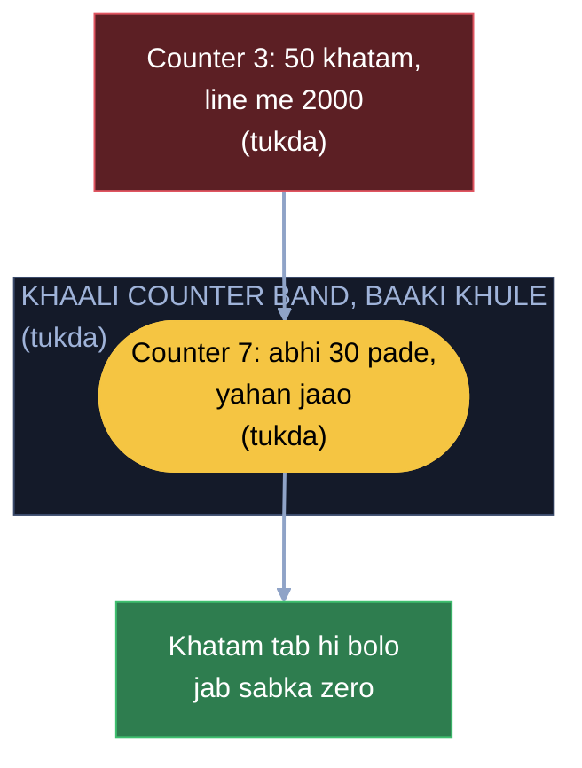

## 6. 500 kate, 60 ne pay hi nahi kiya (cart = list, ginti pay pe)

8:05 tak 500 kat gaye, "sold out" aa gaya, par 8:20 tak sirf 440 ne pay kiya. 60 dabbe kisi ke nahi, aur bahar 49
hazaar log. To jab tak pay nahi hua, ginti nahi kategi. Cart me daalna sirf list hai, aur cart kabhi khaali mat karo:
Myntra pe joota daal ke mahine baad aao to bhi wahin, Blinkit pe mummy se list banwa rahe to 5 minute me sab gaayab
nahi hona chahiye. Galle pe panni le ke khada aadmi: jab tak paisa nahi diya aur bill nahi bana, maal uska nahi. Cart me 10 daalo, 30 daalo, 50 daalo, stock kabhi kam nahi hoga. Ravi ne cart me daala aur masti kar raha, itne me Arpan aaya, dhadadhad pay karke sab le gaya; Ravi lauta to out of stock. Stock tab kam jab pay ho, maal pe thappa lag jaaye "ye Arpan ka hai, is address pe jaayega", aur maal inventory se nikal jaaye.

**Asli naam:** cart = sirf list, koi reserve / TTL nahi. Stock pay ke waqt katta. Pay fail to ginti wapas (atomic DB
query). Cart purana ho to checkout pe abhi ka daam + abhi ka stock dobara check ("price changed / out of stock").

**Maan lo ek order me ghee, aata, daal, aur aata khatam:** poora order mat roko. Jo hai wo bhejo, aate pe out of
stock dikha do. Wo chahe to baaki do le le.
**Asli naam:** har cheez alag check, adhoora (partial) order chalta.

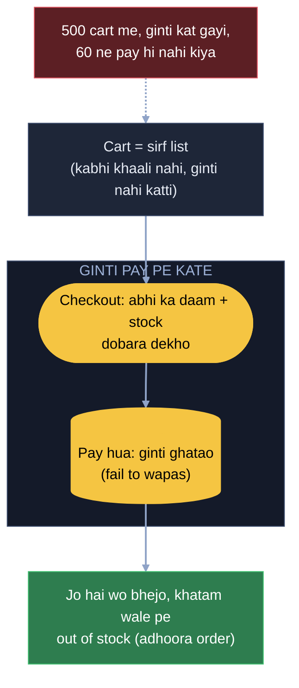

## 7. 3000 ek second me Pay (server pe line, 500 ke baad rollback)

8:00-8:01 me 3000 log Pay dabaate, sabko 500 dikh raha. Pay ki request pehle hamare server pe aati hai, to wahan line
lagao: jo pehle aaya wo pehle paaya. Jiska paisa aaya, ginti kaato, dabba uska. 500 khatam hone ke baad jiska paisa
aaya uska turant rollback, do minute me paisa wapas, aur "out of stock". Out of stock to dikhna hi hai, pehle dikhe
chahe baad me. Asli hal business ka: sale ke liye stock pehle se zyada mangwao (500 nahi, 10-20 hazaar).

**Asli naam:** server pe queue, paisa aane pe ek-ek karke `DECR`. 500 ke baad aaye paise = refund (rollback, PSP refund
API). Doosra raasta: Pay dabaate hi dabba ghadi (10 min) ke saath rok do (BMS jaisa hold), Pay page tabhi khule jab
dabba mila; refund kam, par dabba ghadi tak kisi ke kaam nahi aata. Dono ki keemat: refund ya ruka dabba.

**Ghadi wale ki ek aur keemat:** hold ke beech stock me +1 dikhaya to ek hi dabba cart me bhi, stock me bhi, do jagah.

**Maan lo sabko nahi mil sakta:** Amazon, Flipkart bhi sale pe book karke baad me cancel karte; poora hal nahi, jitna stock
utne log andar ya turant out of stock. **Asli naam:** available vs reserved stock, oversell ka 100% hal nahi.

**Isi pe ek aur raasta (stock tab kaato jab paisa kate, par andar sirf 500):** Mere raaste: (1) sabko line me lagao, ek ke baad ek, 499, 498; consistency rahegi, ek bhi zyada nahi bikega, bas user ko thoda time lagega. Kafka bhi laga sakte, par itni bheed me Kafka achhi cheez nahi. (2) bina line ke: har request ek hi transaction me dekhe ">= 1 hai?" aur -1 kare; ye sabse badhiya, kisi ko intezaar nahi, race kabhi nahi. Isliye SQL DB, jahan consistency aur transaction chahiye: 10 thread aaye to lock lagega, ek ek karke 499, 498. -1 tab hoga jab PSP se event aaye ki paisa kat gaya; cart me daalne ya Pay dabane se nahi. Par 3000 ko PSP pe jaane hi mat do: 500 hai to 500 ko andar lao, PSP pe 500 request hi jaayengi; Apple store Mumbai jaisa, kuch log andar, phir agla batch. 10-15 ka pay fail hua ya 50 log kuch nahi kar rahe (450 bike), to agle 50 bulao. Jo pehle pay kare use milega, ye general rule hai, Amazon Flipkart sab yahi karte. 0 hua to out of stock dikhao aur Pay ka button hata do. UI pe kya dikhana aur PSP andar kaise chalta, ye HLD ka hissa nahi.
**Asli naam:** line = queue · ">= 1 to -1 ek transaction me" = conditional atomic update (stock >= 1 ho tabhi -1) · SQL = transaction + row lock · andar sirf stock jitne, phir agla batch = sale gate · paisa katne pe -1 = webhook pe kaatna.

**Aur neeche (line Pay se pehle kyun):** 3000 logon ko seedha pay nahi karne dunga; paise kaat liye aur saamaan nahi bheja to consumer court me ghaseet lenge. Isliye pehle line, ek-ek karke.
**Asli naam:** oversell = kanooni / bharose ka khatra, isliye gate Pay se pehle.

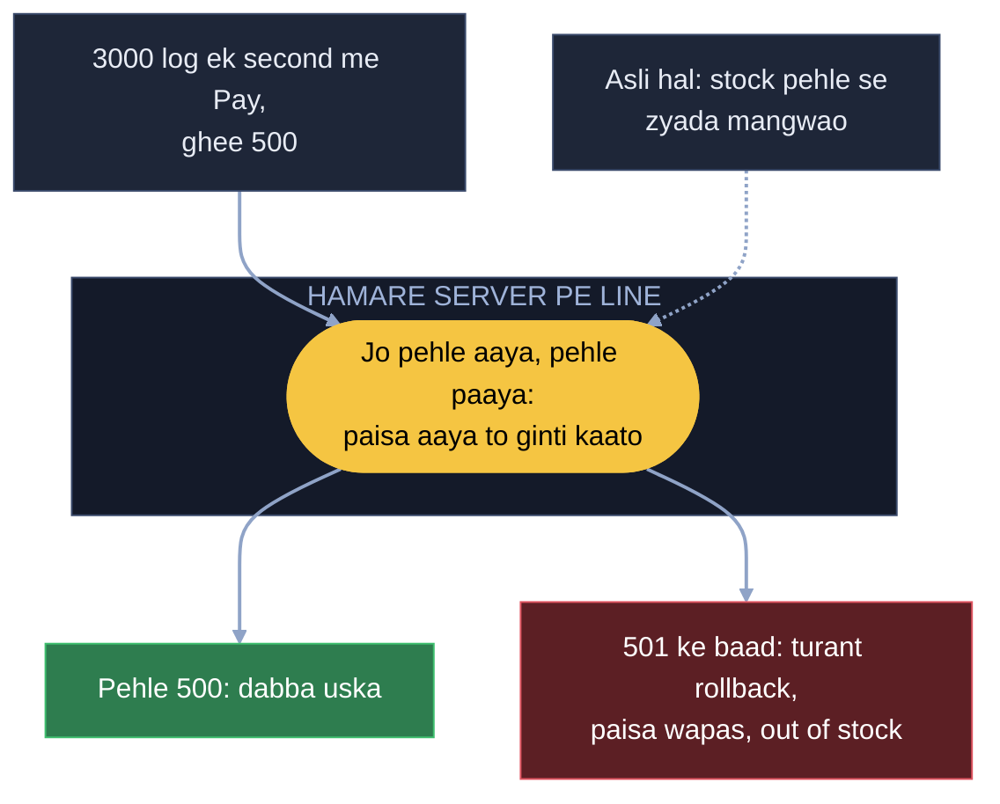

## 7b. Rollback me bhi pech, ghadi me bhi (Apple store jaisa sale gate)

(Normal cart pe kadam 6 wahi: ginti pay pe. Sirf sale wale item pe gate ginti pehle kaatta, isliye yahan ghadi aur wapas jodna.)

Rollback me bhi pech hai aur 10 minute wale me bhi, to koi screwdriver? Apple store dekho: 500 iPhone, bahar 3000
log. Jitne phone utne log andar, baaki bahar. Kisi ka card decline hua ya koi chala gaya to agla batch bulao, jitne
bache utne. 3000 ko andar bula ke kya fayda. App pe poora app to rok nahi sakte, aata-daal wale bhi hain. To ghee ke
liye ek alag counter lagao: sale wala maal us gate se guzrega, normal checkout chalta rahega. Us counter se sirf 500
ghee guzarne hain, to dikkat hi khatam.

**Asli naam:** sale gate. Sale item ka "Buy now" (normal cart me nahi jaata). Gate sirf utne logon ko Pay tak jaane
deta jitna stock (Redis DECR), card fail / chala gaya = agla batch. Gate ke bahar walon ka paisa kabhi katta hi nahi,
aur koi dabba bina bike nahi padta. Gate ek baar banta, har sale pe sirf list badalti (item + ginti + waqt).

**Maan lo Ravi ne 4 tab khole, Buy now 4 baar:** Gate pe user id hi key: ek user ka ek hi ghee rukega, Ravi ka pehle se ruka hai to wahi lauta do, naya mat roko. User id ek hai, to 4 tab ho, 5 ya 10, ek hi katega, 4 nahi. Ek tab se Buy now karke pay kar diya to baaki saare tab me cart 0: "order successful", khatam. Cart ko hamesha sync rakho; ye login, sign up aur user id ka khel hai.
**Asli naam:** idempotency key (wahi ID dobara aaye to chhodo). · cart server pe user id pe (tab pe nahi), sab tab sync.

**Maan lo Ravi Pay page pe jaake chai peene chala gaya, na pay na cancel:** pay nahi kiya to phone bika nahi. Dukaandar
jaisa: "ya pay kar ke le ja, ya wapas rakh de". Andar aate hi 5 minute ki ghadi; pay kiya to uska, nahi to wapas line me,
agla andar.
**Asli naam:** reservation expiry (TTL), release (Redis INCR) + agla batch. TTL khatam hone se ginti apne aap wapas nahi badhti; ek job (ya expiry ki khabar) INCR karti hai.

**Isi pe ek aur raasta (TTL nahi, stock paisa katne pe hi):** Ravi ne Google Pay ka app khola aur bahut der se kuch nahi kar raha. Uske dabbe pe TTL laga sakte hain ki wo gaayab ho ke wapas chala jaaye, par main nahi lagaunga, koi app aisa nahi karta (BookMyShow me seat HELD karte the, wahan theek). Stock 500 hi rahega jab tak paisa nahi katta; dabba tab kat-ta jab PSP bole paisa aa gaya. Aaj pay kare, kal kare, parson kare, tab tak 500; peeche log aate jaayenge, pay karte jaayenge, kisi waqt 0 hoga to cart me out of stock dikhega.
**Asli naam:** reservation / TTL nahi; stock sirf payment success (webhook) pe kat-ta; bheed me andar sirf utne jitna stock (kadam 7 ka sale gate).

**Maan lo ghadi 10:05 pe khatam, phone Priya ko gaya, Ravi 10:05 + 1 second pe Pay dabaye:** 5 minute ka time, code ke liye
1-2 second upar, zyada nahi; uske baad phone Priya ka (BookMyShow me bhi timer khatam to seat kisi aur ki). Time ke
andar Pay daba diya aur PSP dheema to hamari zimmedari.
**Asli naam:** Pay pe reservation zinda hai ya nahi check (expiry check), chhota grace period, andar dabaya to
PAYMENT_PENDING aur hold ruk jaata (kadam 8 / BMS jaisa).

**Aur neeche (ek order me sale ka ghee + normal aata):** Kisi ne ek order me ghee aur aata dono liya to line nahi todunga. Checkout ek hi; ghee sale ka maal hai to sale counter se katega, aata normal counter se. Har sale pe naya counter nahi, bas us din kaunsa maal sale me hai wo badalta.
**Asli naam:** har item ka raasta alag (sale item Redis gate se, baaki DB stock se), checkout ek.

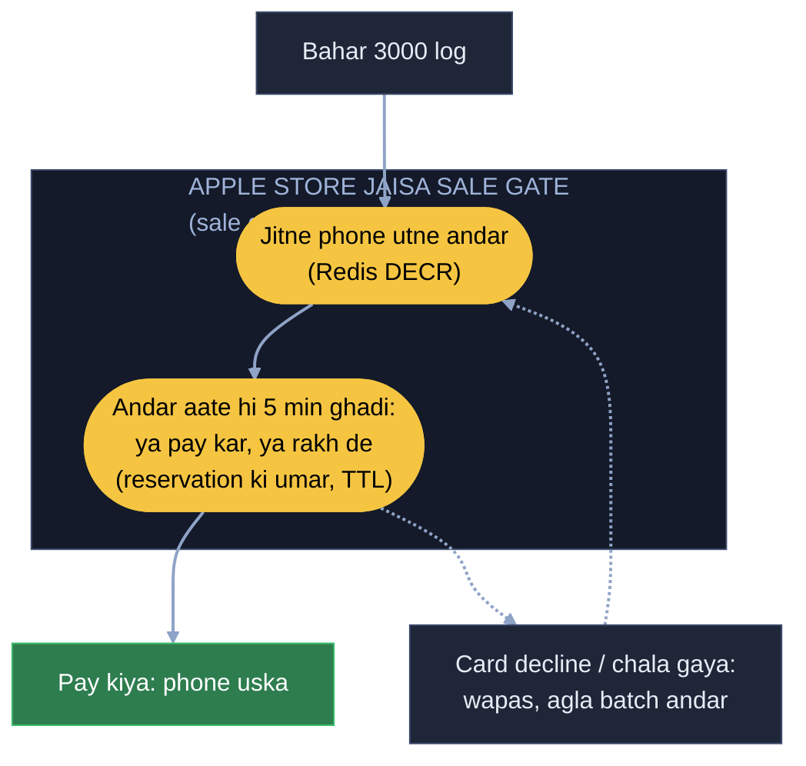

## 8. Net gaya / PSP chup (PAYMENT_PENDING, PSP se poochte raho)

Ravi ko laga pay ho gaya, par PSP tak request pahunchi hi nahi, ya paisa kata aur PSP anjaan. Design har jagah se
thoda toot-ta hai: chahe 10 minute rok lo, chahe paisa aane pe kaato, kinaare pe dikkat rehti hai. Aakhri second pe pay
kiya to wahan BMS wali cheez hi leni padegi. Paisa kata to zimmedari hamari, PSP se hum baat karenge.

**Asli naam:** PAYMENT_PENDING (BMS jaisa) + status job PSP se poochta rahe. Paisa kata mila to dabba uska; dabba na
bacha ho to refund. Perfect design koi nahi, bas kitne refund.

**Maan lo PSP 30-50 second chup, Myntra ko pata nahi Ravi ka paisa kata ya nahi:** Order ki khabar Myntra ki apni hai: Pay dabate hi apne paas order PENDING aur payment INITIATED likh diya, stock rok liya. Paisa kata ya nahi, ye PSP hi batayega, Myntra Ravi ka bank nahi dekh sakta. Razorpay kitni der lega, hamare haath me nahi; zyada der Ravi ko nahi rok sakte. Isliye ghadi hamari: 30-50 second, uske baad Ravi ko "time out, paisa kata to wapas aa jaayega, dobara pay karo" dikhao; dobara pay kare to Razorpay ki jagah doosre PSP pe bhejo, kyunki pata hai Razorpay abhi dheema hai. Baad me pata chala Razorpay pe bhi kata tha, to Razorpay ko bolo "lautao". Google Pay se itni baar pay kiya, 0 se 60 second me jawab aa hi jaata: ya fail, ya paisa kata; zyadatar 2 second me. Isliye had 60 second: peeche chhotu lagao jo PSP se poochhe, ya PSP ko bolo paisa katte hi event bhej de. 60 second me jawab nahi to DB me "payment fail" likh do, usse zyada wait nahi. PSP 2 minute baad bole paisa kat gaya, to ek alag column me likho kitni der me kata aur kitna, aur refund shuru karo.

**Asli naam:** order PENDING + payment INITIATED (Myntra ka apna DB), paise ki khabar sirf PSP se (webhook / status API, din ka settlement report), hamara client timeout (50 sec), der se "success" aaya to DB me REFUND_PENDING + raat ki refund job (BMS 6e) + refund API (Razorpay ko bolo lautao), REFUNDED sirf pakke jawab pe -> isliye dobara pay doosre PSP pe chal jaata (PSP failover), do baar kata to ek wapas.

**Payment fail hua to cart (12-Nov, Arpan):** cart khaali mat karo. Amazon cart tabhi khaali karta jab payment
SUCCESS ho; fail hua to cart wahin, bas "dobara pay kar do". Raaste kai: dobara QR doosre PSP pe, net banking, ya cash on
delivery. Ek hi raasta nahi.
**Asli naam:** cart sirf SUCCESS pe khaali, fail pe cart + order wahin, retry = PSP failover / net banking / COD (payment method fallback).

**Maan lo Ravi ka paisa kat gaya, par Myntra ko ye khabar der se mile ya mile hi na. Har baar Razorpay se poochhte rahoge?
(BookMyShow 6c wala hi jawab):** Razorpay ko bolo "paisa katte hi mujhe chhota sa event bhej do", jaise S3 file aane pe
event bhejta. Event aaya = kata, hum "mil gaya" bol dete. Event raste me kho gaya to wo Razorpay ka HLD hai, wo dobara
bhejega. Badi sale (Big Billion Day) pe 3-4 company (Razorpay jaisi doosri service) line me.

**Asli naam:** event = webhook (PSP callback), "mil gaya" = ack (2xx), dobara bhejega = webhook redelivery, 3-4 company =
backup PSP (failover).

**Maan lo PSP ka "success" do baar aaya (ek retry se, ek status job se):** Payment id hi key: pehli baar aaya to order pakka, doosri baar wahi id dekh ke chhod do. Do order nahi, ginti do baar nahi kategi.

**Asli naam:** idempotency key (wahi ID dobara aaye to chhodo).

**Isi pe ek aur raasta (paisa kata to maal dena hamari zimmedari):** Ravi ke paise kat gaye to use ghee dena hamari zimmedari, PSP se hum baat kar lenge, dabbe pe chipka do "ye Ravi ka hai". Bahut companies "stock khatam" bol ke der se refund karti, par kabhi order cancel dikh bhi gaya to bolunga "tera order cancel nahi hua, ye apne paise pakdo, ghee free me de denge". Amazon shuru me aisa hi karta hoga.
**Asli naam:** payment success = order nibhao; muavza = business ka faisla.

**Maan lo aakhri ek iPhone pe Ravi aur Arpan dono ne pay kar diya:** Do raaste. Pehla: doosre store ki inventory dekho, Delhi me nahi to Haryana-Punjab wale store se mangwa ke Ravi ko de do, kyunki Ravi ko kya pata hamare paas ek hi tha. Doosra: kahin nahi hai to "out of stock" bol ke refund, bank ki timeline pe 2-7 din. Amazon jaisi badi company ko ek customer ke naraaz hone se farak nahi padta, wo cancel + refund karti; par chhota store hai ya naam banana hai to main kahin na kahin se arrange karke dunga.
**Asli naam:** oversell = doosre store se pura karo (cross-store fulfilment), warna cancel + refund; business ka faisla.

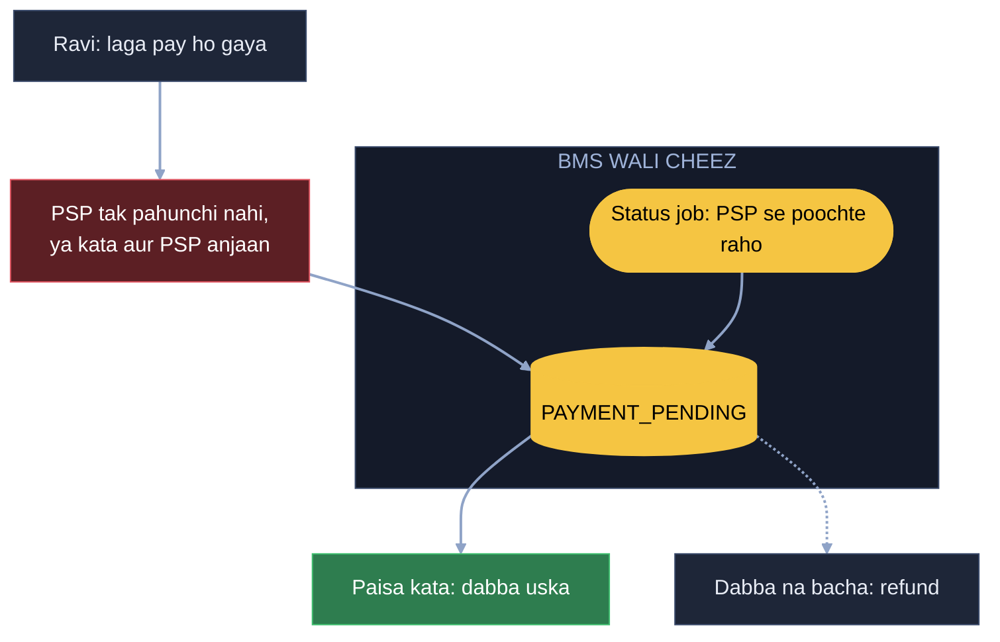

---

## 9. Sale pe Rahul ke cart ki do almari giri (aage wali chalti almari pe likh do)

**URL 10 / Twitter 19 se aaya:** teen copy A, B, C, do me likho do se padho (quorum, R + W > N). Yahan sirf naya.

Diwali sale aa gayi. Mausi ne bahut saara maal mangwa liya; sab ek hi godown me padta to ek saath sabki bheed lag
jaati. Isliye godown ko 10 hisson (almari) me tod diya, URL / cache wali ring pe. Maal ke saath grahakon ki cart-list
bhi in almari pe baant di; har grahak ka cart 3 almari pe copy, taaki ek gire to bhi cart na khoye. Usi sale ki raat
12 baje Rahul (naya grahak, pehli baar app pe) aaya. Rahul ka cart teen almari A, B, C pe: N = 3, W = 2,
R = 2, 2 + 2 > 3 to likhne aur padhne wali almari me kam se kam ek common. Rahul ne iPhone pe "Add to Cart" dabaya,
usi waqt B aur C dono band. Sirf A chalu, 2 ki "haan" milegi hi nahi. Har almari ki ek aur copy banana = kharcha aur
sar-dard, upar se D, E, F khaali padi bekaar. Isliye B aur C gire to ring pe aage wali chalti almari D aur E pe likh
do; W = 2 poora, "Add to Cart" fail nahi. B, C band to D pe jao; D bhi band to F pe. Likhna A + D ya A + E me, poochhna bhi unhi do se, baat ek hi. Saari almari band ho gayi to server hi band, wo alag baat.

**Asli naam:** sloppy quorum (Amazon Dynamo, leaderless replication: client khud kai copy pe likhe / padhe, jo naya wo lo).

**9b. Aadhe ghante baad B, C wapas, par iPhone D, E pe:** B, C ko pata nahi iPhone juda, agla padhna unse hua to iPhone
gayab. B, C ko kahani se hatana chalega nahi (kal D, E gire to wahi dikkat). Isliye D ka chhotu dekhta rahe; B, C wapas
aate hi bole "tum gire the, D ne sambhala, ye Rahul ka iPhone, rakh lo", phir D apni copy chhod de. Upar se ek job
sab almari milaati rahe, taaki jo parchi kho jaaye wo bhi pakdi jaaye.

**Asli naam:** hinted handoff (D ke paas maal + hint ki ye B, C ka), anti-entropy / read repair (peeche milaan).

**Padhai (reel, R aur W ka dial):** N = 10 pe W1 R1 = tez par purana mil sakta; W6 R5 = 11 > 10 pakka, par 1 hi almari
gir sakti. Balance = R aur W dono N ke aadhe ke paas. Yahi dial consistency aur availability ke beech chunne deta.

**Isi pe ek aur raasta (B, C ka purana saaf, kaam D, E ke paas):** Ek chhotu bitha do jo dekhe B aur C wapas aaye ya nahi, warna kal B, C khade ho jaayein aur bagawat pe utar aayein to dikkat. Aaye to chhotu halla macha de aur unhe batao: tum thodi der band the, tumhara kaam D aur E ko de diya, tum chup raho; tumhare paas Rahul ka jo purana tha (cart me 10 iPhone ho to bhi) use 0 kar do. Ab line me aage khade ho jao, koi naya aayega to tumhe agla kaam milega. Jaise company: ek employee chala gaya to company nahi rukti, doosre se kaam karwa lete.
**Asli naam:** chhotu = wapas aaye machine ko pakadne wali job · purana 0 + kaam D, E pe = ownership D, E ko (purani copy hatao).

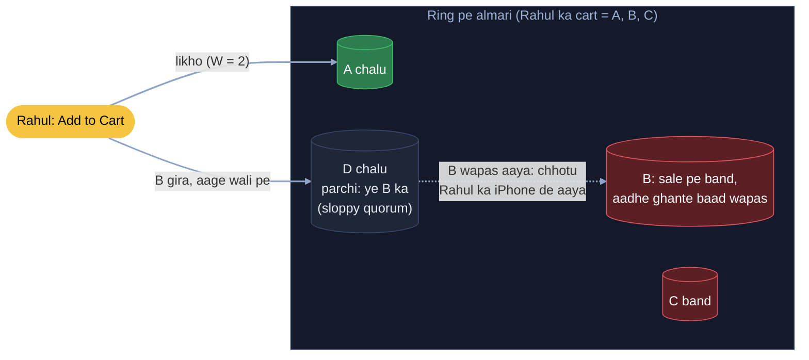

---

## Poora dhaancha ek nazar me

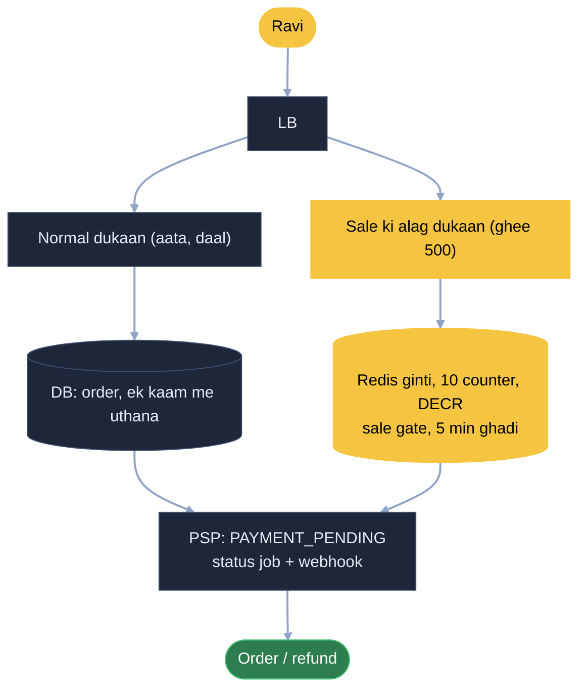

---

Notes (Arpan ke shabd) = [ECOMMERCE_HAND_NOTES.md](ECOMMERCE_HAND_NOTES.md)
