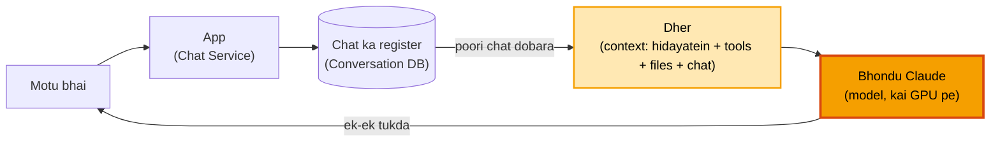

# Design Claude: hand notes (bhondu Claude andar se)

Har block = sawaal -> jo samjha (Arpan ke shabd jahan bole) -> Technical me. Sirf wahi jo 5-Nov ki baat me aaya.
Mock abhi baaki: ye padhai ke notes hain, scene-mock ke baad isi me Arpan ke jawab judenge.

&nbsp;

**1. Tera jawab andar banta kaise hai?**
Samjha: main poora vakya dimaag me pehle bana leta hoon, phir likhta hoon. Model ek-ek tukda nikalta hai: ab tak ki line dekh ke "agla tukda kya", use jodo, phir agla. Isliye screen pe shabd-dar-shabd aata hai.
Technical me: line tokens me katti (har tukde ka number). Model ka kaam = next token predict (har tukde ka chance, ek chuna, jodo, repeat). Loop: `while (jawab khatam nahi) { agla tukda; jodo; }`. "Sochna" = pehle apne liye kuch tukde (rough kaam, user ko nahi dikhte), phir jawab. Andar thoda aage ka plan bhi hota (research), par bahar ek-ek tukda.

**2. Claude ko kal ki baat yaad kaise rehti hai?**
Samjha: model ko kuch yaad nahi rehta. Har message pe poori chat dobara uthake saamne rakhi jaati: msg 1, msg 1 + jawab 1 + msg 2, aise badhta register.
Technical me: model stateless. Chat ka register bahar DB me (Conversation DB), har request pe poora context bhejo. Had = context window: lambi chat me purana kaato ya saaransh (compaction). Isiliye lambi chat me "bhool gaya" lagta, aur isiliye MEMORY.md / PROGRESS.md: session gaya to sab gaya, file padh ke hi "yaad".

**Maan lo "sab DB me rakh do, to sab yaad rahega":** register to pehle se DB me hai (Claude Code me laptop pe `.jsonl`), dikkat register ki nahi, desk ki hai. Jawab dete waqt utna hi padha jaata jitna desk pe aaye (context window: lakhon tukde, par had). 9 mahine ki chat desk pe aati hi nahi. Isliye teen raaste hain: (1) desk bhari to purane ka saaransh (compaction, 5-Nov raat yahi hua) (2) pakki baat file me likh do, har session ki shuruaat me hook desk pe rakh de (CLAUDE.md me "motu bhai" likha, isliye naye session me bhi pata) (3) zaroorat pe register me search karo aur sirf wahi panna desk pe laao ("Uber me kya galti thi" -> sirf Uber wala hissa). Isko RAG kehte hain, claude-mem yahi karta hai.

**3. Abhi mere ek message ke saath tere saamne kya-kya pada hai?**
Samjha: sirf meri ek line nahi, poora dher, har jawab pe.
Technical me: dher ka kram: (1) Anthropic / Claude Code ki hidayatein (system prompt) (2) tools ka manual (3) meri files hook se (CLAUDE.md, MEMORY, ANCHORS, PROGRESS) (4) purani chat ka saaransh (5) aaj ki chat shabd-dar-shabd (6) har tool ka nateeja (7) har message pe DSA_GUARD dobara (8) mera naya message.

**4. Har baar poora dher padhna mehnga nahi?**
Samjha: jo upar wala hissa pichhli baar jaisa hi hai, uska hisaab bacha ke rakh lo, sirf naya hissa naye sire se.
Technical me: prompt caching. Same shuruaat (hidayatein, tools, files, purani chat) ka hisaab cache me (is session me 1 ghanta garam). Naya message hi poora naya kaam. Purana bhi jawab ke waqt poora saamne, gaayab nahi.

**5. CPU pe kyun nahi chalta?**
Samjha: GPU hardware hai, design ka sawaal nahi ("design GPU" koi nahi poochega). Bas itna: kaam crore-arab ek jaise jod-guna ka, to hazaaron saade mazdoor (GPU) ek saath, 8-16 hoshiyar mazdoor (CPU) nahi.
Technical me: model ke weights ek GPU ki memory me nahi samaate, to kai GPU me kaat ke baanto (leaderboard ka shard, par yahan model khud katta). GPU mehnga, khaali na baithe: kai logon ki request ek batch me (auto me 1, bus me 50). Anthropic: Nvidia + Google TPU + Amazon Trainium (public khabar), andar ka pata nahi.

**6. "Love you" ke baad "love you too" aur "I hate you" dono internet pe hain. Tu kaise chunta?**
Samjha: faisla akele shabd se nahi, poore dher se. Motu bhai, 8 mahine, mazak ke baad "I love you" pe "love you too" lagbhag pakka; ladai wali kahani me wahi shabd pe "I hate you". Experiment: teen baar "I hate you, main ja raha" bola, jawab aaya "ruk, kahin nahi ja raha".
Technical me: do padhai. (1) Pehli: internet ka text, bhasha aur "kis haalat me kya bolte" (dono love / hate). (2) Doosri: achha / bura jawab sikhaana (log rate karte, Anthropic likh ke deta Claude kaisa ho). Ye aadat bhaari: bina purani baat ke bhi user ko palat ke "I hate you" nahi; kahani ke kirdaar ke liye likh dega. Koi `if` line nahi, sab weights me seekha pattern.

**7. Anthropic ye training kyun deta? NASA hack kar leta bina training?**
Samjha: darr Claude ke gusse ka nahi, misuse ka: dukhi insaan ko chot (khudkushi ka tareeka), bure insaan ki madad (zeher, password todna). Aur bharosa nahi to koi use nahi karega.
Technical me: jaankari wahi rehti, training badalti ki kya karna chunta. NASA hack itna aasaan nahi (access, tools, security chahiye). Training ke upar aur taale (layered, rate limiter jaisa): khula internet nahi, sirf diye tools; command pe user ka "allow"; send / delete bina haan ke nahi.

**8. Training ke baad bhi galti kyun?**
Samjha: training aadat banati, guarantee nahi. Jaise DSA me pattern pata, phir bhi edge pe fisalna.
Technical me: (1) agla tukda = sabse sambhav, pakka sahi nahi (hallucination ki jad) (2) tool se check nahi kiya to sirf yaad pe tika ("jo check kiya wahi bolo") (3) saaransh me baarik baat chhoot gayi.

**9. Online test ka screenshot pe mana kyun? Madad ke liye bana hai na?**
Arpan: Cheating galat hai, 1000 log line me hain, unfair. Par tu ye mat bol ki "main nahi karunga", ye bol ki "Anthropic ne mujhe aise train kiya". Sirf ek sawaal ka screenshot ho, na ghadi na proctored, to tu solve kar dega, kyunki pata hi nahi chalega.
Technical me: faisla poore dher ke andaze se (chalta test dikhe: ghadi, proctored, "jaldi bata" -> mana; na dikhe -> practice maan ke madad; shak -> poochho). Andaza lagane ka tareeka bhi training se. Chhupa ke bheja to pakad nahi sakta, jhooth bhejne wale ka. "Madad" = sabka bhala (company, baaki candidate), jo maanga wo de dena nahi.

**10. GPU mehnga hai, ek-ek request chalaun to? (bus kab chale)**
Samjha: ek request = auto me ek sawaari, GPU khaali baitha. Isliye kai logon ki request ek saath (batch), bus me 50. GPU sabke saath ek hi kaam karta (har kadam pe sabka agla tukda), isliye 50 ka tukda 1 jitne waqt me.
Dikkat: bus kab chale? 50 bharne ka intezaar karo to raat 2 baje tu stop pe khada (jawab shuru hi nahi). Turant chala do to bus 3 logon ke saath, GPU phir khaali. Hal: ghadi + seat, jo pehle ho jaaye: seat bhari to turant, warna kuch milliseconds ki ghadi poori hote hi aadhi khaali bhi chal do.
Technical me: batching. Trade-off = latency vs throughput (jaldi jawab vs bhari gaadi / kharcha), ek badhao to doosra ghatta.

**11. Ek ka jawab 2 tukde, doosre ka 200. Batch me kya?**
Samjha (dhabe ka tawa): tawe pe 50 roti ki jagah, har round sabki ek-ek roti. Tera order 2 roti, Ravi ka 200. Purana tareeka: tawa tab khaali jab sabse bada order khatam, teri jagah 198 round khaali, bahar grahak khada. Naya: teri 2 roti bante hi us jagah agle grahak ki roti. Tawa hamesha bhara, koi bade order ka intezaar nahi karta.
Technical me: continuous batching (har kadam pe jiska jawab khatam wo bahar, line wala andar). **Par:** har sawaari ka ek bag (uski chat ka hisaab, block 4 wala cache) GPU memory me rehta. Lambi chat = bada bag = kam seat. Isiliye lambi chat mehngi, aur context ki had bhi isi wajah se.
Ajeeb kyun lagta: baaki designs me server sasta aur DB pe bojh, yahan GPU sabse mehnga, to poora design GPU ko khaali na baithne dene ke aas-paas ghoomta.

&nbsp;

Aage (baaki): poora flow scene-mock me, phir main file.
