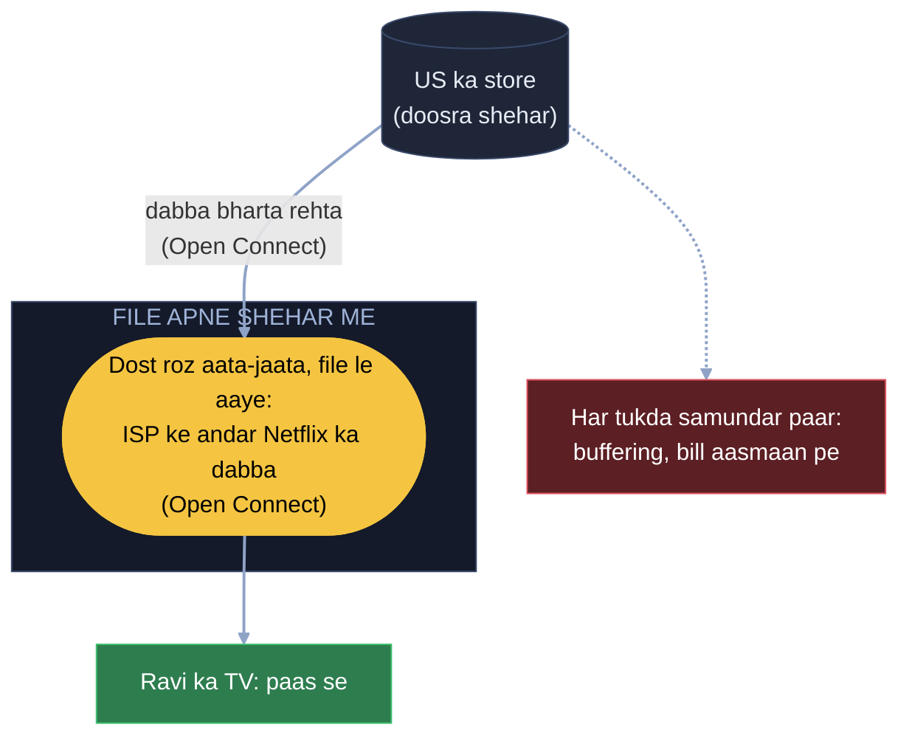
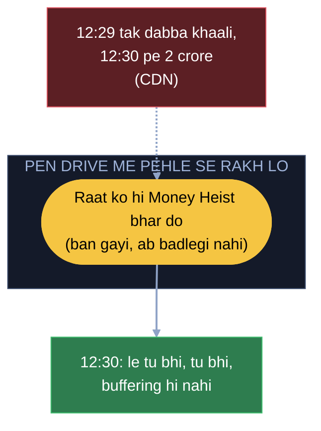
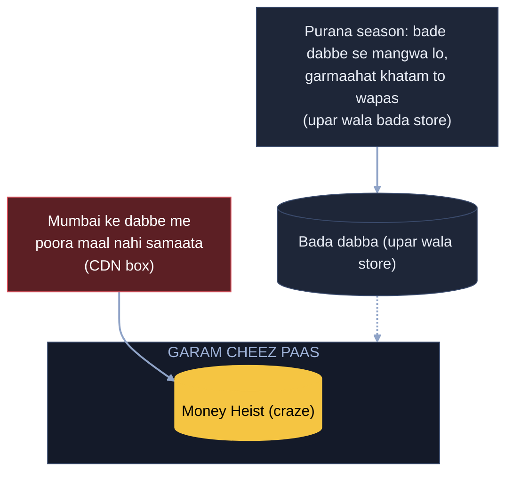
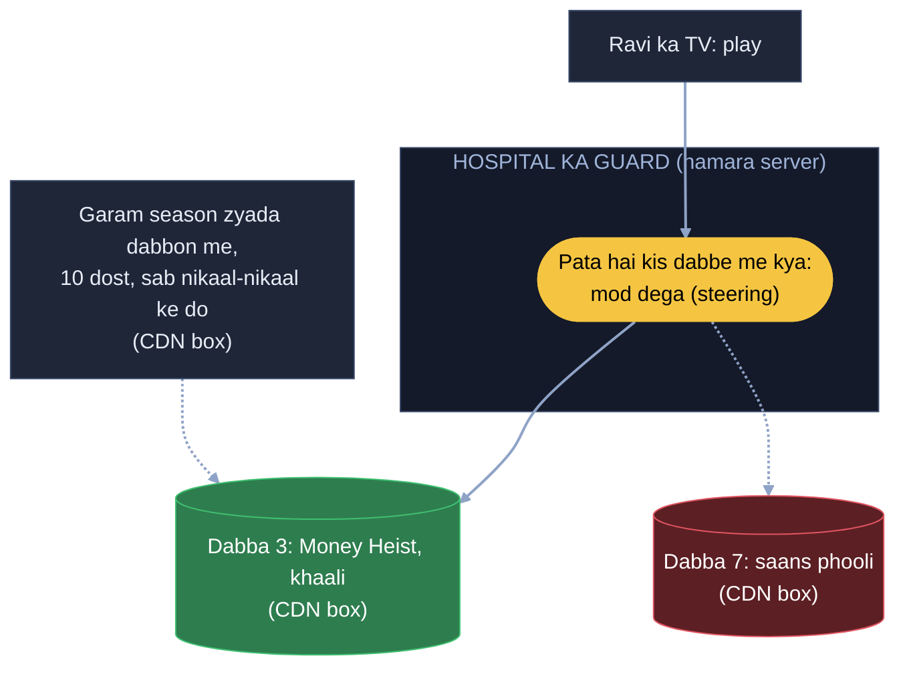
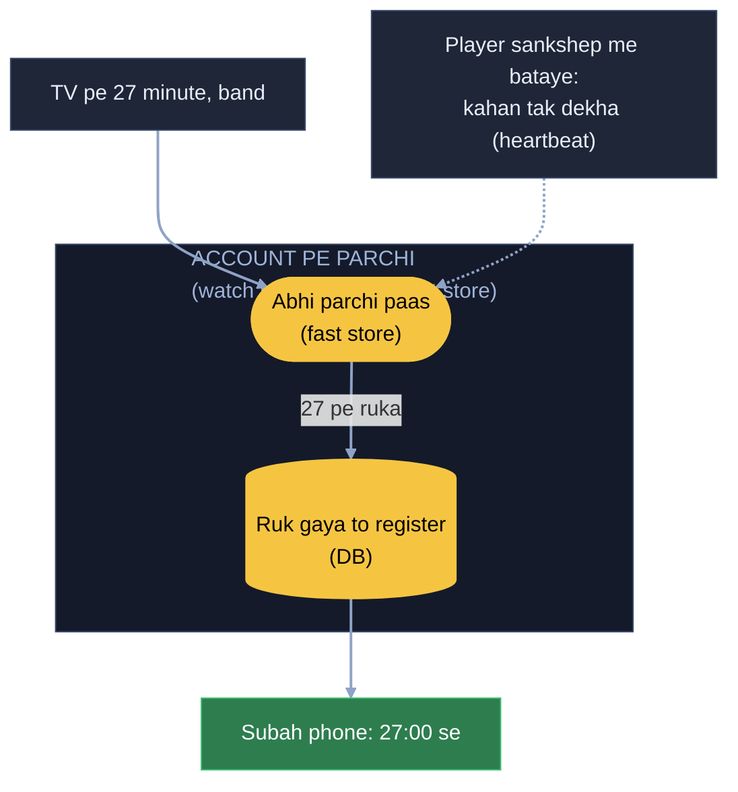
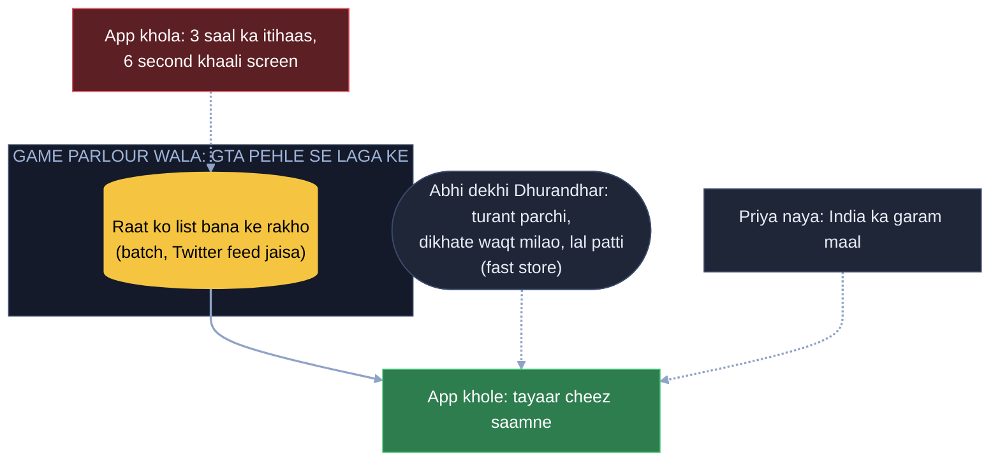
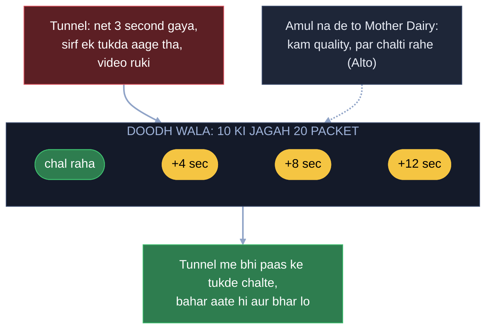
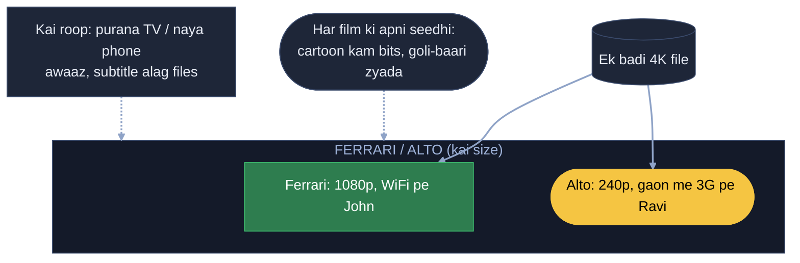
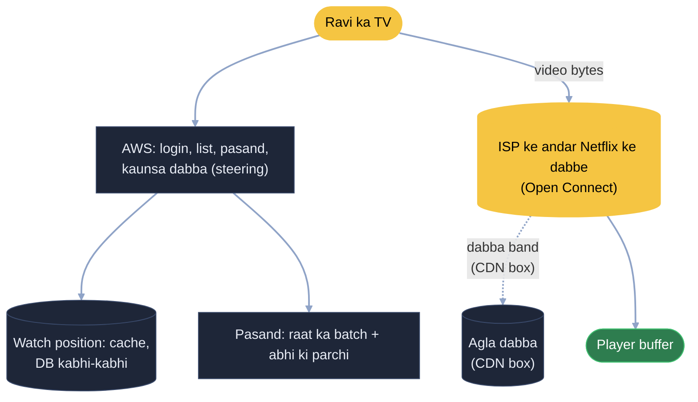

# Netflix: Money Heist ka naya season, 12:30 pe poori duniya ek saath

Maan lo Money Heist ka naya season Friday dopahar 12:30 baje poori duniya me ek saath aata hai. Arpan, Ravi aur India ke 2
crore log 12:30 pe ek saath play dabate hain, saath me US, Spain, Brazil bhi. Kaam: play dabate hi video jaldi shuru ho, quality net ke hisaab se,
data pahunchane ka bill aasmaan pe na jaaye, aur app kholte hi pasand wali list turant dikhe.

Har kadam = **kahani** (dikkat aur hal, bolne wali bhasha) -> **Asli naam** (interview me yahi shabd) -> tasveer
(kahani ka shabd, bracket me asli naam).

---

**Ek nazar: dhaancha + dikkat chain (round me sabse pehle ye, phir FR / NFR isi se):**
```
Ravi ka TV  -->  AWS (login, list, pasand wali list, kaunsa dabba = steering)   video bytes AWS se nahi
                       |                                                        |
              watch position: pehle cache, DB kabhi-kabhi                 ISP ke andar Netflix ke dabbe (Open Connect)
              pasand wali list: raat ka batch + abhi ki parchi            raat ko pehle se bhare, garam paas, thanda bade dabbe se
                                                                          dabba band = TV agla dabba; player buffer

 1   har tukda samundar paar se                  ->  file apne shehar me (Open Connect, ISP ke andar)
 2   12:29 tak dabba khaali                      ->  pehle se bhar do, video badalta nahi (proactive fill)
 3   dabbe me poora maal nahi                    ->  garam paas, thanda bade dabbe se (popularity, tier)
 4   20 dabbe, kis se maange                     ->  server batata (steering, AWS pe)
 4b  aadhe episode pe dabba 3 band               ->  TV ke paas 2-3 naam, agla (client failover)
 5   TV pe 27 min, phone pe wahi se              ->  account pe parchi (watch position)
 5b  TV ka purana 27, phone ke 37 ke upar        ->  baad wala jeete (timestamp, last-write-wins)
 5c  har kuch second update, DB ki saans         ->  pehle cache, DB kabhi-kabhi
 5d  tukde ISP ke dabbe se, AWS ko kaise pata    ->  TV sankshep me bataye
 6   pasand wali list me 6 second                ->  raat ka batch, cache se
 6b  11 baje Dhurandhar dekhi                    ->  turant parchi, dikhate waqt milao
 6c  Priya naya user                             ->  India ka garam maal (cold start)
 7   tunnel me 3 sec net gaya                    ->  player buffer, nahi to doosri quality
```

**FR / NFR kahan se:** upar ki dikkat chain dekh ke nikale; har line ke aage likha hai wo kis kadam se aayi.
Arpan: "Buffering nahi" NFR galat hai. User ka net bahut mandda hai, 144p pe bhi nahi chal raha, to buffering hogi hi; quality 180p se 720p ya 360p badalti hai tab bhi hoti hai, Netflix me buffering hoti hai. Net ke hisaab se hogi. FR / NFR ki bhasha wahi jo neeche design me likhi, alag shabd ("tere liye" jaisa) nahi.
Technical me: NFR = jaldi shuru (low start-up time) + adaptive bitrate (ABR), buffering zero ka vaada nahi.

**Isi pe ek aur raasta (round me: FR / NFR, numbers, dhaancha):** Pehle scope saaf karo: recommendation chahiye ya nahi, kitna chahiye. FR: user ko video dikhe, wo video khole, play / pause kare, search kare. NFR: video net ke hisaab se ho; net achha chal raha to badhiya quality, achha nahi to theek-thaak quality. "Video buffer na ho" koi requirement nahi: net band ya slow hua to buffer hoga hi, Netflix bhi buffer karta; quality 144p tak gir jaaye to dekhne ka fayda nahi. Numbers: poori duniya me 1 billion user, 10-20 million roz (DAU), matlab bahut scalable system chahiye. Dhaancha: user app pe aaya, bahut saare server, beech me LB; LB ke baad local cache, phir Redis, phir CDN, CDN ke peeche S3. Video kahan rakhta wo Netflix ka andar ka system hai, hamara lena-dena nahi. Video koi DB me nahi rakhta, wo S3 jaisi cheez me; CDN Netflix ne apne bana rakhe (Open Connect), paas ke server pe video taaki kam se kam time me dikhe. DB: Netflix andar bahut saare DB use kar sakta, Cassandra / NoSQL type shayad mushkil, par kisi use case ke liye wo bhi kar le; mere hisaab se mere hisaab se Postgres theek, kyunki writes bahut nahi: Netflix pe hum user video upload nahi karte, Netflix rights khareed ke khud daalta. Postgres me user ki jaankari, uski recommendations, wo roz kya dekhta. Ya recommendation ke liye Neo4j bhi le sakta hoon. Netflix ka design public nahi, andar kya use karta pata nahi.
**Asli naam:** FR = browse, play / pause, search · NFR = adaptive bitrate (ABR), buffering zero ka vaada nahi · dhaancha = LB -> app servers -> local cache -> Redis -> CDN (Open Connect) -> S3 · Postgres (RDS) = user, list, dekhne ka itihaas (dekhne ki likhai bahut ho to kadam 5c: pehle cache, DB me batch) · Neo4j = graph DB (kaun kis jaisa dekhta).

**API (round me):** POST wala video upload nahi chahiye, kyunki video Netflix ke andar hi daali jaati, hum upload nahi karte. GET filmein / series: kitni filmein, kitni series, Netflix ke server se jo data aa raha. GET recommendation: poori pasand wali list. GET dekhi hui: 3 saal purane user ne jo dekh rakhi (Stranger Things, Money Heist). POST search. POST payment wali. Ye 4-5 main API, jin pe system tika hai.
**Asli naam:** GET /titles (filmein + series), GET /recommendations (pehle se bani list, kadam 6), GET /continue-watching (dekhi hui + kahan tak, kadam 5), POST /search, POST /payment (subscription); video upload ki API nahi (Netflix khud daalta). Video ke tukde API server se nahi, paas ke dabbe (Open Connect) se.

## FR / NFR / Numbers (interview me pehle 2 minute)

```
FR      1  video chalana (play)                                             -> kadam 1, 4, 7
        2  video beech me roko, kisi bhi device pe wahi se aage chale       -> kadam 5, 5b, 5c, 5d
        3  app kholte hi user ki pasand ke hisaab se videos ki list         -> kadam 6, 6b, 6c

NFR     1  play dabate hi video jaldi shuru ho; net ke hisaab se quality ghate-badhe
           (net bahut kamzor ho ya quality badle to thodi buffering hogi hi) -> kadam 1, 2, 4b, 7
        2  kamzor net aur purane TV pe bhi chale                            -> kadam 7, P3
        3  pasand wali list jaldi khule (thodi purani chalegi)              -> kadam 6, 6b
        4  data pahunchane ka kharcha kam                                   -> kadam 1, 3
Numbers India me 2 crore log ek saath, saath me baaki duniya -> ek jagah se sabko video nahi bhej sakte
        · har film kai size me -> poora maal kisi ek dabbe me nahi samaata
```

---

## 1. Har tukda samundar paar se (file apne shehar me)

Saari episode US ke store me hain. 12:30 pe karodon log wahi file maang rahe, har tukda samundar paar se aata hai,
Ravi ke TV pe buffering, aur data pahunchane wali company ka bill aasmaan pe. Jaise main roz wahi file lene doosre
shehar jaata hoon, bus me tel phoonk ke. File ghar nahi la sakta, par apne shehar me to la sakta hoon. CA doosre
shehar me hai, to mera dost jo roz aata-jaata hai, wo file mere shehar le aaye. Main chupchaap jaao, sign karo, wapas
aao. Bekaar me baar-baar shehar kyun.

**Asli naam:** apne shehar ka dabba = ISP ke andar Netflix ka apna CDN box (Open Connect). Ghar nahi la sakte = poora
video phone pe nahi rakhte. Dost roz aata-jaata = dabba US ke store (origin) se bharta rehta.

**Maan lo video cache me kyun nahi:** cache us kaam ka nahi; video ek baar bani, badalti nahi, isliye dabbe (CDN) me,
pen drive jaisa. **Asli naam:** CDN for immutable video, Redis chhote data ke liye.



## 2. 12:29 tak dabba khaali, 12:30 pe 2 crore (pehle se laa ke rakho)

Dabba lag gaya, par season 12:30 pe aaya aur 12:29 tak dabba khaali tha. 12:30 pe 2 crore ek saath aaye, dabba sabko
"laata hoon" bolta hai aur saari request phir samundar paar. Jab pata hai log kis liye aa rahe, to wo cheez pehle se
laa ke rakh lo. Pen drive me Money Heist rakh liya, ab sabko baant raha: le tu bhi le, tu bhi le, buffering hi nahi.
Aur ye cheez ban gayi hai, ab badlegi nahi, isliye rakhne me koi dikkat nahi.

**Asli naam:** pehle se laa ke rakhna = release se pehle raat ko dabba bharna (proactive fill / pre-positioning).
Badlegi nahi = video static hai, isliye CDN pe rakhna safe.

**Isi pe ek aur raasta (round me: kahan maang, Netflix ko pata):** Netflix ko pata hai bada season aa raha aur kahan-kahan maang zyada hogi: Spain jaise desh me (Money Heist wahi bani), India, Australia, New Zealand. Har baar maangne pe laana Netflix ke liye bahut dikkat: Spain me lakhon dekhenge tab laao, India dekhe tab laao, Australia dekhe tab. Isliye Mumbai ke server pe pehle se laga ke rakh do; ek baar laao, rakh lo, phir sabko serve karte raho. Main roz CA se sign karwane doosre shehar kyun jaaun, dost roz aata-jaata hai, wahi le aayega. Video ek baar bani to badalne ki nahi, isliye rakhne me dikkat nahi.
**Asli naam:** region ke hisaab se maang pata = kis desh ke dabbe me kya pehle se bharna (proactive fill per region).



## 3. Dabbe me poora maal nahi samaata (garam paas, thanda bade dabbe se)

Mumbai ke dabbe ki jagah seemit hai, aur Netflix ka saara maal (har film, kai size me) usme nahi samaata. Ek dabba
nahi, kai dabbe le lo, jaise maal ek truck me na aaye to 3-4 truck. Par dabbe ki bhi seema hai, isliye dabbe me wahi
daalo jiska craze hai: garam cheez paas rakho, thandi nahi. Purana season koi aaj bhi dekhe to bade dabbe se mangwa
lo, thodi der chhote dabbe me rakh lo, garmaahat khatam to wapas.

**Asli naam:** garam paas = popularity ke hisaab se kya rakhna (region-wise). Bade dabbe se mangwa lo = upar wala bada
store / tier. Garmaahat khatam to wapas = thanda maal dabbe se nikalna (evict).

**Isi pe ek aur raasta (round me: mahina bhar garam, thande ka chhota tukda):** Saara maal main server pe banta (US me), bahar se to laana hi padega. Par jo garam cheez baar-baar maangi ja rahi, use baar-baar bahar se laane ka fayda nahi. Money Heist ka season aaya, public jaanti ye mahina bhar chalega, karodon India me dekh rahe: paas wale dabbe pe rakh do, wahin se serve. Stranger Things abhi garam nahi, 1-2 request aa rahi to koi dikkat nahi: uska chhota tukda rakh do, koi dobara maange to bade se le aao. Garam maal paas, thanda door; thande ki thodi request aaye to thodi der ke liye paas.
**Asli naam:** popularity se tier: garam = edge dabba, thanda = maang pe bade store se (cache miss -> upar se bharo), thodi der rakh ke nikaalo (evict).



## 4. 20 dabbe, Ravi ka TV kis dabbe se maange (server batata hai)

Mumbai me 20 dabbe hain, kuch me Money Heist hai kuch me nahi, aur ek ki saans phool rahi hai. Akela bhaar kyun
uthaun: 10 dost bulao, sabko dabba do, nikaal-nikaal ke do, aur garam season ko zyada se zyada dabbon me rakho.
Request hamare server pe aati hai, use pata hai kis dabbe me kya hai, wo mod dega. Jaise hospital ka guard:
wheelchair wale is line, mahila us line, buzurg us line.

**Asli naam:** zyada dabbon me = hot content ki kai copy. Server mod dega = play dabate hi server batata hai kaunse
dabbe se lo (steering). Guard = load + kis dabbe me kya hai, dono dekh ke sahi dabba.

**Maan lo aadhe episode pe dabba 3 band ya dheema:** Money Heist garam hai to ek dabbe me mat rakho, kai dabbon me copy (kadam 4 me hai hi). Aur TV ko ek dabba nahi, 2-3 ke naam do: ek dheema hai to intezaar kyon, doosre dabbe se le le.
**Asli naam:** "2-3 dabbon ke naam" = server player ko kai CDN dabbon ki list deta, ek atka to player khud agle pe (client side failover).

**Isi pe ek aur misaal (banner pe click):** Ravi ne Money Heist ke banner pe click kiya to Netflix ko pata lag gaya ye Money Heist dekhne aaya; jaise bank me koi AC ki hawa khaane nahi aata.
**Asli naam:** play request me content id aata, server usi se dabba chunta (steering).

**Isi pe ek aur misaal (round me: 100 DVD):** Netflix ek dabbe pe nahi rakhta; Money Heist garam hai, isliye 10 dabbon pe, taaki ek gire ya dheema ho to kaam na ruke. Maan lo maine kahin se Money Heist ki 100 DVD ka jugaad kar liya, logon ko pata chala to ekdum bheed. Main akela itni bheed nahi sambhalunga, 10 dost bulaunga: lo 10-10 pakdo, sab jagah baant do, paise le lo. Ek dheema hai to koi dikkat nahi, doosre chal rahe.
**Asli naam:** garam maal ki kai copy (replication), ek dabba atka to doosre se (client failover).



## 5. TV pe 27 minute, subah phone pe wahi se (account pe parchi)

Ravi ne TV pe 27 minute dekha aur band kiya. Subah metro me phone pe khola, use 27:00 se chahiye. Ravi ka account hai,
Netflix account se yaad rakhta hai. Jaise kisi ke 10,000 rakhe, parchi pe uska naam likha, bus stand pe mila to
pehchaan liya. TV, phone, kahin bhi khole, yaad wahi. Parchi DB me.

**Asli naam:** account se yaad = watch position user ke account pe server me, device me nahi. Parchi DB me = persistent
store.

**Isi pe ek aur raasta (round me: apna cache uda do tab bhi 27):** Netflix account banwata hai, sign in karwata hai, matlab account me bahut kuch rakhta: is ladke ne kya-kya kahan tak dekha, kya dekh raha, kya recommendation. Arpan ne phone pe 27 minute dekha to server ko pata laga, aur wo bahar jaake chilla deta: Arpan ne 27 tak dekh liya, jahan-jahan iska account hai sab sync kar lo. Ab account kahin bhi khule, TV, laptop, phone, London ho ya India, 27 se chalega. Parchi account pe hai. Apne phone ka cache uda diya to bhi Netflix ke paas 27 hi rahega: wo tera cache hai, Netflix ka apna alag. Netflix andar kaise sync karta wo public nahi, hum bas itna bolenge: account pe sync.
**Asli naam:** watch position server pe account ke saath (asli sach), device ka cache sirf apni copy.

**Maan lo TV ka net gaya, TV ne "27:00" apne paas rakh liya. Subah phone pe 37 tak dekha, shaam ko TV on hote hi purana 27 pahuncha aur 37 ke upar likh gaya:** Netflix phone, laptop, TV sab me sync rehta, alag nahi ho sakta. Main Netflix ka server hoon: tukde main hi bhej raha, to 27 ke baad agla tukda nahi maanga matlab 25-27 ke aas-paas band kiya. Phir usne phone pe 27 se 37 dekh liya, naya point 37, parchi pe 37. Shaam ko TV khula aur purana 27 aaya: nahi, isne to 37 tak dekh liya, 27 purana hai, discard; 37 se chalao. Account ek hi hai, kahin se bhi login karo wahi dikhe; TV khulte hi net se account ka sach padhta hai, apna purana nahi thopta. Naya 37 aaya to purana 27 kaat ke 37 likh do.
**Asli naam:** "naya point jeete, purana 27 discard" = har position ke saath uska waqt (timestamp), baad wala jeete (last-write-wins, event time se, aane ke waqt se nahi), "main Netflix hoon, tukde main hi bhej raha" = ISP wala dabba bhi Netflix ka (Open Connect), agla tukda nahi maanga to andaza 25-27 ke aas-paas.

**Isi pe ek aur misaal (round me: librarian):** TV ka net gaya to server ko itna pata ki aakhri tukda 25 se 27 ke beech kahin (maan lo 26:30 tak) diya, parchi pe wahi. Phir mobile pe 26:30 se 37 tak dekha, parchi kaat ke 37. TV khulega to parchi padhega: 37. Jaise librarian: koi kitab le gaya aur 8 din se nahi aaya, main bhoolunga nahi, sab likha hai kisne kaunsi kitab kab li.
**Asli naam:** server ka register hi sach (server jaanta kaunsa tukda diya), TV khulte hi account se padhta.

**Maan lo karodon TV har kuch second "26:50 pe hoon" bhej rahe, DB ki saans phool gayi:** race me har kadam thodi
likhte, jab ruk jaaye tab likho. Abhi parchi paas rakho, 27 pe ruk gaya to register me daal do.
**Asli naam:** parchi paas = position pehle fast store (cache) me, ruk gaya to register = DB me sirf aakhri /
kabhi-kabhi likhna (write kam).

**Isi pe ek aur raasta (round me: chhotu ki sync job):** Har baar Postgres pe likhne ka matlab nahi, server ki parchi (cache) pe rakh lo. Register sab padh rahe: Arpan 27 page tak, Ravi itne page tak, sab mere paas likha; har baar peeche wale mote register (DB) me update karne nahi jaunga. Thodi der baad sync job: chhotu idhar aa, ye sab likha hai, peeche DB me update karta ja. Chhotu gira to pata nahi kahan tak hua: DB se poochho "tu kahan tak update hua", DB bata dega. Parchi ki 3-4 copy apne paas. Peeche DB ki replica hai to wo bhi theek. Chhotu gira to doosra chhotu. DB ki saans nahi phoolegi, kyunki hum baar-baar DB pe nahi jaate, batch me kaam karte.
**Asli naam:** pehle cache me (copy ke saath), phir sync job batch me DB me (write-behind / batch write); job gira to DB me jahan tak likha wahan se aage.

**Maan lo tukde ISP ke dabbe se aa rahe, hamare server ko kaise pata ki Ravi 27 pe ruka:** do log baat kar rahe, ek
mujhse baat nahi karta. Maine dost ko bola, jo baat hui sankshep me mujhe bata diya kar. Jis din kuch nahi bataya,
matlab aaj aage nahi badha.
**Asli naam:** dost sankshep me bataye = dabba / player playback ki report (heartbeat) server ko bhejta.

**Isi pe ek aur misaal (round me: game parlour ka maalik, saar wahi: dabba AWS ko bata de):**
Pehle tasveer (round me Claude ne dikhayi):
```
                 Ravi ka TV
                /          \
   (1) login, list,        (2) video ke tukde
       parchi (27:00)          (asli video bytes)
              |                      |
     AWS wala server          Mumbai ka paas wala dabba
     (Netflix ka dimaag)      (ISP ke andar, Open Connect)
     parchi / DB yahan        sirf video rakhta aur bhejta
```
Aisa ho hi nahi sakta ki do dabbe aapas me baat na karein; microservice me bhi sabko pata hota. Jaise HDFC: mera account Khatauli me khula, main Delhi gaya, to wo kahenge saari jaankari home branch me milegi, par itni yahan bhi de sakte. Game parlour ka maalik saare computer apne main computer se jod leta: koi bhi site khole to use pata, kyunki kal ko phansega wahi. Waise hi dabba AWS ko event bhej de: is bande ne yahan tak dekha. Ya ISP pe ek parchi / chhotu job rakh lo jo sab AWS tak sync kar de; ye kabhi bhi, raat ko jab bheed kam ho, ya subah 5 baje. AWS ke DB me sab update ho gaya (Ravi 27, Arpan 25), to sab jagah sync: Mumbai, Delhi, Jio / Airtel ke dabbe.
**Asli naam:** dabba / player playback report AWS ko bhejta (event), wahan parchi update; dabbe pe sirf video.



## 6. App khola, pasand wali list banane me 6 second (pehle se bana ke rakho)

App khola to server pasand wali list banane baitha: 3 saal ka itihaas, karodon logon se milaan, aur 6 second khaali
screen. Game parlour wala jaanta hai Arpan 3 baje aata hai, to GTA pehle se laga ke rakhta hai. Ravi ka 3 saal ka
pattern hai, kya dekha, kya search kiya. App khole to tayaar cheez saamne. Ye Twitter ki feed jaisa hai, pehle se push.

**Asli naam:** pehle se laga ke rakhta = line raat ko pehle se banti (batch job). App khole to saamne = cache se
uthao, us waqt sochna nahi (precomputed recommendations).

**Maan lo line raat 2 baje bani, Ravi ne 11 baje Dhurandhar khatam ki, 11:05 pe sabse upar wahi:** dekhi hui cheez
turant parchi pe likh lo. List kab bhi bane, dikhate waqt parchi milao, lal patti lag jaati hai. Dobara dikhana galti
nahi, Netflix ka dhandha tujhe app pe rokna hai.
**Asli naam:** turant parchi = abhi ka dekha alag fast store me. Dikhate waqt milao = pehle se bani list + abhi ki baat
mila ke dikhana.

**Maan lo Priya ne pehli baar join kiya, koi itihaas nahi:** parlour wala mere bhai ko nahi jaanta, wo kahega ye hit
game hai, khelo. India me hai to India ka garam maal dikhao. Dheere-dheere lat lagegi, pattern banega.
**Asli naam:** garam maal = naye user ko region ka trending (cold start). Pattern banega = dekhne se apni list.

**Maan lo Priya Ravi ki behen:** Netflix ko rishta nahi pata, alag account; India ke hot topic dikhao. Family account alag baat.
**Asli naam:** per-profile recommendation, cold start = region trending.

**Isi pe ek aur misaal (round me: library):** Ravi 3 saal se hamare paas, uska sab dekha hua pata: pehle Stranger Things, phir Money Heist, phir Breaking Bad. Pattern: chori wali series, sci-fi drama. Use unhi jaisi suggest karo (Narcos), taaki zyada der Netflix pe rahe. Library: 100 tarah ki kitab, 50 log roz aate jo 5 tarah ki padhte (drama, thodi horror); main unke liye usi jaisi aur kitab laaunga taaki wo zyada der library me rahein, unhe dekh ke aur log aayein, library famous ho. Naya user, koi itihaas nahi: us waqt jo famous chal raha wo dikhao, "most watched", "most loved". List pehle se bana ke rakho, Twitter wala hi.
**Asli naam:** pasand = itihaas se milti cheez, naya user = trending (cold start), list pehle se (precompute, kadam 6).



## 7. Metro ki tunnel, 3 second net gaya, video ruki (10 ki jagah 20 packet)

Ravi metro me Money Heist dekh raha, 4 sec ka tukda chal raha. Tunnel aayi, net 3 second poora gaya. Tukda khatam,
player ne agla maanga, kuch nahi aaya, gola ghoomne laga, video ruk gayi. Main doodh wala hoon. Amul har ghar aake
packet nahi deta, mohalle ki dukaan ko deta, log dukaan se lete. Mere paas 10 packet, aa gaye 15 log, 5 laut gaye. To
pehle hi Amul se bolunga 10 ki jagah 20 bhej, 18 bhi aa gaye to sabko mil jaayega, 2 bache to fridge me pade rahenge.
Waise hi Ravi ke liye agla 4 sec ka tukda pehle hi apne paas rakh lo, thode tukde aage ke; peeche se data aata rahega.
Amul ne mana kar diya to Mother Dairy se le aaunga: Amul jaisa nahi, par theek, kaam chal jaayega.
Aur Amul ko bolunga raat ko de jaaya kar, 12-1 baje, jab bheed na ho.

**Asli naam:** agla tukda pehle se paas rakh lo = player buffer (aage ke kuch tukde pehle se; sirf ek tukda aage
rakho to tunnel me ruk jaata), Mother Dairy = kam quality ka tukda (ABR, P3 ka Alto), raat ko de jaaya kar = raat ko
bharai (kadam 2).

**Isi pe ek aur misaal (round me: moti file):** Arpan 12ve minute pe dekh raha to Netflix har minute laane nahi jaata; paas ke server pe 30 minute tak rakh lo, phir 40, phir 50, ek saath bada tukda laake serve. Moti file hai, roz uske 2-3 page khol rahe, to file apne paas le aaunga, baar-baar wahan nahi jaunga.
**Asli naam:** aage ke tukde pehle se (prefetch + player buffer).



---

# Padhai wala hissa (mock se pehle saath padha, scene me nahi poocha gaya)

Ye kadam nahi hain. Notes me bhi alag hain (P1-P4). Interview me poochhe to yahan se.

## P1. Bahar ka CDN (CloudFront / Akamai) kyun nahi, apna dabba kyun?

Doodh company ki kahani: courier har litre ka paisa leta hai, aur Netflix ke liye ye "litre" roz ke hazaaron TB hain.
To Netflix ne har mohalle ki dukaan me apna fridge muft me rakh diya. Teen fayde: paisa (dabba ek baar ka kharcha,
per-GB bill nahi), paas (video ISP ke andar se, buffering kam), ISP bhi khush (uska bahar jaane wala bandwidth
bachta). Aur aam CDN tab file laata jab koi pehli baar maange; Netflix raat ko, jab net khaali hota, pehle se bhar deta.
Doodh wala subah se pehle fridge bhar deta, maangne ka intezaar nahi karta.
**Asli naam:** courier = per-GB bill wala CDN, mohalle ka fridge = Open Connect, ISP ke andar free me laga, raat ko pehle se = proactive fill (off-peak).

## P2. Phir AWS kis kaam ka?

AWS chhoda nahi. Login, browse, pasand wali list, aur play dabane pe kaunsa paas wala dabba video dega, ye sab AWS pe.
Sirf video ke bytes Open Connect se.
**Asli naam:** AWS = login / browse / recommendation / steering (control plane), Open Connect = sirf video ke bytes.

## P3. Ek video ke kai size: Twitter wala Ferrari / Alto, teen twist ke saath

US ke store me har episode ki ek badi 4K file hai. John WiFi pe mast, Ravi gaon me 3G pe, video chalta hi nahi; aur
uska purana TV naye tarah ki file samajhta bhi nahi. Twitter wala hi khel: Ferrari highway ke liye, Alto gaon ke liye.
Kai size banao, phone apna net dekh ke size chune, net gire to tasveer thodi dhundhli par chalti rahe. Video (maan lo) 4-4 second
ke tukdon me, aage khiskao to player manifest dekh ke seedha us tukde pe (copy ka 51wa page). Netflix me teen twist:

1. **Har film ki apni seedhi.** Cartoon (Doraemon) kam hilta, kam bits me bhi saaf. Bank wala goli-baari scene bahut
   hilta, zyada bits chahiye. Ek niyam sab pe lagao to cartoon pe data barbaad aur action film dhundhli.
2. **Ek size ke bhi kai roop.** Purana TV ek tarah ki file samajhta, naya phone doosri jo aur chhoti hoti. Play dabate
   hi app batata "main ye wala samajhta hoon", wahi roop milta.
3. **Ek baar banao, karodon baar chalao.** Studio film din-hafte pehle de deta. Kai machine tukde baant ke aaraam se
   saare size aur roop banati (wahi "video ki id ki parchi, 10 log kaam baanto"), phir raat ko dabbon me.

Awaaz aur subtitle alag files hain: ek hi 1080p ke saath Hindi ya English kuch bhi chuno, video ki 10 copy nahi banti.

```
(misaal ke number, maan lo)
cartoon      : 240p = 0.2 Mbps ... 1080p = 1.5 Mbps     (kam me hi saaf)
action film  : 240p = 0.4 Mbps ... 1080p = 5 Mbps       (zyada chahiye)
```

**Asli naam:** Ferrari / Alto = transcoding (kai size) + ABR (net dekh ke size), 4 sec tukde + manifest = segments +
seek, har film ki apni seedhi = per-title encode ladder, kai roop = codec, ek baar banao = AWS pe batch encoding
(parallel workers / consumers), awaaz / subtitle alag = alag audio / subtitle tracks.



## P4. Pasand wali list ke baaki tukde

Mohalle ka chaiwala tujhe roz dekhta, tere aane se pehle jaanta tu adrak wali kam cheeni maangega. Isme do itihaas judte hain: Ravi ka apna (kitna dekha, beech me kahan chhoda bhi) aur Ravi jaise logon ka ("jinhone
Money Heist dekha, unhone Squid Game bhi dekha"). App khola to list uthao aur thoda abhi ke
hisaab se badlo: "abhi raat hai to thriller upar", "tu TV pe hai". Tasveer bhi teri: ek film ki 5-6 tasveer, Ravi action
dekhta to Money Heist ki goli wali, koi romance dekhta to usi film ki pyaar wali. Film wahi, darwaza alag.

**Asli naam:** tera + tere jaise logon ka itihaas = batch recommendation, thoda abhi ka mod = online halka re-rank,
apni tasveer = personalized thumbnail, dekhna / chhodna / search = events Kafka se batch tak.

---

## Poora dhaancha ek nazar me



---

Notes (Arpan ke shabd) = [NETFLIX_HAND_NOTES.md](NETFLIX_HAND_NOTES.md)
