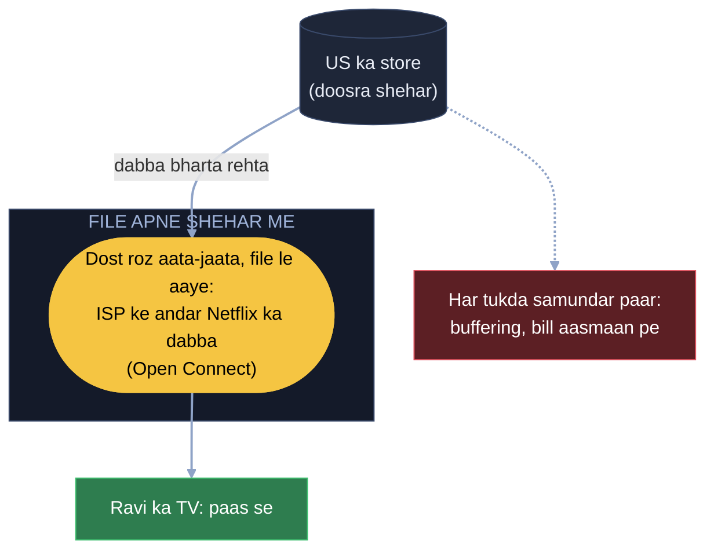
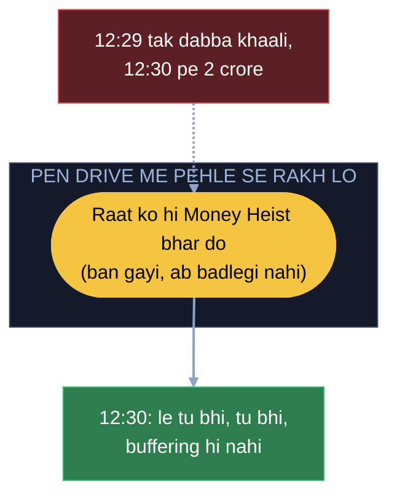
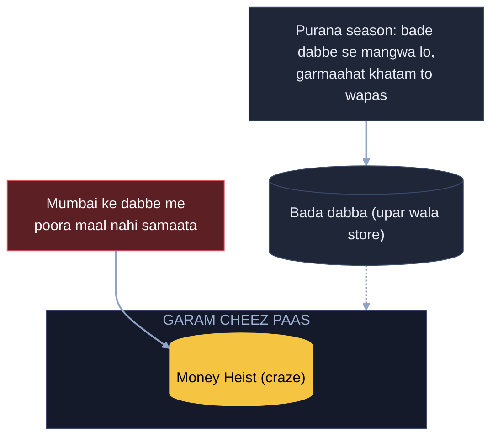
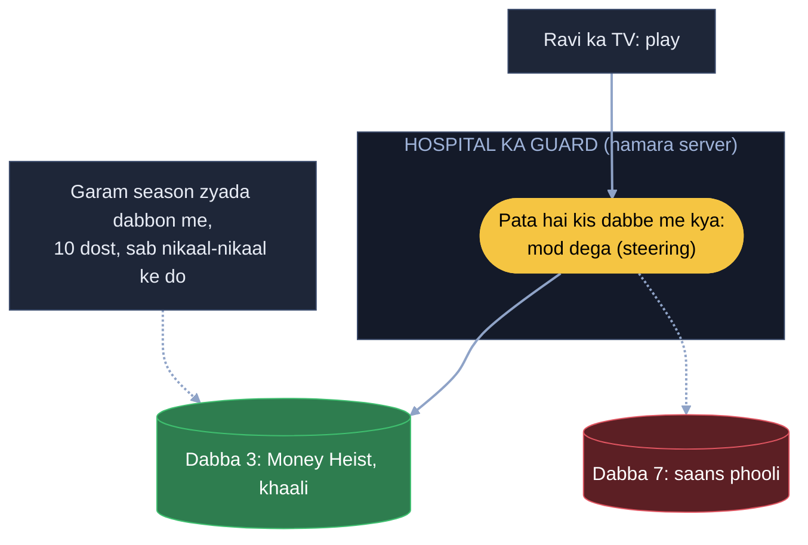
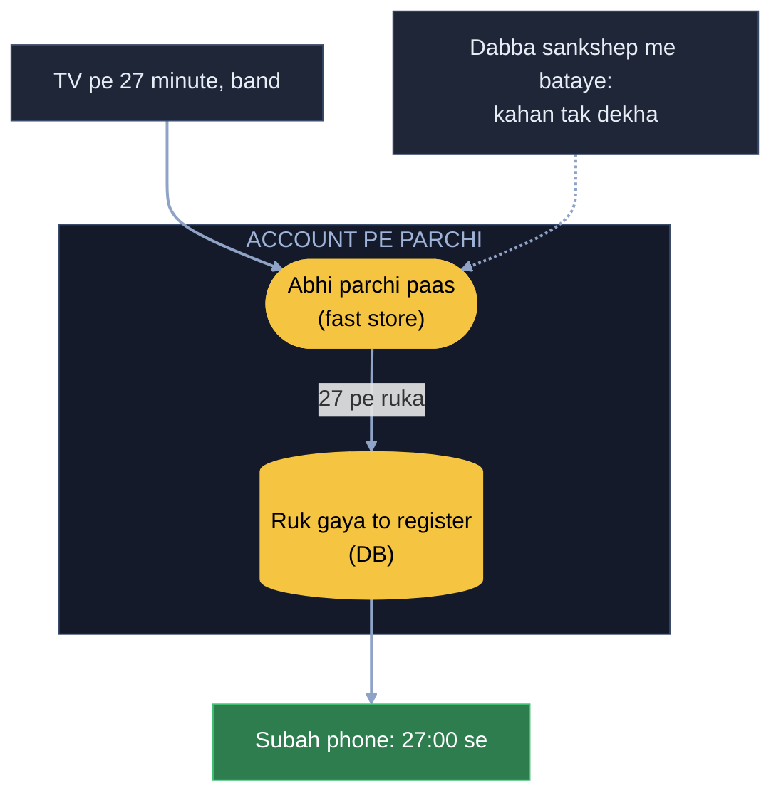
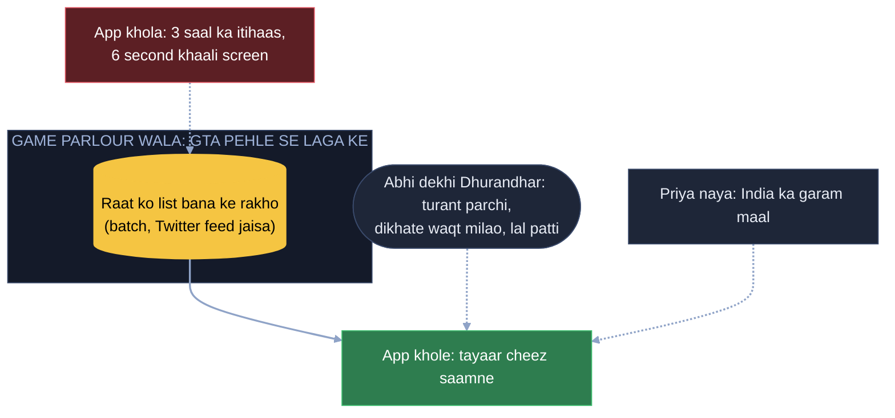
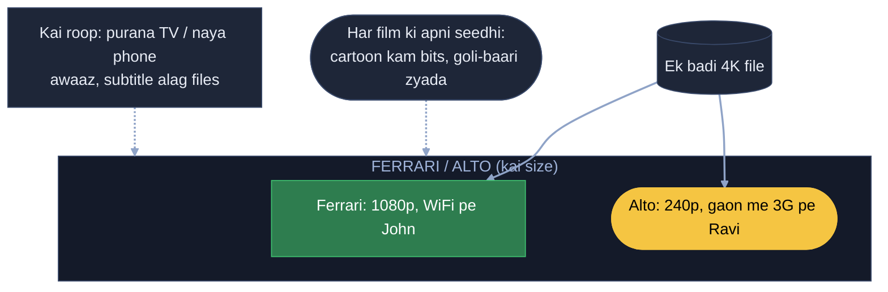

# Netflix: Money Heist ka naya season, 12:30 pe poori duniya ek saath

Money Heist ka naya season Friday dopahar 12:30 baje poori duniya me ek saath aata hai. Arpan, Ravi aur India ke 2
crore log 12:30 pe ek saath play dabate hain, saath me US, Spain, Brazil bhi. Kaam: sabko bina buffering video mile,
data pahunchane ka bill aasmaan pe na jaaye, aur app kholte hi "tere liye" wali line turant dikhe.

Har kadam = **kahani** (dikkat aur hal, bolne wali bhasha) -> **Asli naam** (interview me yahi shabd) -> tasveer
(kahani ka shabd, bracket me asli naam).

---

## FR / NFR / Numbers (interview me pehle 2 minute)

```
FR      video chalana (play) · ruk ke kisi bhi device pe wahi se aage · app kholte hi "tere liye" wali line
NFR     play dabate hi video, buffering nahi · kamzor net aur purane TV pe bhi chale · 12:30 jaisi bheed bhi jhele · "tere liye" line turant
        (thodi purani chalegi) · data pahunchane ka kharcha kam
Numbers India me 2 crore log ek saath, saath me baaki duniya -> ek jagah se sabko video nahi bhej sakte
        · har film kai size me -> poora maal kisi ek dabbe me nahi samaata
```

---

## 1. Har tukda samundar paar se (file apne shehar me)

Saari episode US ke store me hain. 12:30 pe karodon log wahi file maang rahe, har tukda samundar paar se aata hai,
Ravi ke TV pe buffering, aur data pahunchane wali company ka bill aasmaan pe. Jaise main roz wahi file lene doosre
shehar jaata hoon, bus me tel phoonk ke. File ghar nahi la sakta, par apne shehar me to la sakta hoon. CA doosre
shehar me hai, to mera dost jo roz aata-jaata hai, wo file mere shehar le aaye. Main chupchaap jaao, sign karo, wapas
aao. Bekaar me baar-baar shehar kyun.

**Asli naam:** apne shehar ka dabba = ISP ke andar Netflix ka apna CDN box (Open Connect). Ghar nahi la sakte = poora
video phone pe nahi rakhte. Dost roz aata-jaata = dabba US ke store (origin) se bharta rehta.



## 2. 12:29 tak dabba khaali, 12:30 pe 2 crore (pehle se laa ke rakho)

Dabba lag gaya, par season 12:30 pe aaya aur 12:29 tak dabba khaali tha. 12:30 pe 2 crore ek saath aaye, dabba sabko
"laata hoon" bolta hai aur saari request phir samundar paar. Jab pata hai log kis liye aa rahe, to wo cheez pehle se
laa ke rakh lo. Pen drive me Money Heist rakh liya, ab sabko baant raha: le tu bhi le, tu bhi le, buffering hi nahi.
Aur ye cheez ban gayi hai, ab badlegi nahi, isliye rakhne me koi dikkat nahi.

**Asli naam:** pehle se laa ke rakhna = release se pehle raat ko dabba bharna (proactive fill / pre-positioning).
Badlegi nahi = video static hai, isliye CDN pe rakhna safe.



## 3. Dabbe me poora maal nahi samaata (garam paas, thanda bade dabbe se)

Mumbai ke dabbe ki jagah seemit hai, aur Netflix ka saara maal (har film, kai size me) usme nahi samaata. Ek dabba
nahi, kai dabbe le lo, jaise maal ek truck me na aaye to 3-4 truck. Par dabbe ki bhi seema hai, isliye dabbe me wahi
daalo jiska craze hai: garam cheez paas rakho, thandi nahi. Purana season koi aaj bhi dekhe to bade dabbe se mangwa
lo, thodi der chhote dabbe me rakh lo, garmaahat khatam to wapas.

**Asli naam:** garam paas = popularity ke hisaab se kya rakhna (region-wise). Bade dabbe se mangwa lo = upar wala bada
store / tier. Garmaahat khatam to wapas = thanda maal dabbe se nikalna (evict).



## 4. 20 dabbe, Ravi ka TV kis dabbe se maange (server batata hai)

Mumbai me 20 dabbe hain, kuch me Money Heist hai kuch me nahi, aur ek ki saans phool rahi hai. Akela bhaar kyun
uthaun: 10 dost bulao, sabko dabba do, nikaal-nikaal ke do, aur garam season ko zyada se zyada dabbon me rakho.
Request hamare server pe aati hai, use pata hai kis dabbe me kya hai, wo mod dega. Jaise hospital ka guard:
wheelchair wale is line, mahila us line, buzurg us line.

**Asli naam:** zyada dabbon me = hot content ki kai copy. Server mod dega = play dabate hi server batata hai kaunse
dabbe se lo (steering). Guard = load + kis dabbe me kya hai, dono dekh ke sahi dabba.



## 5. TV pe 27 minute, subah phone pe wahi se (account pe parchi)

Ravi ne TV pe 27 minute dekha aur band kiya. Subah metro me phone pe khola, use 27:00 se chahiye. Ravi ka account hai,
Netflix account se yaad rakhta hai. Jaise kisi ke 10,000 rakhe, parchi pe uska naam likha, bus stand pe mila to
pehchaan liya. TV, phone, kahin bhi khole, yaad wahi. Parchi DB me.

**Asli naam:** account se yaad = watch position user ke account pe server me, device me nahi. Parchi DB me = persistent
store.

**Maan lo karodon TV har kuch second "26:50 pe hoon" bhej rahe, DB ki saans phool gayi:** race me har kadam thodi
likhte, jab ruk jaaye tab likho. Abhi parchi paas rakho, 27 pe ruk gaya to register me daal do.
**Asli naam:** parchi paas = position pehle fast store (cache) me, ruk gaya to register = DB me sirf aakhri /
kabhi-kabhi likhna (write kam).

**Maan lo tukde ISP ke dabbe se aa rahe, hamare server ko kaise pata ki Ravi 27 pe ruka:** do log baat kar rahe, ek
mujhse baat nahi karta. Maine dost ko bola, jo baat hui sankshep me mujhe bata diya kar. Jis din kuch nahi bataya,
matlab aaj aage nahi badha.
**Asli naam:** dost sankshep me bataye = dabba / player playback ki report (heartbeat) server ko bhejta.



## 6. App khola, "tere liye" line banane me 6 second (pehle se bana ke rakho)

App khola to server "tere liye" line banane baitha: 3 saal ka itihaas, karodon logon se milaan, aur 6 second khaali
screen. Game parlour wala jaanta hai Arpan 3 baje aata hai, to GTA pehle se laga ke rakhta hai. Ravi ka 3 saal ka
pattern hai, kya dekha, kya search kiya. App khole to tayaar cheez saamne. Ye Twitter ki feed jaisa hai, pehle se push.

**Asli naam:** pehle se laga ke rakhta = line raat ko pehle se banti (batch job). App khole to saamne = cache se
uthao, us waqt sochna nahi (precomputed recommendations).

**Maan lo line raat 2 baje bani, Ravi ne 11 baje Dhurandhar khatam ki, 11:05 pe sabse upar wahi:** dekhi hui cheez
turant parchi pe likh lo. List kab bhi bane, dikhate waqt parchi milao, lal patti lag jaati hai. Dobara dikhana galti
nahi, Netflix ka dhandha tujhe app pe rokna hai.
**Asli naam:** turant parchi = abhi ka dekha alag fast store me. Dikhate waqt milao = pehle se bani list + abhi ki baat
mila ke dikhana.

**Maan lo Priya ne pehli baar join kiya, koi itihaas nahi:** parlour wala mere bhai ko nahi jaanta, wo kahega ye hit
game hai, khelo. India me hai to India ka garam maal dikhao. Dheere-dheere lat lagegi, pattern banega.
**Asli naam:** garam maal = naye user ko region ka trending (cold start). Pattern banega = dekhne se apni list.



---

# Padhai wala hissa (mock se pehle saath padha, scene me nahi poocha gaya)

Ye kadam nahi hain. Notes me bhi alag hain (P1-P4). Interview me poochhe to yahan se.

## P1. AWS ka CDN (CloudFront / Akamai) kyun nahi, apna dabba kyun?

Doodh company ki kahani: courier har litre ka paisa leta hai, aur Netflix ke liye ye "litre" roz ke hazaaron TB hain.
To Netflix ne har mohalle ki dukaan me apna fridge muft me rakh diya. Teen fayde: paisa (dabba ek baar ka kharcha,
per-GB bill nahi), paas (video ISP ke andar se, buffering kam), ISP bhi khush (uska bahar jaane wala bandwidth
bachta).
**Asli naam:** courier = per-GB bill wala CDN, mohalle ka fridge = Open Connect, ISP ke andar free me laga.

## P2. Phir AWS kis kaam ka?

AWS chhoda nahi. Login, browse, "tere liye" line, aur play dabane pe kaunsa paas wala dabba video dega, ye sab AWS pe.
Sirf video ke bytes Open Connect se.
**Asli naam:** AWS = login / browse / recommendation / steering (control plane), Open Connect = sirf video ke bytes.

## P3. Ek video ke kai size: Twitter wala Ferrari / Alto, teen twist ke saath

US ke store me har episode ki ek badi 4K file hai. John WiFi pe mast, Ravi gaon me 3G pe, video chalta hi nahi; aur
uska purana TV naye tarah ki file samajhta bhi nahi. Twitter wala hi khel: Ferrari highway ke liye, Alto gaon ke liye.
Kai size banao, phone apna net dekh ke size chune, net gire to tasveer thodi dhundhli par chalti rahe. Video 4-4 second
ke tukdon me, aage khiskao to player manifest dekh ke seedha us tukde pe (copy ka 51wa page). Netflix me teen twist:

1. **Har film ki apni seedhi.** Cartoon (Doraemon) kam hilta, kam bits me bhi saaf. Bank wala goli-baari scene bahut
   hilta, zyada bits chahiye. Ek niyam sab pe lagao to cartoon pe data barbaad aur action film dhundhli.
2. **Ek size ke bhi kai roop.** Purana TV ek tarah ki file samajhta, naya phone doosri jo aur chhoti hoti. Play dabate
   hi app batata "main ye wala samajhta hoon", wahi roop milta.
3. **Ek baar banao, karodon baar chalao.** Studio film din-hafte pehle de deta. Kai machine tukde baant ke aaraam se
   saare size aur roop banati (wahi "video ki id ki parchi, 10 log kaam baanto"), phir raat ko dabbon me.

Awaaz aur subtitle alag files hain: ek hi 1080p ke saath Hindi ya English kuch bhi chuno, video ki 10 copy nahi banti.

```
cartoon      : 240p = 0.2 Mbps ... 1080p = 1.5 Mbps     (kam me hi saaf)
action film  : 240p = 0.4 Mbps ... 1080p = 5 Mbps       (zyada chahiye)
```

**Asli naam:** Ferrari / Alto = transcoding (kai size) + ABR (net dekh ke size), 4 sec tukde + manifest = segments +
seek, har film ki apni seedhi = per-title encode ladder, kai roop = codec, ek baar banao = AWS pe batch encoding
(parallel workers), awaaz / subtitle alag = alag audio / subtitle tracks.



## P4. "Tere liye" line ke baaki tukde

Isme do itihaas judte hain: Ravi ka apna (kitna dekha, beech me kahan chhoda bhi) aur Ravi jaise logon ka ("jinhone
Money Heist dekha, unhone Squid Game bhi dekha"). App khola to list uthao aur thoda abhi ke
hisaab se badlo: "abhi raat hai to thriller upar", "tu TV pe hai". Tasveer bhi teri: ek film ki 5-6 tasveer, Ravi action
dekhta to Money Heist ki goli wali, koi romance dekhta to usi film ki pyaar wali. Film wahi, darwaza alag.

**Asli naam:** tera + tere jaise logon ka itihaas = batch recommendation, thoda abhi ka mod = online halka re-rank,
apni tasveer = personalized thumbnail, dekhna / chhodna / search = events Kafka se batch tak.

---

Notes (Arpan ke shabd) = [NETFLIX_HAND_NOTES.md](NETFLIX_HAND_NOTES.md)
