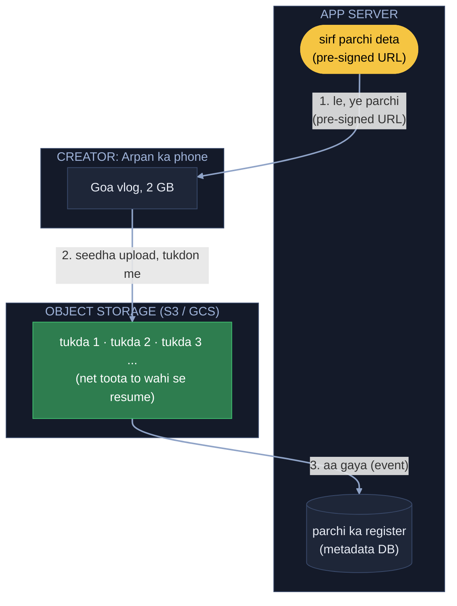
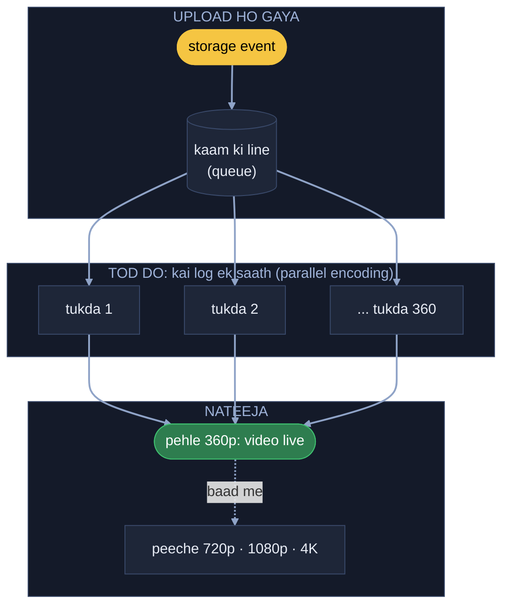
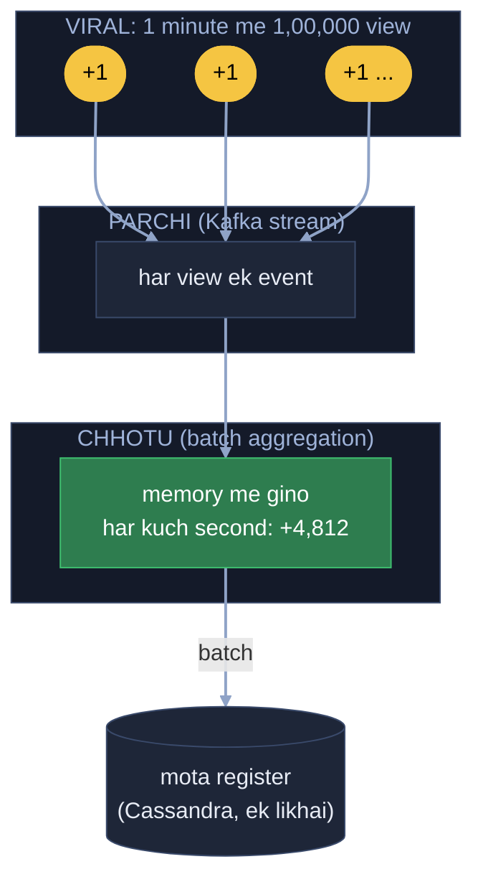
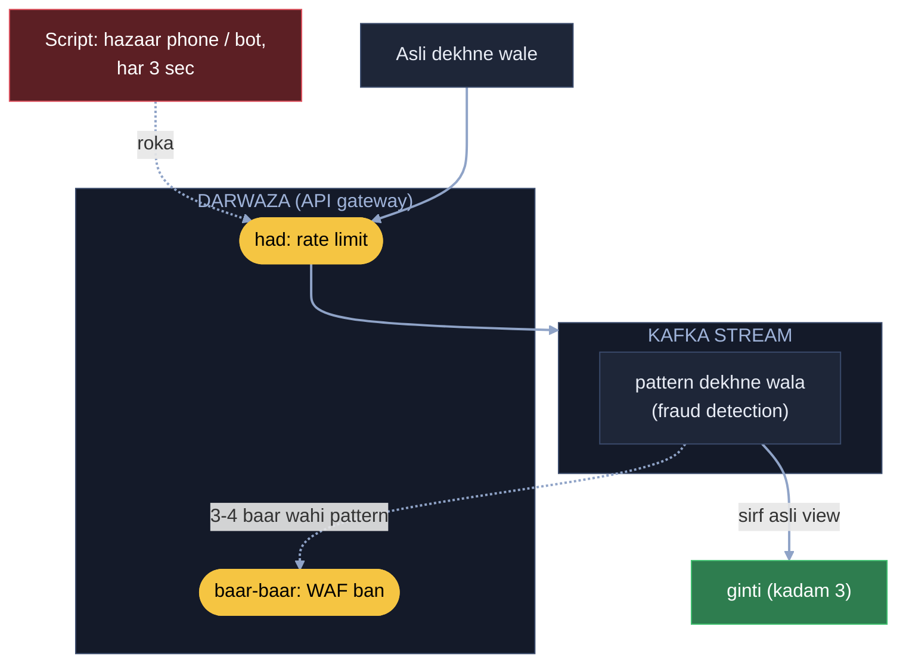
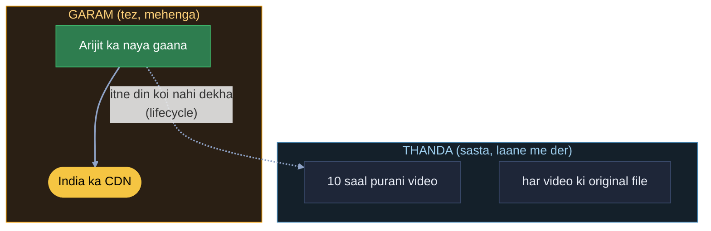
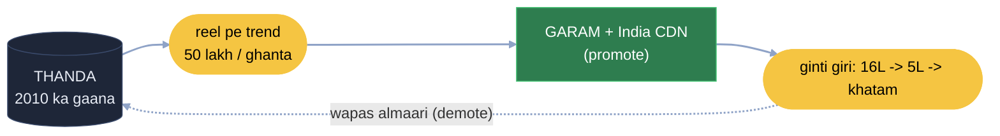
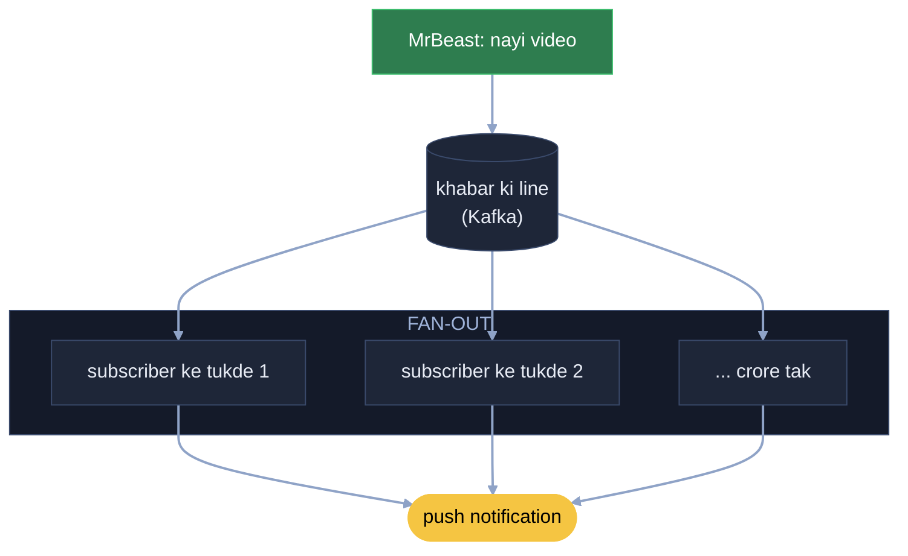
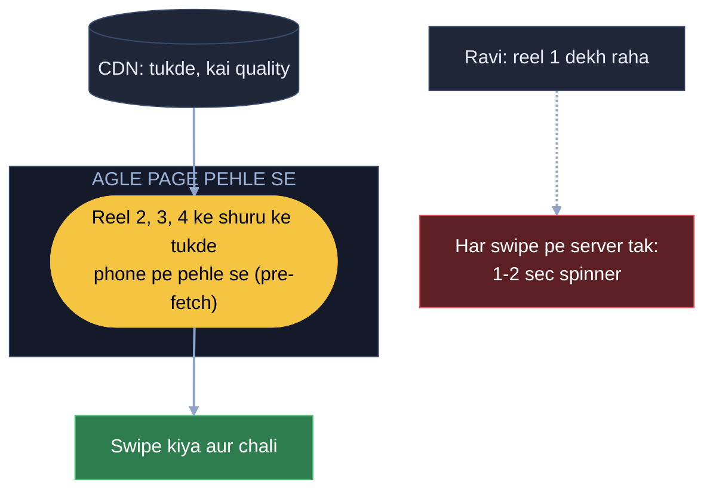
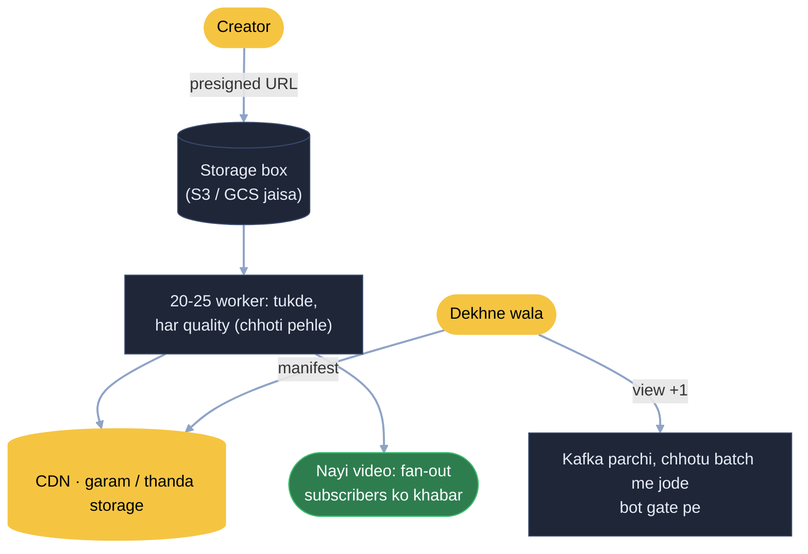

# YouTube: Goa trip ka vlog, upload se viral tak

Arpan YouTuber hai. Goa trip ka vlog banaya: 1 ghante ki video, 2 GB (4K me 40 GB tak). Usi waqt duniya bhar ke lakhon
creator apni video daal rahe hain, aur crore log dekh rahe hain. Kaam: upload kabhi app ko na roke, video jaldi live ho,
viral hone pe ginti DB ko na giraye, fake view gine na jaayen, aur storage ka bill aasmaan pe na jaaye.

Har kadam = **kahani** (dikkat aur hal, bolne wali bhasha) -> **Asli naam** (interview me yahi shabd) -> tasveer
(kahani ka shabd, bracket me asli naam).

Dekhne wala raasta (manifest, net ke hisaab se quality, paas ka CDN) = [Netflix](../18_netflix/18_netflix.md) kadam 1-4 (CDN) + P3 (manifest, quality),
wahi yahan bhi. Upload ke tukde aur resume = [File upload](../07_file_upload_validate_system/07_file_upload.md).

---

**Ek nazar: dhaancha + dikkat chain (round me sabse pehle ye, phir FR / NFR isi se):**
```
creator  --presigned URL-->  storage box (S3 / Google Cloud Storage jaisa; file seedha locker me, server se nahi)  -->  20-25 worker tukde baant ke har quality
                                                                              (chhoti quality pehle = jaldi live)
dekhne wala  -->  manifest + CDN (Netflix jaisa) · garam video garam jagah, purani sasti jagah, trend pe wapas CDN
view +1  -->  Kafka parchi, chhotu batch me jode · bot ke view gate pe hi rok
nayi video  -->  Twitter wala fan-out, subscribers ko khabar · reels: agle kuch shuru ke tukde pehle se

 1   10 hazaar creator, video server me phansi   ->  seedha locker (storage box, presigned URL)
 2   ek machine har quality, 3 ghante            ->  tukde baanto, chhoti quality pehle (parallel encoding)
 3   1 lakh view, ek row ke lock pe line         ->  +1 parchi pe, batch me jodo (Kafka, batch count)
 4   bot / phone se 10 lakh "view"               ->  gate pe rok, baar-baar to ban (rate limit, WAF)
 5   10 saal purani video bhi mehngi jagah       ->  garam garam jagah, thandi sasti (hot / cold storage)
 6   2010 ka gaana aaj trend pe                  ->  thodi der garam + CDN, phir wapas
 7   MrBeast ki video, crore subscriber          ->  fan-out + notification
 8   reels me har swipe pe spinner               ->  agle pehle se (pre-fetch)
 8b  mobile data, reels skip                     ->  net ke hisaab se quality (ABR)
 8c  har reel poori pehle se, 29 sec bekaar      ->  sirf shuru ke tukde pehle se
```

**Arpan (FR / NFR pe):** nakli view FR nahi, NFR hai (FR 6 hata, NFR 4 me). "Bina buffering" jhootha vaada, Netflix jaisa: net ke hisaab se buffering hogi.

## FR / NFR / Numbers (interview me pehle 2 minute)

Pehli line interviewer ko: "Main poora YouTube (sign-up se logout tak) nahi, ye cheezein solve karunga: video upload,
jaldi live, dekhna, view count, nayi video ki khabar, aur reels / shorts ka swipe. Theek lage to aage badhein." Neeche har line ke saath kadam
number, taaki FR / NFR aur design ek hi kahani rahe.

```
FR      1  video upload (badi file, 2-40 GB)                                  -> kadam 1
        2  upload ke baad har quality me bane (144p se 4K)                       -> kadam 2
        3  har phone / net pe video dekh sake                                    -> Netflix kadam 1-4 + P3
        4  har video ka view count                                              -> kadam 3
        5  subscribe kiya to nayi video ki khabar (MrBeast)                      -> kadam 7
        6  reels / shorts: swipe karte hi agli chale                            -> kadam 8
        7  roko, wahi se chalao                                                 -> Netflix kadam 5 (yaad account pe)
        8  search + recommendation (pasand ka music / video): recommendation ki algorithm / ML design ka
           hissa nahi; pattern kaise banta = kadam 8 Maan lo; search maange to Elasticsearch            -> kadam 8

NFR     1  upload kabhi app ko na roke (badi file app server se na guzre)       -> kadam 1
        2  video jaldi live (pehle chhoti quality)                              -> kadam 2
        3  viral pe bhi ginti DB na giraye (count thoda der se chalega)         -> kadam 3
        4  nakli / bot ke view ginti me na aayein                               -> kadam 4
        5  storage sasta (purani video sasti jagah)                             -> kadam 5
        6  purani video achanak trend pe aaye to bhi aaram se chale (garam jagah + CDN);
           net ke hisaab se quality, kamzor net pe thodi buffering hogi hi      -> kadam 6 + Netflix P3
        7  swipe pe spinner nahi, par skip hui reel pe data / battery bekaar na jaaye -> kadam 8, 8c

Numbers lakhon video roz, ek video 2-40 GB -> app server se nahi guzar sakti
        · viral video pe ek minute me lakhon view -> ek row pe +1 nahi chalega
        · saalon ki videos x kai quality -> sab tez storage me nahi rakh sakte
```

Trade-off jo bolne hain: view count thodi der se badhta (DB bachane ke liye) · thandi jagah sasti par laane me der
(isliye trend pe wapas garam) · pehle chhoti quality (4K wale ko thoda intezaar) · reels pehle se zyada laaye to data / battery, kam laaye to spinner.

**Isi pe ek aur raasta (round me: FR / NFR, numbers, dhaancha):**
```
YouTube Google ka hai, AWS ka S3 nahi chalata; apna storage box (S3 / Google Cloud Storage jaisa).
Zyada hissa Netflix jaisa, bas video upload ka system alag.

FR       dekhna, post karna, chalana, rokna, wahi se dobara (TV se laptop, account pe sync, Netflix jaisa);
         download scope se bahar.

NFR      upload net ke hisaab se jaldi, upload hote hi subscribers ko khabar, bot se apne hi view na badhein,
         purani videos kahan, shorts bhi.

Numbers  global (Russia, China chhod ke), 1-10 crore user, roz ~5 crore.

Dhaancha do tarah ke user (upload + dekhne wale, sirf dekhne wale); 24 ghante ki video tod ke bahut saare chhotu,
         pehle 144 / 240 / 360p, phir 1080p, 4K; likhai bahut (view, like) to Cassandra jaisa, user aur video ki
         jaankari Postgres jaisa, video storage box me; net ke hisaab se quality ("kabhi na ruke" vaada nahi);
         Google ke apne CDN (Mumbai, Dubai, Europe), poori video nahi, chhote tukde (YouTube ki safed patti =
         itna aa chuka).
```

**API (round me):** POST upload · GET saari video (home page) · GET ek video · POST view · GET recommendation · POST
subscribe · nayi video ki khabar YouTube khud push karta (fan-out).
```
API     POST /videos              -> upload (upload ki parchi = presigned URL)
        GET  /feed                -> home page, saari video ek saath
        GET  /videos/{id}         -> ek video
        POST /videos/{id}/view    -> view gino
        GET  /recommendations     -> suggestion
        POST /subscriptions       -> subscribe
        nayi video ki khabar = API nahi, server ka push (Android: Firebase FCM, iPhone: Apple APNs)
```

---

## 1. Video app server se hokar ja rahi, sabka app atka (seedha storage me)

Maine upload dabaya, aur video hamare app server se hokar storage ja rahi hai. Usi waqt 10 hazaar creator aur apni badi
videos daal rahe hain. App server ki saari bandwidth aur memory in videos me phans gayi, aur jo log sirf search ya
comment kar rahe the, unka app bhi atak gaya. Ye isliye hua kyunki badi file hamare apne darwaze se guzar rahi thi. To
badi file apne paas mat rakho. Jaise bank me koi bahut moti file le aaya ki locker me rakh lo: hum badi file locker me
kyun rakhenge? Watchman ko bulao, iska bas ek chhota sa hissa (parchi) apne paas rakho, aur file seedha bade storage me
bhijwa do.

**Asli naam:** file seedha bade storage me = pre-signed URL (server sirf ek parchi deta hai, phone seedha object
storage, S3 / GCS, me tukdon me upload karta hai; net toota to wahi se resume), chhota hissa apne paas = DB me sirf
video ki parchi (metadata: title, owner, status), app server pe video kabhi nahi.

**Isi pe ek aur misaal (round me: chhote bank ki parchi):** mere chhote bank ka locker sab ke saaman se ek din me bhar
jaayega; file main nahi leta, parchi deta hoon, parchi le ke bade bank jao, wo apne bade locker me rakh lenge. 100-200 GB
ki video aur lakhon creator, app server baith jaayega; seedha bade godown me.



## 2. Ek machine, 3 ghante, subscribers pooch rahe "video kab?" (tod ke kai log, chhoti quality pehle)

Video storage me aa gayi. Ab use 360p, 720p, 1080p aur 4K me banana hai, taaki har phone aur net pe chale. Ek machine
poori video ek-ek quality me bana rahi hai, 3 ghante lag rahe hain. Ye isliye hua kyunki saara kaam ek ke sar pe hai. To
badi file hai to 20-25 log lagao: file tod do, chhote-chhote hisse, sab apna hissa fatafat banao, jab sab ho jaaye to
ek jagah jod do. Upload hote hi storage khud khabar bhej de ki ho gaya. Aur pehle sabse chhoti, theek-thaak quality
banao. Jaise dulha-dulhan ko apni shaadi ki video jaldi dekhni hai: pehle chhoti quality de do, ek baar dekh ke
santusht ho jaayenge, aur peeche hamare log 720p aur 4K banate rahenge.

**Asli naam:** upload hua, khabar bhejo = storage event -> queue, file tod do, 20-25 log = video ko segment (jaise 10
second) me kaat ke parallel encoding (har tukda, har quality), phir jod do = merge + manifest, pehle chhoti quality =
360p pehle publish (video jaldi live), 4K baad me.



## 3. Viral: 1 minute me 1 lakh view, ek row pe line (parchi pe +1, chhotu batch me)

Vlog viral ho gaya, 1 minute me 1 lakh view. Har view pe hum DB me us video ki ek hi row me `views + 1` kar rahe the.
Ek lakh request ek row ke lock pe line me lag gayi, DB atak gaya, aur us DB pe baaki videos ke like aur comment bhi
ruk gaye. Ye isliye hua kyunki har +1 pe mote register tak bhaag rahe the. To +1 abhi parchi pe likh do. Peeche chhotu
rakh lo: wo parchi dekhta rahe aur batch me mote register me jodta rahe, "is batch me itne +1 aaye". Ek chhotu gira to
2-3 aur hain. Aur YouTube pe likhai bahut zyada hai, to Cassandra jaisa DB.

**Asli naam:** parchi pe +1 = har view ek event, stream me (Kafka), chhotu batch me jode = batch aggregation (memory me
gino, kuch second me ek baar DB me likho; lakh likhai ki jagah ginti ki), likhai zyada = Cassandra. Trade-off: count
thodi der se badhta hai.

Isi pe ek aur raasta (Kafka ya Redis, pehle ek dabbe me jama): koi har ghante ek rupaya de jaaye to har rupaye ke liye bank nahi bhaagte; apne paas jama karo, gaddi
bani to ek saath jama. **Asli naam:** Redis counter (INCR) / Kafka, phir batch me DB.

**Isi pe ek aur misaal (round me: 10-10 rupaye):** screen pe +1 turant dikha do, DB me har baar nahi. Roz 10 rupaye leke
aane wale ke liye har baar bank nahi jaata, 500-700 jama hone pe ek saath; waise hi 1000-2000 view pe batch. Beech me
Kafka ki line, disk pe hai to kuch nahi khota.



## 4. Script se ek ghante me 10 lakh fake view (gate pe rok, ginti me hi mat lo)

Ek creator ne script likh di: hazaar phone / bot se har 3 second refresh, ek ghante me 10 lakh "view". Views pe paisa milta
hai, wo trending me upar aa gaya, asli creators shikayat kar rahe hain. Ye fraud hai. Aisa view ginti me gino hi mat.
API gateway pe hi rok do, request andar hi mat aane do: ek hi bande / IP se 10 lakh request? Rate limit laga do.
Baar-baar kare to WAF me daal do, ya permanent ban. Peeche Kafka ka worker / consumer pattern dekhta rahe: 3-4 baar wahi pattern
dikha to daal do.

**Asli naam:** gateway pe rok do = rate limit per user / IP / video ([Rate limiter](../02_rate_limiter/02_rate_limiter.md)),
WAF me daal do = WAF ban, worker / consumer pattern dekhe = fraud detection worker / consumer (bot / repeat view ginti se pehle filter, kadam
3 wali stream padh ke).

**Isi pe ek aur misaal (round me: gate pe bouncer):** API gateway = gate pe bouncer: ek view / like wala andar, 10,000
ya script wala gate pe hi bahar, line me ghuse hi nahi. YouTube ke paas lakhon pattern pehle se.



## 5. Har purani video bhi mehenge storage me, bill aasmaan pe (garam jagah, thandi jagah)

Roz lakhon video aati hain, har ek ki 40 GB original aur 5 quality ki copies. 10 saal purani videos, jinhe mahine me ek
aadmi dekhta hai, wo bhi mehenge tez storage me padi hain. To storage baant do: garam cheez garam jagah, thandi cheez
thandi jagah. Arijit Singh ka naya gaana aaya, YouTube ke paas saalon ka pattern hai, pata hai ye chalega. Uske fan India
me hain, to India ke CDN pe rakh do aur garam storage me. 10-20 saal purana gaana jo koi nahi sunta, thande storage me.
Jo ladka roz file lene aata hai, uski file apne paas; jo mahine me ek baar aata hai, uski file locker me, wo aaye tab
jaake le aao.

**Asli naam:** garam / thanda storage = hot / cold storage tiering (lifecycle policy: itne din koi nahi dekha to sasti
jagah; original file, saari quality ban jaane ke baad cold me), pehle se India ke CDN pe = popular video ko pehle se regional CDN pe.



## 6. Purana gaana reel se phat gaya, thandi jagah se late (thodi der garam, phir wapas)

2010 ka ek gaana thandi jagah pada tha. Aaj wo reels pe trend ho gaya, 1 ghante me 50 lakh log. Thandi jagah se laane me
har baar time lag raha, video ghoom rahi, log likh rahe "YouTube down hai?". To aaj wo phat gaya hai, thodi der ke liye
garam storage aur CDN pe rakh lo. Pattern pata hai: ek-do din phatega, roz koi nahi sunega. Jaise Saiyaara ka gaana
India ka hai, Europe wale nahi sunenge, to India ke CDN pe. Fati jeans jaisa: kabhi nahi pehenta tha, trend aaya to 4-5
din pehni, trend thanda hua to wapas almaari me. Roz ginti dekho, 50 lakh, 16 lakh, 10 lakh, 5 lakh... trend khatam,
wapas thande storage me. Purana gaana US ke server pe tha aur India ka traffic roz US tak ja raha, to ek copy Mumbai ke
server pe; 10 din peak ke baad ginti girti dikhe to wapas thandi jagah.

**Asli naam:** phat gaya, garam me lao = trend detect (view spike, kadam 3 wali ginti se), promote to hot storage +
regional CDN; ginti giri, wapas almaari = demote (CDN se hatao, phir cold storage, TTL / lifecycle).



## 7. MrBeast ki nayi video, crore subscribers ko khabar (subscriber wala fan-out)

Arpan ka vlog chal gaya, par asli bojh tab jab MrBeast jaisa bada YouTuber nayi video daale. MrBeast ne nayi video daali, uske crore subscribers ko turant pata chalna chahiye. Ye wahi subscriber wala fan-out hai
jo Twitter me kiya: jisne subscribe kiya hai, sabko notification push kar do, jaise Instagram / Twitter pe follow karte
hain to feed me aata hai. YouTube asal me kaise karta hai, unka design public nahi, par fan-out jaisa hi kuch hoga.

**Asli naam:** sab subscribers ko push = fan-out ([Twitter](../03_twitter_feed/03_twitter_feed.md)) + [Notification](../04_notification_system/04_notification_system.md)
system. Ghanti ke liye pull nahi chalta (user ko pata hi nahi kuch aaya), isliye bade creator pe bhi push; crore
subscribers ko queue me daal ke workers / consumers thoda-thoda bhejte. Home feed me video dikhana alag baat: wahan Twitter wala
hybrid (bade creator ka pull: feed kholne pe uski nayi video khinch lo).



## 8. Reels me har swipe pe spinner (agli reels pehle se, sirf shuru ke tukde)

YouTube Shorts ho ya Instagram Reels, chhoti video ka swipe ek hi baat.
Arpan ne Goa vlog se 30 second ke shorts bhi kaat ke daale. Arpan ka dost Ravi Instagram pe reels dekh raha, har swipe pe app server se agli reel maangta, beech me 1-2 second ka spinner aur Ravi
aage swipe kar gaya. Reel ke tukde pehle se CDN pe hain (kai quality me bane, transcoding). Ek banda dhadadhad page padh
raha, to main 20ve page ke khatam hone ka intezaar nahi karunga, chhotu ko bolunga "turant agle 20 page utha la"; wo
intezaar nahi karta, mere paas pehle se saamaan hai.

**Asli naam:** agle page pehle se = pre-fetching (aage ki reels ki list ek saath, unke tukde pehle se phone pe, agli
reel ka player bhi taiyaar).

**Isi pe ek aur misaal (round me: roz ki kitaab):** reel chhoti (30 second se 1 minute); Delhi wale ko har reel US se
nahi, Mumbai ke CDN se; ek dekhi to agli 3-4 saath mangwa ke rakh lo. Roz wahi kitaab padhne wale ki kitaab thodi der
counter pe rakh do.

**Maan lo Ravi mobile data pe, zyadatar reels 1 second me skip, app 5 reels poori achhi quality me utaar raha, pack
shaam tak khatam:** Net dekho: kamzor hai to kam quality laao (240p bahut, pehle blur phir saaf). Battery pe Instagram
kya karta, public nahi. Aur jis reel pe engagement 1 second, wo aage dikhane ka nahi; jisme 30 second guzaare, wahi
dekhna chah raha. Library jaisa: 10 log roz aate, unka pattern samajh ke wahi kitaabein zyada aur alag-alag variety rakh di.
**Asli naam:** ABR (adaptive bitrate), recommendation ka engagement signal (kitni der dekhi).

**Maan lo net achha, par 5 me se 4 reel 1 second me skip, har reel poori 30 second pehle hi aa chuki:** Poori 10
reel laana bewakoofi; shuru ke kuch chunks lo, achha laga to baaki. Chhotu ko sirf 3-4 page laane bolo, poora padha to
baaki chupchaap aa jaayenge. Par 1-2 page dekh ke kitaab mat hatao; 1-2 din pattern dekh ke laana kam karo.
**Asli naam:** pre-fetch me sirf pehle kuch second, kitna laana = user ke pattern se. Trade-off: zyada laaye to data aur
battery, kam laaye to spinner. Data saver on ho to pehle se laana band.

**Isi pe ek aur misaal (round me: 8 page ka chhota version):** roz 4 page padhne wale ke liye 100 page ki nahi, 8-10
page ka chhota version counter pe. Har reel 2 second dekh ke swipe, to pehle 2 second hi; aage dekhe to 4, phir 8 second
CDN se turant. Skip kiya to bas 6 second aaya, poori reel nahi.

**Maan lo pattern kaise:** pehle region (India, phir north / south) ka, phir roz ke dekhne se apna. **Maan lo 1-2 reel
achhi nahi lagi:** 1-2 page pe kitaab nahi phaadte, 7 din koi na padhe to hatao. **Asli naam:** region trending, engagement signal.



---

## Wrap

Upload seedha storage me (parchi server ke paas) -> event pe tod ke parallel encoding, chhoti quality pehle -> dekhna
Netflix jaisa (manifest + CDN) -> har view stream me, ginti batch me (Cassandra) -> fake view gate pe aur stream me
chhaano -> garam / thanda storage, trend pe upar-neeche -> nayi video ki khabar fan-out se -> reels me agli reels ke shuru ke tukde pehle se (pre-fetch, kitna = user ke
pattern se).

---

## Poora dhaancha ek nazar me



---

Notes (Arpan ke shabd) = [YOUTUBE_HAND_NOTES.md](YOUTUBE_HAND_NOTES.md)
