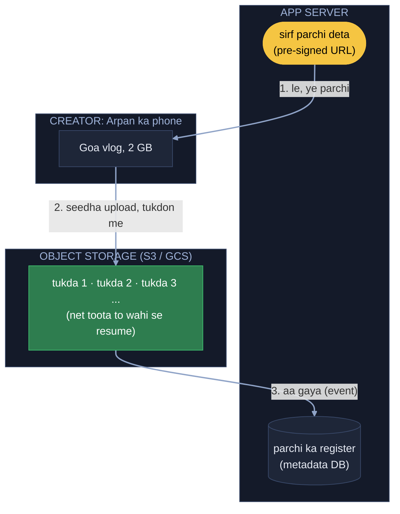
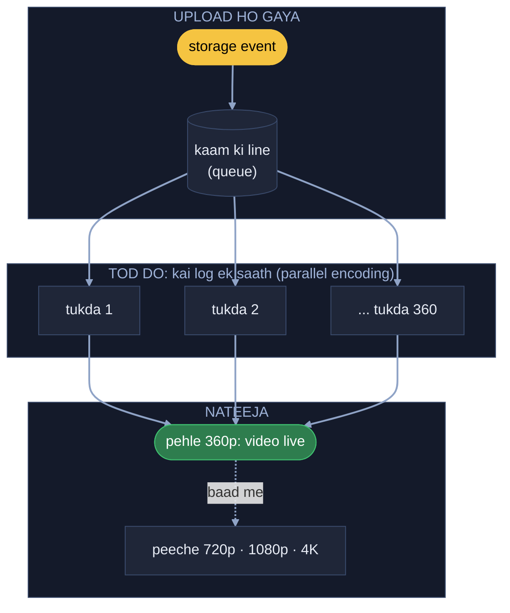
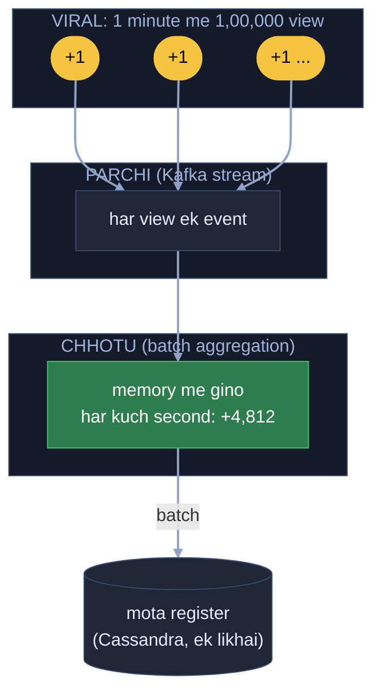
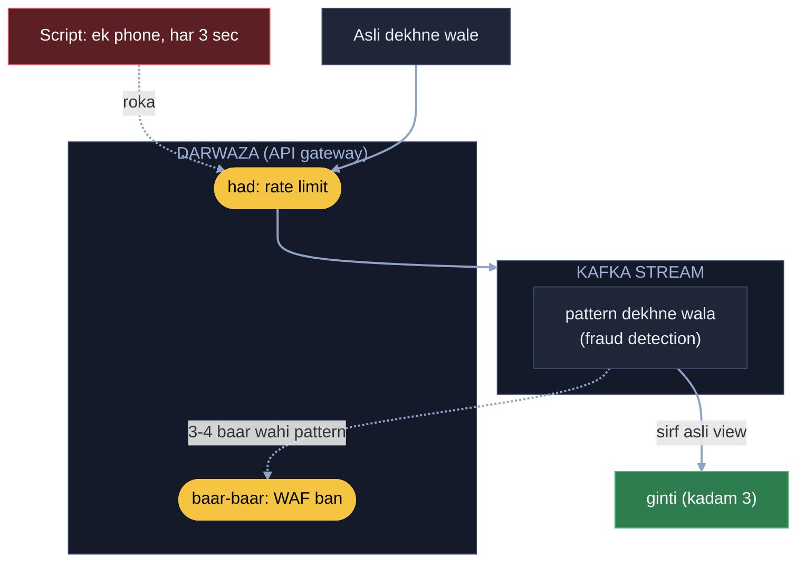
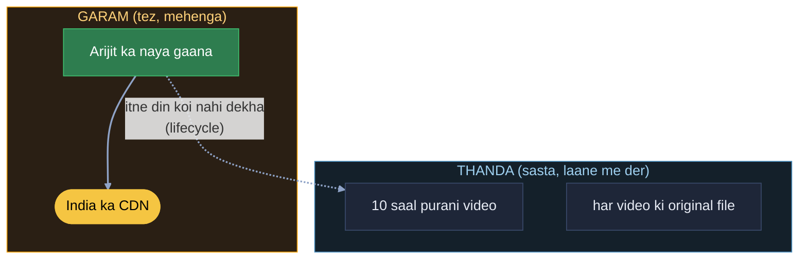
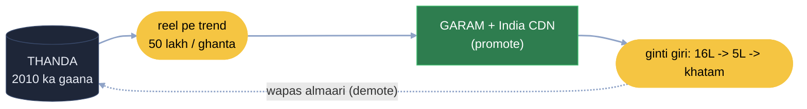
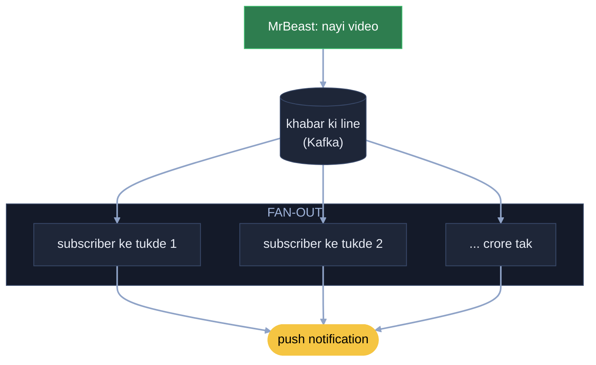

# YouTube: Goa trip ka vlog, upload se viral tak

Arpan YouTuber hai. Goa trip ka vlog banaya: 1 ghante ki video, 2 GB (4K me 40 GB tak). Usi waqt duniya bhar ke lakhon
creator apni video daal rahe hain, aur crore log dekh rahe hain. Kaam: upload kabhi app ko na roke, video jaldi live ho,
viral hone pe ginti DB ko na giraye, fake view gine na jaayen, aur storage ka bill aasmaan pe na jaaye.

Har kadam = **kahani** (dikkat aur hal, bolne wali bhasha) -> **Asli naam** (interview me yahi shabd) -> tasveer
(kahani ka shabd, bracket me asli naam).

Dekhne wala raasta (manifest, net ke hisaab se quality, paas ka CDN) = [Netflix](../18_netflix/18_netflix.md) kadam 1-3,
wahi yahan bhi. Upload ke tukde aur resume = [File upload](../07_file_upload_validate_system/07_file_upload.md).

---

## FR / NFR / Numbers (interview me pehle 2 minute)

Pehli line interviewer ko: "Main poora YouTube (sign-up se logout tak) nahi, ye cheezein solve karunga: video upload,
jaldi live, dekhna, view count, aur nayi video ki khabar. Theek lage to aage badhein." Neeche har line ke saath kadam
number, taaki FR / NFR aur design ek hi kahani rahe.

```
FR      1  video upload (badi file, 2-40 GB)                                  -> kadam 1
        2  upload ke baad har quality me bane (360p se 4K)                       -> kadam 2
        3  har phone / net pe dekhna (manifest + CDN, Netflix jaisa)             -> Netflix kadam 1-3
        4  har video ka view count                                              -> kadam 3
        5  subscribe kiya to nayi video ki khabar (MrBeast)                      -> kadam 7

NFR     1  upload kabhi app ko na roke (badi file app server se na guzre)       -> kadam 1
        2  video jaldi live (pehle chhoti quality)                              -> kadam 2
        3  viral pe bhi ginti DB na giraye (count thoda der se chalega)         -> kadam 3
        4  fake view na gine                                                    -> kadam 4
        5  storage sasta (purani video sasti jagah)                             -> kadam 5
        6  achanak trend pe bhi bina buffering                                  -> kadam 6

Numbers lakhon video roz, ek video 2-40 GB -> app server se nahi guzar sakti
        · viral video pe ek minute me lakhon view -> ek row pe +1 nahi chalega
        · saalon ki videos x 5 quality -> sab tez storage me nahi rakh sakte
```

Trade-off jo bolne hain: view count thodi der se badhta (DB bachane ke liye) · thandi jagah sasti par laane me der
(isliye trend pe wapas garam) · pehle chhoti quality (4K wale ko thoda intezaar).

---

## 1. Video app server se hokar ja rahi, sabka app atka (seedha storage me)

Maine upload dabaya, aur video hamare app server se hokar storage ja rahi hai. Usi waqt 10 hazaar creator aur apni badi
videos daal rahe hain. App server ki saari bandwidth aur memory in videos me phans gayi, aur jo log sirf search ya
comment kar rahe the, unka app bhi atak gaya. Ye isliye hua kyunki badi file hamare apne darwaze se guzar rahi thi. To
badi file apne paas mat rakho. Jaise bank me koi bahut moti file le aaya ki locker me rakh lo: hum badi file locker me
kyun rakhenge? Watchman ko bulao, iska bas ek chhota sa hissa (parchi) apne paas rakho, aur file seedha bade storage me
bhijwa do.

**Asli naam:** file seedha bade storage me = pre-signed URL (server sirf ek parchi deta hai, phone seedha object
storage, S3 / GCS, me tukdon me upload karta hai; net toota to wahi se resume), chhota hissa apne paas = DB me sirf
video ki parchi (metadata: title, owner, status), app server pe video kabhi nahi.



## 2. Ek machine, 3 ghante, subscribers pooch rahe "video kab?" (tod ke kai log, chhoti quality pehle)

Video storage me aa gayi. Ab use 360p, 720p, 1080p aur 4K me banana hai, taaki har phone aur net pe chale. Ek machine
poori video ek-ek quality me bana rahi hai, 3 ghante lag rahe hain. Ye isliye hua kyunki saara kaam ek ke sar pe hai. To
badi file hai to 20-25 log lagao: file tod do, chhote-chhote hisse, sab apna hissa fatafat banao, jab sab ho jaaye to
ek jagah jod do. Upload hote hi storage khud khabar bhej de ki ho gaya. Aur pehle sabse chhoti, theek-thaak quality
banao. Jaise dulha-dulhan ko apni shaadi ki video jaldi dekhni hai: pehle chhoti quality de do, ek baar dekh ke
santusht ho jaayenge, aur peeche hamare log 720p aur 4K banate rahenge.

**Asli naam:** upload hua, khabar bhejo = storage event -> queue, file tod do, 20-25 log = video ko segment (jaise 10
second) me kaat ke parallel encoding (har tukda, har quality), phir jod do = merge + manifest, pehle chhoti quality =
360p pehle publish (video jaldi live), 4K baad me.



## 3. Viral: 1 minute me 1 lakh view, ek row pe line (parchi pe +1, chhotu batch me)

Vlog viral ho gaya, 1 minute me 1 lakh view. Har view pe hum DB me us video ki ek hi row me `views + 1` kar rahe the.
Ek lakh request ek row ke lock pe line me lag gayi, DB atak gaya, aur us DB pe baaki videos ke like aur comment bhi
ruk gaye. Ye isliye hua kyunki har +1 pe mote register tak bhaag rahe the. To +1 abhi parchi pe likh do. Peeche chhotu
rakh lo: wo parchi dekhta rahe aur batch me mote register me jodta rahe, "is batch me itne +1 aaye". Ek chhotu gira to
2-3 aur hain. Aur YouTube pe likhai bahut zyada hai, to Cassandra jaisa DB.

**Asli naam:** parchi pe +1 = har view ek event, stream me (Kafka), chhotu batch me jode = batch aggregation (memory me
gino, kuch second me ek baar DB me likho; lakh likhai ki jagah ginti ki), likhai zyada = Cassandra. Trade-off: count
thodi der se badhta hai.



## 4. Script se ek ghante me 10 lakh fake view (gate pe rok, ginti me hi mat lo)

Ek creator ne script likh di: ek hi phone se har 3 second refresh, ek ghante me 10 lakh "view". Views pe paisa milta
hai, wo trending me upar aa gaya, asli creators shikayat kar rahe hain. Ye fraud hai. Aisa view ginti me gino hi mat.
API gateway pe hi rok do, request andar hi mat aane do: ek hi bande / IP se 10 lakh request? Rate limit laga do.
Baar-baar kare to WAF me daal do, ya permanent ban. Peeche Kafka ka worker pattern dekhta rahe: 3-4 baar wahi pattern
dikha to daal do.

**Asli naam:** gateway pe rok do = rate limit per user / IP / video ([Rate limiter](../02_rate_limiter/02_rate_limiter.md)),
WAF me daal do = WAF ban, worker pattern dekhe = fraud detection worker (bot / repeat view ginti se pehle filter, kadam
3 wali stream padh ke).



## 5. Har purani video bhi mehenge storage me, bill aasmaan pe (garam jagah, thandi jagah)

Roz lakhon video aati hain, har ek ki 40 GB original aur 5 quality ki copies. 10 saal purani videos, jinhe mahine me ek
aadmi dekhta hai, wo bhi mehenge tez storage me padi hain. To storage baant do: garam cheez garam jagah, thandi cheez
thandi jagah. Arijit Singh ka naya gaana aaya, YouTube ke paas saalon ka pattern hai, pata hai ye chalega. Uske fan India
me hain, to India ke CDN pe rakh do aur garam storage me. 10-20 saal purana gaana jo koi nahi sunta, thande storage me.
Jo ladka roz file lene aata hai, uski file apne paas; jo mahine me ek baar aata hai, uski file locker me, wo aaye tab
jaake le aao.

**Asli naam:** garam / thanda storage = hot / cold storage tiering (lifecycle policy: itne din koi nahi dekha to sasti
jagah; original file shuru se hi cold me), pehle se India ke CDN pe = popular video ko pehle se regional CDN pe.



## 6. Purana gaana reel se phat gaya, thandi jagah se late (thodi der garam, phir wapas)

2010 ka ek gaana thandi jagah pada tha. Aaj wo reels pe trend ho gaya, 1 ghante me 50 lakh log. Thandi jagah se laane me
har baar time lag raha, video ghoom rahi, log likh rahe "YouTube down hai?". To aaj wo phat gaya hai, thodi der ke liye
garam storage aur CDN pe rakh lo. Pattern pata hai: ek-do din phatega, roz koi nahi sunega. Jaise Saiyaara ka gaana
India ka hai, Europe wale nahi sunenge, to India ke CDN pe. Fati jeans jaisa: kabhi nahi pehenta tha, trend aaya to 4-5
din pehni, trend thanda hua to wapas almaari me. Roz ginti dekho, 50 lakh, 16 lakh, 10 lakh, 5 lakh... trend khatam,
wapas thande storage me.

**Asli naam:** phat gaya, garam me lao = trend detect (view spike, kadam 3 wali ginti se), promote to hot storage +
regional CDN; ginti giri, wapas almaari = demote (CDN se hatao, phir cold storage, TTL / lifecycle).



## 7. MrBeast ki nayi video, crore subscribers ko khabar (subscriber wala fan-out)

MrBeast ne nayi video daali, uske crore subscribers ko turant pata chalna chahiye. Ye wahi subscriber wala fan-out hai
jo Twitter me kiya: jisne subscribe kiya hai, sabko notification push kar do, jaise Instagram / Twitter pe follow karte
hain to feed me aata hai. YouTube asal me kaise karta hai, unka design public nahi, par fan-out jaisa hi kuch hoga.

**Asli naam:** sab subscribers ko push = fan-out ([Twitter](../03_twitter_feed/03_twitter_feed.md)) + [Notification](../04_notification_system/04_notification_system.md)
system. Ghanti ke liye pull nahi chalta (user ko pata hi nahi kuch aaya), isliye bade creator pe bhi push; crore
subscribers ko queue me daal ke workers thoda-thoda bhejte. Home feed me video dikhana alag baat: wahan Twitter wala
hybrid (bade creator ka pull: feed kholne pe uski nayi video khinch lo).



---

## Wrap

Upload seedha storage me (parchi server ke paas) -> event pe tod ke parallel encoding, chhoti quality pehle -> dekhna
Netflix jaisa (manifest + CDN) -> har view stream me, ginti batch me (Cassandra) -> fake view gate pe aur stream me
chhaano -> garam / thanda storage, trend pe upar-neeche -> nayi video ki khabar fan-out se.

Notes (Arpan ke shabd) = [YOUTUBE_HAND_NOTES.md](YOUTUBE_HAND_NOTES.md)
