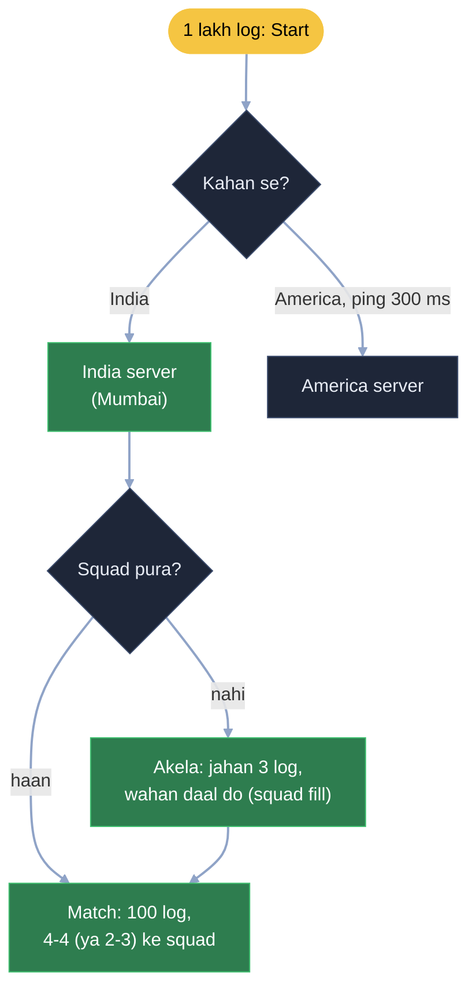
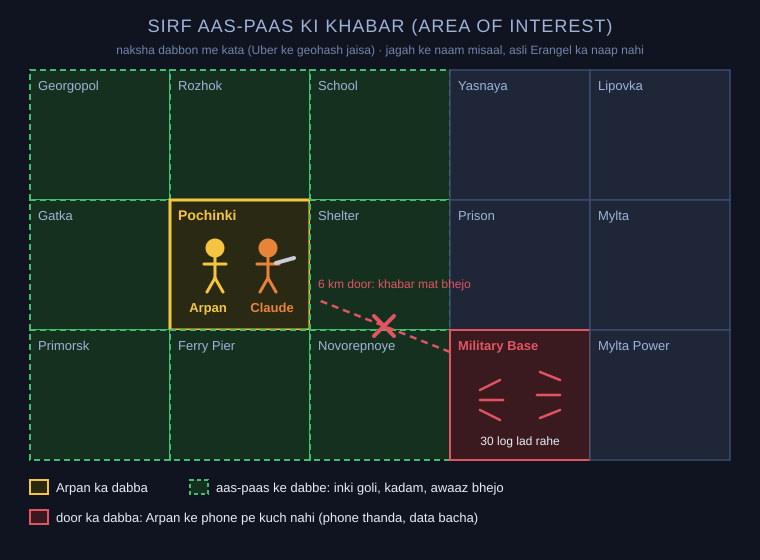
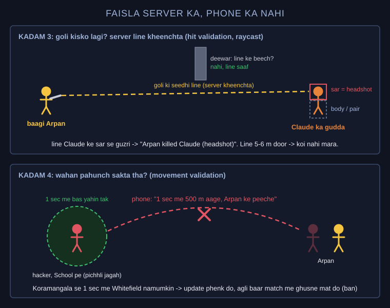
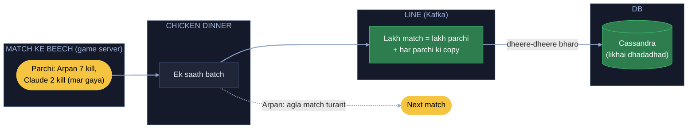
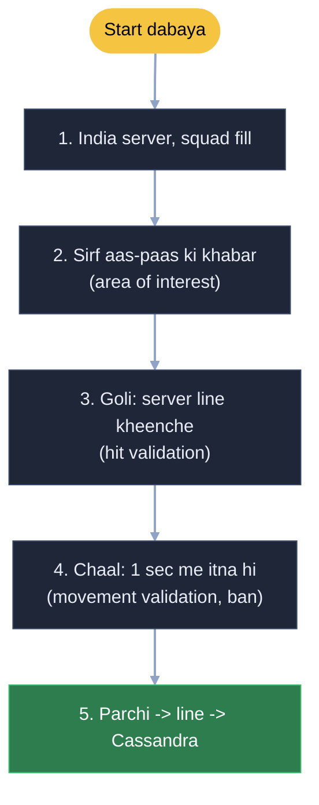

# PUBG: Arpan aur Claude ka squad, Pochinki se chicken dinner tak

Arpan aur Claude ek squad me hain. Plane se Pochinki me utre, Claude ke haath me shotgun. Raat 9 baje India me lakhon
log khel rahe, ek match me 100 log, 8 km x 8 km ka naksha. Kaam: sahi logon ko ek match me jodo, har phone ko sirf
uske kaam ki khabar do, goli aur chaal ka faisla server kare (hacker na jeete), aur match khatam hone pe lakhon ka
hisaab DB ko na giraye.

Har kadam = **kahani** (dikkat aur hal, bolne wali bhasha) -> **Asli naam** (interview me yahi shabd) -> tasveer.

**Uber se aaya:** naksha dabbon me kata (geohash) = kadam 2 ka aas-paas ka gola · map pe gudda andaze se chalana
(dead reckoning, [Uber kadam 16](../15_uber/15_uber.md)) = yahan dushman smooth chalta dikhna · "Koramangala se 1
second me Whitefield namumkin" = kadam 4. Neeche sirf naya.

---

## Pehle ye (padhai: online game andar se kaise chalta)

Ye hissa scene-mock se pehle samjhaya tha, interview me "goli kaise lagti hai" pooche to yahi kahani.

- **Faisla server ka:** tu trigger dabata hai to phone bas itna bhejta: "maine is waqt, is disha me goli chalayi".
  Lagi ya nahi, server referee ki tarah tay karta. Phone khud bole "headshot laga" to hacker har goli headshot bata de.
- **Goli udti dikhna = phone ka cartoon:** asli hisaab (goli kitni tez, kitni neeche giri, raaste me kaun aaya)
  server pe; screen pe sirf animation.
- **Dushman smooth chalta dikhe:** server second me (maan lo) 20-30 baar sabki jagah bhejta, beech ka hissa phone andaze se
  bharta. Wahi Uber wala gudda; dushman achanak kood jaaye to wahi U-turn wali kood.
- **Lag:** tera net 100 ms peeche. Tune jahan dushman dekh ke maara, wo 100 ms pehle wahan tha. Server ghadi peeche
  ghuma ke dekhta goli chalne ke pal wo kahan tha (lag compensation). Leaderboard ke event time jaisa: kaam kab hua,
  khabar kab pahunchi nahi. Isliye kabhi deewar ke peeche chhup ke bhi mar jaate ho.
- **Jagah UDP pe:** purani jagah raaste me kho gayi to dobara mangwane ka fayda nahi, nayi aa hi rahi (Uber: sach
  wahi jo abhi aaya).

---

## FR / NFR / Numbers (interview me pehle 2 minute)

Pehli line interviewer ko: "Main poora PUBG (skins, shop, login) nahi, ye cheezein solve karunga: match me jodna,
match ke andar khel, goli aur chaal ka faisla, aur match ke baad ka hisaab. Design India ke servers tak." Neeche har
line ke saath kadam number.

```
FR      1  "Start" dabao to 100 logon ke match me jodo, 4-4 ke squad          -> kadam 1
        2  match me aas-paas ke log, goli, awaaz dikhe / sunai de               -> kadam 2
        3  goli lagi ya nahi, sar pe lagi to headshot                           -> kadam 3
        4  match khatam: kills, damage, rank points save                        -> kadam 5

NFR     1  ping kam (India wala India ke server pe)                             -> kadam 1
        2  phone garam na ho, data na jale                                      -> kadam 2
        3  hacker na jeete: faisla server ka                                    -> kadam 3, 4
        4  match khatam hone pe DB na ghute, agla match turant                  -> kadam 5

Numbers raat 9 baje lakhon log · ek match 100 log, 8 km x 8 km
        · server second me (maan lo) 20 baar sabki jagah -> 100 x 99 khabar har baar, sabko sab nahi bhej sakte
        · raat 10 baje hazaron match ek saath khatam -> lakhon likhai ek pal me
```

Trade-off jo bolne hain: door ki khabar nahi aati (par door ka dikhna hi nahi chahiye) · server har goli check karta
(server pe kaam zyada, par hacker ki nahi chalti) · rank points thodi der se dikhte (DB bachane ke liye).

---

## 1. America ka ladka Arpan ke match me, aur akele ka kya (region + squad fill)

Raat 9 baje 1 lakh log ek saath "Start" dabate hain. Arpan ke match me abhi 37 log hain, tabhi America se ek ladka
aaya jiska Mumbai server tak ping (maan lo) 300 ms hai. America wala ladka America ke server pe jaayega, uska yahan matlab nahi;
design India tak, India ke servers pe. PUBG me log 4-4 ke squad me baithte: tere 4 dost hain to tere 4 jud jaayenge.
Akela hai to kisi aise squad me daal do jahan 3 log pehle se hain. 4 zaroori bhi nahi, 2 ya 3 ka squad bhi match shuru
kar sakta. Raat 3 baje 37 pe atka match: matchmaking ki baat, main design ye nahi.

**Asli naam:** America wala America ke server pe = region-based matchmaking (har desh ka apna server, ping kam),
akele ko 3 wale squad me = squad fill, 2-3 ka squad bhi = flexible squad size.



## 2. Military Base ki har goli Arpan ke phone pe (sirf aas-paas ki khabar)

Match shuru. Server har second (maan lo) 20 baar sabki jagah sabko bhej raha: 100 logon ko 99-99 ki khabar. Arpan Pochinki ke
ghar me chhupa hai, 6 km door Military Base me 30 log lad rahe, aur unki har goli, har kadam Arpan ke phone pe aa
rahi. Phone garam, data jal raha. Ek khula taar rakho, phone mangwaye nahi, khabar apne aap aaye. Par 6 km door ki
awaaz PUBG me aati hi nahi. Goli chali to ek event bana; server dekhe kaun us jagah ke aas-paas hai, sirf unko bhejo.
Saamne wali building me goli chali to Arpan ko sunai de, Military Base wali nahi. Ye Uber jaisa hai: Arpan ke
aas-paas kya ho raha, wahi Arpan ke kaano me. Map pe bhi aas-paas ke log, door ke nahi.

**Asli naam:** khula taar = WebSocket / UDP connection (push), sirf aas-paas walon ko event = area of interest /
interest management (naksha dabbon me, Uber ke geohash jaisa; har player ko sirf apne aur pados ke dabbon ki khabar).



## 3. Hacker ka phone bole "meri goli lagi" (faisla server ka)

Hacker ka phone server ko bolta "meri goli Arpan ko lagi", jabki goli deewar pe lagi ya Arpan se 5-6 meter door.
Server ne phone ki baat maan li to wo sabko maar dega, wahi king. Faisla server karega ki goli kisko, kab, kahan lagi.
Goli kahan se chali, beech me deewar to nahi? Arpan 5 minute se ek hi jagah saanp ban ke chhupa tha; goli chalne se
lagne tak wahin tha, aur goli 5-6 meter door lagi, thoda idhar-udhar karo to bhi nahi lagti. To Arpan nahi marega.
Aur maan lo baagi Arpan ne Claude ko goli maari: server ek seedhi line kheenchta, Claude us line pe tha? Claude ka
gudda bana ke dekha goli kahan lagi: upar lagi to headshot, neeche to "Arpan killed Claude".

**Asli naam:** server line kheenche, deewar dekhe, gudda bana ke dekhe = server-side hit validation (raycast: goli ki
line, beech me deewar, player ka hitbox), sar / body / pair alag = hitbox. Phone sirf "is disha me goli chalayi" bhejta.

## 4. Hacker 1 second me 500 meter (chaal bhi server jaanche)

Hacker ki goli imaandaar thi. Dikkat ye ki wo 1 second me 500 meter daud ke Arpan ke peeche pahuncha; phone ne bas bola
"main ab Arpan ke peeche hoon". 500 meter to PUBG me ek poori jagah, poora School paar. Server ke paas pichhli jagah
hai: 1 second baad player ya to wahin hoga ya aas-paas. Jaise Koramangala me khadi gaadi 1 second baad Whitefield nahi
pahunch sakti. To ye update phenk do, ye bot hai ya hacker; is baar ghus gaya to uski koi baat mat maano, agli baar
match me ghusne hi mat do.

**Asli naam:** pichhli jagah se 1 second me itna hi = server-side movement validation (speed ki had, namumkin chaal
reject), update phenko = server ki jagah sach, agli baar ghusne mat do = anti-cheat ban.



## 5. Chicken dinner ke baad DB ghut gaya (parchi, line, Cassandra)

"Winner winner chicken dinner." Raat 10 baje hazaron match lagbhag ek saath khatam, lakhon players ke kills, damage,
rank points ek pal me DB pe. DB ghut gaya, Arpan ki screen pe "Rank points updating..." 2 minute se. Har cheez turant
DB pe kyun? Docs wala scene: har click pe DB pe mat jao. Match ke beech parchi pe likho "Arpan ne itna kiya, Claude ne
itna" (Claude bechara mar gaya), match khatam ho to ek saath. Lakh match = lakh parchi, parchi kho jaaye to uski copy
rakho; phir parchiyan le jao aur dheere-dheere DB me bharo, DB pe achanak bojh nahi. DB aisa jo likhai dhadadhad pel
de: Cassandra, kyunki yahan paise jaisi pakki consistency nahi chahiye, wo kaam server dekh raha.

**Asli naam:** match ke beech parchi, end me ek saath = game server memory me jama, match end pe batch · parchi line me
+ copy, phir DB = queue (Kafka) + async write, copy = durable queue (Arpan ko DB ka intezaar nahi, agla match turant) ·
likhai dhadadhad = write-heavy DB (Cassandra).



---

## Wrap (ek nazar me)



---

Notes (Arpan ke shabd) = [PUBG_HAND_NOTES.md](PUBG_HAND_NOTES.md)
