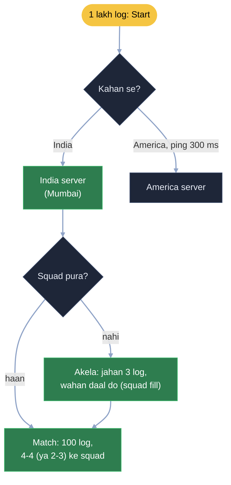
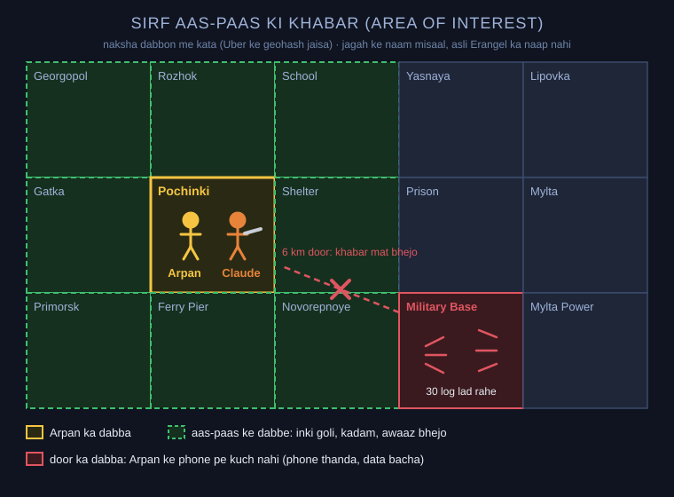
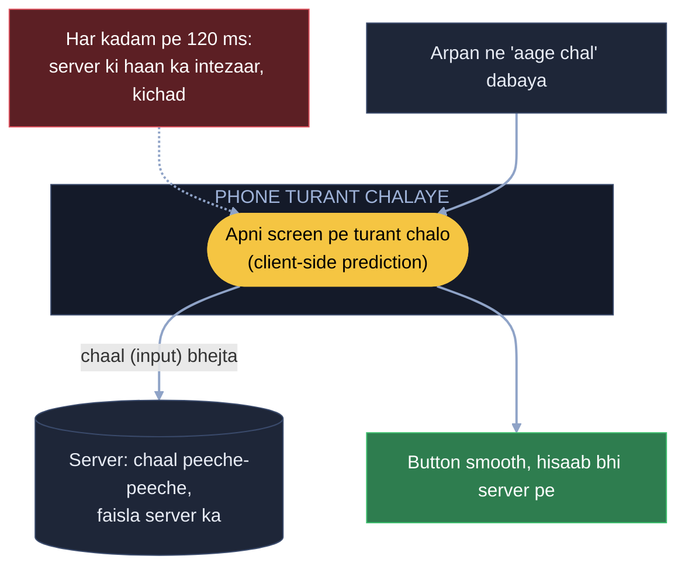
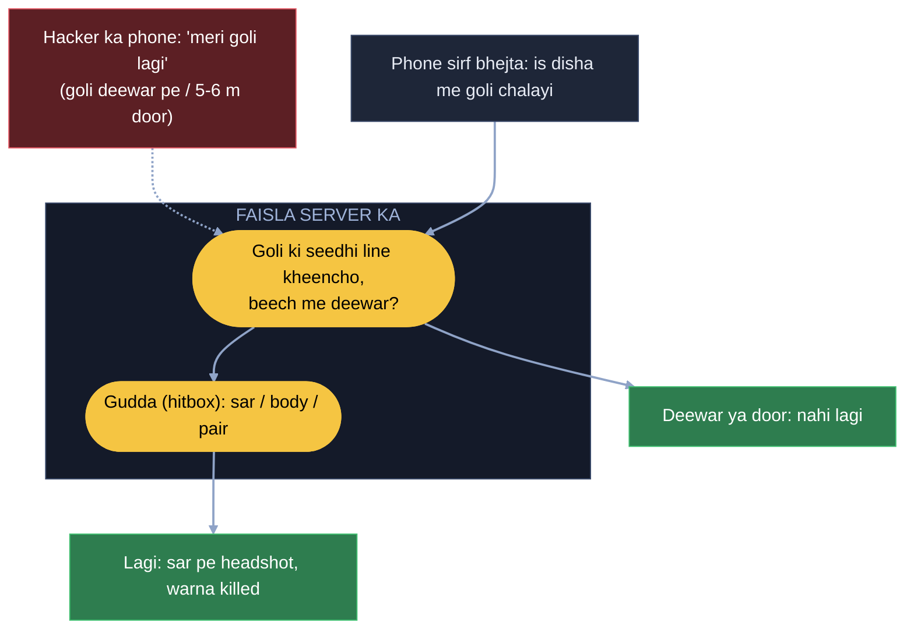
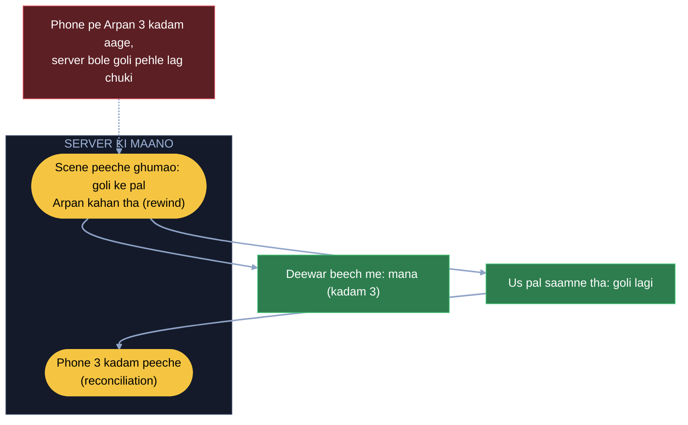
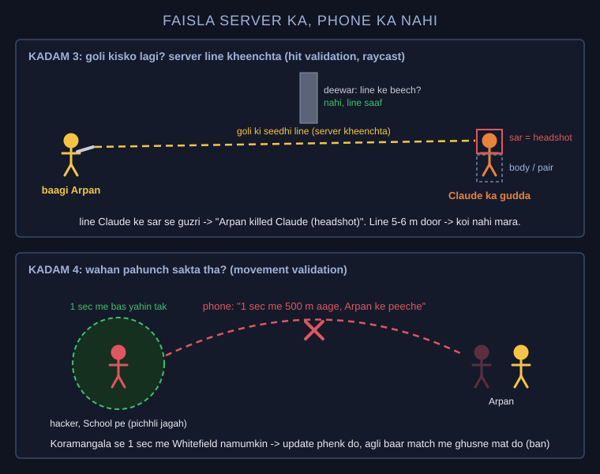
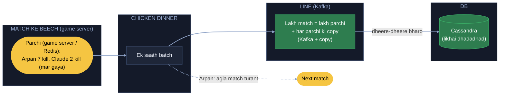
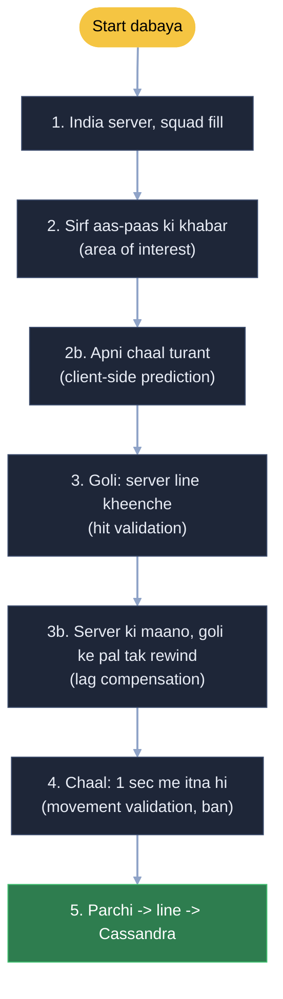
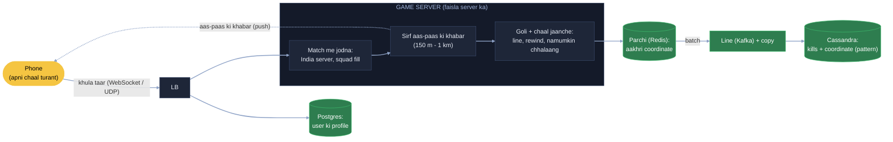

# PUBG: Arpan aur Claude ka squad, Pochinki se chicken dinner tak

Arpan aur Claude ek squad me hain. Plane se Pochinki me utre, Claude ke haath me shotgun. Raat 9 baje India me lakhon
log khel rahe, ek match me 100 log, 8 km x 8 km ka naksha. Kaam: sahi logon ko ek match me jodo, har phone ko sirf
uske kaam ki khabar do, goli aur chaal ka faisla server kare (hacker na jeete), aur match khatam hone pe lakhon ka
hisaab DB ko na giraye.

Har kadam = **kahani** (dikkat aur hal, bolne wali bhasha) -> **Asli naam** (interview me yahi shabd) -> tasveer.

**Uber se aaya:** naksha dabbon me kata (geohash) = kadam 2 ka aas-paas ka gola · map pe gudda andaze se chalana
(dead reckoning, [Uber kadam 16](../15_uber/15_uber.md)) = yahan dushman smooth chalta dikhna · "Koramangala se 1
second me Whitefield namumkin" = kadam 4. Neeche sirf naya.

---

**Ek nazar: dhaancha + dikkat chain (round me sabse pehle ye, phir FR / NFR isi se):**
```
Phone  -->  khula taar (WebSocket / UDP)  -->  LB  -->  India ka game server (ek match, 100 log)
                                                   |
             match me jodna:                       |   India wala India server pe, squad fill
             khel ke beech:                        |   sirf aas-paas ki khabar
                                                   |   apni chaal phone pe turant, faisla server ka
                                                   |   goli + chaal server jaanche (rewind karke)
             match khatam:                         |   parchi (game server / Redis) -> line (Kafka) -> Cassandra
                                                   v
             user ki profile:  Postgres (seedha SQL)

 1   America ka ladka Mumbai match me, ping 300    ->  America wala America server pe; akela 3 wale squad me (region matchmaking, squad fill)
 2   100 logon ko 99-99 ki khabar, phone garam     ->  khula taar + sirf aas-paas walon ko (WebSocket / UDP, area of interest)
 2b  har kadam pe 120 ms, kichad me chalna         ->  player turant apni screen pe chale, server peeche hisaab kare (client-side prediction)
 3   hacker ka phone bole "goli lagi"              ->  server line kheenche, deewar, gudda (hit validation, hitbox)
 3b  phone pe 3 kadam aage, server bole ruk gaya   ->  server ki maano, 3 kadam peeche; goli ke pal tak rewind (reconciliation, lag compensation)
 4   1 second me 500 meter                         ->  Koramangala se Whitefield namumkin, phenk do, ban (movement validation)
 5   chicken dinner pe lakhon likhai, DB ghuta     ->  match me parchi, end pe line + copy, dheere DB (batch, Kafka, Cassandra)
```

**FR / NFR kahan se:** hawa se nahi aate. Upar ki dikkat chain dekh ke nikale; har FR / NFR line ke aage likha hai wo kis kadam ki dikkat se aayi.
Arpan: FR badhiya. Start dabane pe match me jodna, PUBG karta bhi hai. Match me aas-paas ke log, goli, gaadi chalegi, noise aayegi. Goli lagi to mara hua dikhao; sar pe lagi to headshot, kahin bhi lagi to dead dikhao. NFR me ping kam aayega. Phone garam na ho, ye NFR me nahi aayega: ye physical hardware ki dikkat hai, hatao. Hacker na jeete theek, match khatam hone pe DB theek. Har kadam pe 120 ms ka kichad: client-side prediction NFR me daal sakte. Phone pe 3 kadam aage, server bole ruk gaya, goli ke pal tak peeche: ye bhi NFR me aa sakta. Chicken dinner NFR me nahi, wo PUBG ka khaas hai. 1 second me 500 meter namumkin, wo hacker wale me aa gaya.
Technical me: "button dabate hi chale" = low input latency (client-side prediction), "goli ke pal tak peeche" = fair hit registration (lag compensation), "faisla server ka" = server authoritative.

## FR / NFR / Numbers (interview me pehle 2 minute)

Pehli line interviewer ko: "Main poora PUBG (skins, shop, login) nahi, ye cheezein solve karunga: match me jodna,
match ke andar khel, goli aur chaal ka faisla, aur match ke baad ka hisaab. Design India ke servers tak." Neeche har
line ke saath kadam number.

```
FR      1  "Start" dabao to 100 logon ke match me jodo, 4-4 (ya 2-3) ke squad   -> kadam 1
        2  match me aas-paas ke log, goli, gaadi, awaaz dikhe / sunai de        -> kadam 2
        3  goli lagi ya nahi; sar pe lagi to headshot, kahin bhi lagi to dead   -> kadam 3
        4  match khatam: kills + aakhir tak bachi team (winner) save             -> kadam 5

NFR     1  ping kam (India wala India ke server pe)                             -> kadam 1
        2  button dabate hi player chale, kichad jaisa na lage                  -> kadam 2b
        3  hacker na jeete: faisla server ka                                    -> kadam 3, 4
           (pehle interviewer se poochho: hacker ka case chahiye? chahiye to beech match me kya karna)
        4  goli ka faisla insaaf se: goli ke pal jo saamne tha use lagi         -> kadam 3b
        5  match khatam hone pe DB na ghute, agla match turant                  -> kadam 5

Numbers raat 9 baje lakhon log · ek match 100 log, 8 km x 8 km
        · server second me (maan lo) 20 baar sabki jagah -> 100 x 99 khabar har baar, sabko sab nahi bhej sakte
        · raat 10 baje hazaron match ek saath khatam -> lakhon likhai ek pal me
```

Trade-off jo bolne hain: door ki khabar nahi aati (par door ka dikhna hi nahi chahiye) · server har goli check karta
(server pe kaam zyada, par hacker ki nahi chalti) · match ka hisaab thodi der se dikhta (DB bachane ke liye).

**Isi pe ek aur raasta (round me: FR / NFR, numbers, dhaancha):**
```
FR       sabse pehle 4-4 ka squad bane aur log pelam pel khelein; India ke log India ke server pe, China ke China
         pe, Australia ke Australia pe.
         "Start" dabate hi match chale.
         Gaadi me baithe to gaadi ki awaaz, goli chali to goli ki, par aas-paas ki.
         Maine opponent ko goli maari to wo mare; headshot maara to dikhe "you killed this enemy by headshot".

NFR      ping kam; guddi chala rahe to guddi chalta dikhe, gaadi chala rahe to gaadi; lag kam.
         "Server ye kare, wo kare" NFR me nahi bol sakte, wo peeche ka scene hai.
         "Phone kam MB / GB me chale" bhi nahi, phone ki jitni memory utni wo lega hi.

Numbers  kul 1 crore user, roz ~5 million khelte (5 million sweet spot; roz 1 crore bahut zyada).

Dhaancha client ka phone PUBG ke server pe jaata hai.
         Yahan main cheez client hai: client ne guddi chalaya to guddi aage, gaadi chalayi, goli maari; aur
         server decide kare kisne kya kiya.
         Kaafi saare server, aage LB.
         Dono taraf taar khula chahiye, isliye WebSocket.
         CDN ka socha, par design me koi aapatti nahi kar raha, isliye nahi liya.
         AWS ka CDN to har jagah chalta hi hoga.

DB       likhai bahut (har goli, har kadam ke coordinate, America, India, China, Australia sab jagah), isliye
         Cassandra pehli pasand.
         User ki profile ke liye seedha SQL, Postgres jaisa.
         Kuch rakhna pada to Redis cache.
```
**Asli naam:** "dono taraf khula taar" = WebSocket, "likhai bahut" = write-heavy DB (Cassandra), "profile" =
relational DB (Postgres), "kuch rakhna pade" = cache (Redis).

**API (round me):**
Arpan (API): Match shuru = POST (Start dabaya, match me jodo). Match ke andar har baar POST nahi: ek baar khula taar (WebSocket), phir guddi chala, goli chali jaise chhote message coordinate ke saath jaate; server unse line banata. Headshot laga, kaun mara, ye phone nahi bhejta, server tay karta; warna hacker khud bol dega "maine maara". Server se jo aata (ping, aas-paas ki khabar), wo server khud bhejta. Wahi chaal / goli wale message server peeche logs / DB me likhta, hacker ka pattern wahin se. Match khatam (winner winner chicken dinner): GET match ke result.
```
API     POST /matchmaking          -> "Start" dabaya, 100 ke match me jodo, squad bhar do       (FR 1, kadam 1)
        match ke andar REST nahi, khule taar (WebSocket / UDP) pe chhote message:
             phone -> server  chaal {kahan, kis disha}  -> server line banaye, jagah tay      (FR 2, kadam 2b, 4)
             phone -> server  goli  {kahan se, disha}   -> server line kheench ke jaanche     (FR 3, kadam 3, 3b)
             server -> phone  aas-paas ki khabar, kaun mara, headshot (server khud push)      (FR 2, 3, kadam 2)
        GET  /matches/{id}/result  -> chicken dinner: kills + aakhri bachi team               (FR 4, kadam 5)
```

---

## 1. America ka ladka Arpan ke match me, aur akele ka kya (region + squad fill)

Raat 9 baje 1 lakh log ek saath "Start" dabate hain. Arpan ke match me abhi 37 log hain, tabhi America se ek ladka
aaya jiska Mumbai server tak ping (maan lo) 300 ms hai. America wala ladka America ke server pe jaayega, uska yahan matlab nahi;
design India tak, India ke servers pe. PUBG me log 4-4 ke squad me baithte: tere 4 dost hain to tere 4 jud jaayenge.
Akela hai to kisi aise squad me daal do jahan 3 log pehle se hain. 4 zaroori bhi nahi, 2 ya 3 ka squad bhi match shuru
kar sakta. Raat 3 baje 37 pe atka match: matchmaking ki baat, main design ye nahi.

**Asli naam:** America wala America ke server pe = region-based matchmaking (har desh ka apna server, ping kam),
akele ko 3 wale squad me = squad fill, 2-3 ka squad bhi = flexible squad size.



## 2. Military Base ki har goli Arpan ke phone pe (sirf aas-paas ki khabar)

Match shuru. Server har second (maan lo) 20 baar sabki jagah sabko bhej raha: 100 logon ko 99-99 ki khabar. Arpan Pochinki ke
ghar me chhupa hai, 6 km door Military Base me 30 log lad rahe, aur unki har goli, har kadam Arpan ke phone pe aa
rahi. Phone garam, data jal raha. Ek khula taar rakho, phone mangwaye nahi, khabar apne aap aaye. Par 6 km door ki
awaaz PUBG me aati hi nahi. Goli chali to ek event bana; server dekhe kaun us jagah ke aas-paas hai, sirf unko bhejo.
Saamne wali building me goli chali to Arpan ko sunai de, Military Base wali nahi. Ye Uber jaisa hai: Arpan ke
aas-paas kya ho raha, wahi Arpan ke kaano me. Map pe bhi aas-paas ke log, door ke nahi.

**Asli naam:** khula taar = WebSocket / UDP connection (push; jagah UDP pe: purani jagah kho gayi to dobara nahi mangwate, nayi aa hi rahi), sirf aas-paas walon ko event = area of interest /
interest management (naksha dabbon me, Uber ke geohash jaisa; har player ko sirf apne aur pados ke dabbon ki khabar).



**Maan lo aas-paas kitna:** 500-800 meter, bahut hua to 1 km; door ki goli / bomb nahi.
**Asli naam:** AOI radius.

**Isi pe ek aur raasta (round me: 150-200 meter):** Poore map se awaaz nahi aa sakti, awaazon ka bombardment ho
jaayega, phone 2 minute me garam. Arpan ko uske aas-paas 150 se 200 meter ke beech ki awaaz aani chahiye; 1 km bahut
bada area ho jaayega.

## 2b. Har kadam pe 120 ms, kichad me chalna (apni chaal turant)

Arpan ka phone Mumbai server se 60 ms door hai, jaana-aana 120 ms. Arpan "aage chal" dabata, phone server ko batata,
server "haan" bole tab player chalta: har kadam pe 120 ms ki der, jaise kichad me chal raha ho. Server door bhi ho sakta,
isliye client side hi kar lo: player ko turant apni screen pe chala do, jaise Zomato me gudda chalta dikhta. Phone apni
chaal server ko bhejta rehta, server peeche-peeche apna hisaab chalata aur aakhri jagah pakad leta. Seedhi line ho ya
idhar-udhar, exact nahi par andaza aaram se. Player ka button smooth, server ka hisaab bhi chalta.

**Asli naam:** player turant apni screen pe chale, server ka intezaar nahi = client-side prediction, phone apni chaal
(input) bhejta aur faisla server ka = server authoritative.

**Isi pe ek aur misaal (round me: server ko guddi nahi dikhta):**
- Screen pe lagta hai guddi bhaag raha, par server ko guddi-puddi nahi dikhta.
- Wo lines dekh raha, ping dekh raha: kahan se ping aaya, uske hisaab se react karta.
- Jaise Zomato me bike chalti dikhti hai, asal me bike thodi chal rahi, animation hai; server number se, ping se baat
  karta.
- Client guddi chalata hai to peeche ek chhoti line chalti jo na client ko dikhti na kisi aur ko, sirf server dekhta.
- Ping me 150-200 ms lagte, to server ke hisaab se tu yahan khada, asal me thoda aage.
- Mudne pe Zomato ke driver jaisa: server andaza lagata, kabhi seedha nikal ke wapas aata.



## 3. Hacker ka phone bole "meri goli lagi" (faisla server ka)

Hacker ka phone server ko bolta "meri goli Arpan ko lagi", jabki goli deewar pe lagi ya Arpan se 5-6 meter door.
Server ne phone ki baat maan li to wo sabko maar dega, wahi king. Faisla server karega ki goli kisko, kab, kahan lagi.
Goli kahan se chali, beech me deewar to nahi? Arpan 5 minute se ek hi jagah saanp ban ke chhupa tha; goli chalne se
lagne tak wahin tha, aur goli 5-6 meter door lagi, thoda idhar-udhar karo to bhi nahi lagti. To Arpan nahi marega.
Aur maan lo baagi Arpan ne Claude ko goli maari: server ek seedhi line kheenchta, Claude us line pe tha? Claude ka
gudda bana ke dekha goli kahan lagi: upar lagi to headshot, neeche to "Arpan killed Claude".

**Asli naam:** server line kheenche, deewar dekhe, gudda bana ke dekhe = server-side hit validation (raycast: goli ki
line, beech me deewar, player ka hitbox), sar / body / pair alag = hitbox. Phone sirf "is disha me goli chalayi" bhejta.

**Isi pe ek aur misaal (round me: hamari goli bas animation):** Arpan ne enemy ko dekh ke goli chalayi. Server seen
recreate karta: jahan se goli chali wahan se seedhi line us guddi tak; beech me deewar to nahi, player chhupa to nahi.
Goli seedhi uske sar pe lagi = turant headshot. Hamari goli kuch nahi karti, bas animation hai; jo chala wo sab server
ne kiya. Guddi wahan khada nahi hota to goli miss, koi dikkat nahi.



## 3b. Phone pe 3 kadam aage, server bole goli pehle lag chuki (server ki maano, rewind)

Phone ne Arpan ko turant 3 kadam aage dikha diya. 120 ms baad server ka jawab: us pal se pehle Claude ki goli lag chuki
thi, Arpan ruk gaya tha. Maano server ki, wahi sach hai: 3 kadam aage chale to 3 kadam peeche. Claude ne Arpan ko
dekha, Arpan uske dekhne ke baad aage badh gaya, aur Claude ne goli chalayi. Server scene recreate karta: goli kahan se
chali, Arpan us waqt kahan tha. Server Arpan ko (delay jitna) peeche karke dekhta; us pal Arpan goli ke saamne tha to
goli lagi, bhale wo aage chala gaya. Isi se kabhi bhaag ke deewar ke peeche pahunch ke bhi mar jaate ho (PUBG, GTA,
bahut game me). Server ki aankhen nahi, wo ping se baat karta. Goli deewar pe lagti to server mana karta (kadam 3).

**Asli naam:** server ki maano, 3 kadam peeche = server reconciliation, jhatke se peeche = rubber banding, server
scene peeche ghuma ke dekhe = lag compensation (server rewind, goli wale ke ping jitna),
deewar ke peeche marna iska asar, corner se nikal ke maarne wale ko fayda = peeker's advantage.

**Isi pe ek aur misaal (round me: dost aage nikal gaya phir bhi mara):** Dost chal ke ja raha tha, saamne se goli
aayi, wo 1-2 second aage nikal chuka tha phir bhi mar gaya. Kyunki goli chali to server ne scene dobara banaya aur
dekha dost aakhri baar kahan khada tha; wahin goli lagi. Server dobara chala ke dekhta hai, isliye aage nikal ke bhi
mar jaate.



## 4. Hacker 1 second me 500 meter (chaal bhi server jaanche)

Kadam 3 wala wahi hacker agle match me phir aaya. Is baar uski goli imaandaar thi. Dikkat ye ki wo 1 second me 500
meter daud ke Arpan ke peeche pahuncha; phone ne bas bola "main ab Arpan ke peeche hoon". 500 meter to PUBG me ek
poori jagah, poora School paar. Server ke paas pichhli jagah
hai: 1 second baad player ya to wahin hoga ya aas-paas. Jaise Koramangala me khadi gaadi 1 second baad Whitefield nahi
pahunch sakti. To ye update phenk do, ye bot hai ya hacker; is baar ghus gaya to uski koi baat mat maano, agli baar
match me ghusne hi mat do.

**Asli naam:** pichhli jagah se 1 second me itna hi = server-side movement validation (speed ki had, namumkin chaal
reject), update phenko = server ki jagah sach, agli baar ghusne mat do = anti-cheat ban.

**Isi pe ek aur raasta (round me: ping chhoot gaya to):**
- Pochinki se School 5-6 minute ka raasta, ye 1 second me pahunch gaya.
- Case 1, server ne dekh liya: iske liye pattern nahi chahiye, server khud pakad lega: pehla ping Pochinki se, doosra
  School se = namumkin, hacker. Server ne poora raasta dekha to wo maanega hi nahi; hum hote to Arpan ko marne nahi
  dete, kill nullify, count nahi hoga.
- Case 2, server andha: maan lo beech me kuch millisecond ke liye server andha ho gaya (busy tha, ping late aaya ya
  aaya hi nahi): use chhalaang dikhi hi nahi. Hacker School me aaram se chal ke 10 meter andar khade Arpan ke peeche
  gaya aur maar diya, to server ko ye theek khela lagega.
- Pehli soch: server ko pata lagne tak ho sakta hai hacker Arpan ko maar bhi de aur Arpan mar bhi jaaye. Par sab logs
  me likha ja raha; isse hamare paas pattern aa gaya (logs, Cassandra me); wo save kar lenge, aur agli baar us hacker
  ko match se disqualify. Baad me dekhenge: uske kills radd, agle din phir aaya to phir radd, kuch din baad match me
  ghusne hi mat do.
- PUBG asal me kya karta (nullify ya ban), wo unke docs me hoga, mujhe nahi pata.
**Asli naam:** "server khud pakde, maane hi nahi" = server-side movement validation (server authoritative), "ping
chhoota to chhalaang dikhi hi nahi" = packet loss se beech ka gap, "baad me logs dekh ke radd + ban" = offline cheat
review + ban.



## 5. Chicken dinner ke baad DB ghut gaya (parchi, line, Cassandra)

"Winner winner chicken dinner." Raat 10 baje hazaron match lagbhag ek saath khatam, lakhon players ke kills aur
winner ek pal me DB pe. DB ghut gaya, Arpan ki screen pe "Result updating..." 2 minute se. Har cheez turant
DB pe kyun? Docs wala scene: har click pe DB pe mat jao. Match ke beech parchi pe likho "Arpan ne itna kiya, Claude ne
itna" (Claude bechara mar gaya), match khatam ho to ek saath. Lakh match = lakh parchi, parchi kho jaaye to uski copy
rakho; phir parchiyan le jao aur dheere-dheere DB me bharo, DB pe achanak bojh nahi. DB aisa jo likhai dhadadhad pel
de: Cassandra, kyunki yahan paise jaisi pakki consistency nahi chahiye, wo kaam server dekh raha.

**Asli naam:** match ke beech parchi, end me ek saath = game server memory me jama, match end pe batch · parchi line me
+ copy, phir DB = queue (Kafka) + async write, copy = durable queue (Arpan ko DB ka intezaar nahi, agla match turant) ·
likhai dhadadhad = write-heavy DB (Cassandra).

**Isi pe ek aur raasta (round me: coordinate kyun likhein):**
- Cassandra me aise hi kuch bhi nahi likh dete.
- Likhai isliye bahut, kyunki hacker ek din me nahi pakda jaata, pattern chahiye: ek second me Koramangala, agle
  second Whitefield, namumkin.
- Sirf aakhri coordinate likha to ye pata hi nahi chalega.
- Har user ko seedha DB pe nahi likhwaana: pehle parchi (Redis) me "iska aakhri coordinate ye", jaldi milta; phir
  Kafka me batch, line lagwa ke Cassandra.
- Match khatam pe har kisi ke stats nahi chahiye, damage / rank points kuch nahi; sirf kills (Arpan ne 4, isne 8, usne
  9) aur aakhir tak kaunsi team bachi, wahi winner.
- Damage ka matlab nahi, heal lagake aadmi theek ho jaata. Rank = world leaderboard wali, bahut saare match khel ke
  bani; har match me hum kills hi dekhte, aur aakhir me jo team bachi wo jeeti.
- Coordinate sirf pattern ke liye, taaki hacker dikhe aur game sudhaar sakein.
**Asli naam:** "parchi -> line -> Cassandra" = Redis + Kafka batch writes, "kai din ka pattern dekh ke hacker" =
offline cheat detection (poora raasta log, baad me analytics).



---

## Wrap (ek nazar me)



---

## Poora dhaancha ek nazar me



---

Notes (Arpan ke shabd) = [PUBG_HAND_NOTES.md](PUBG_HAND_NOTES.md)
