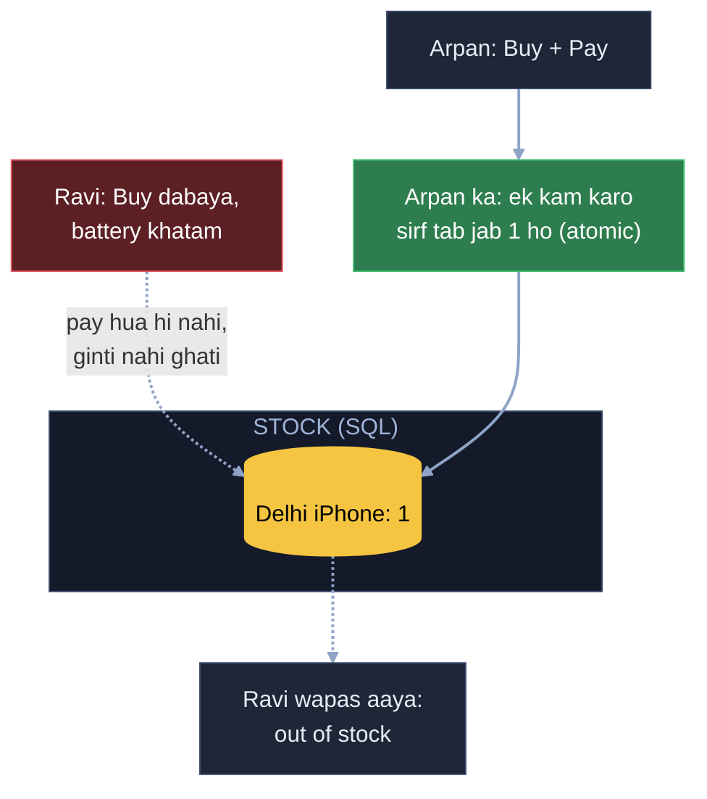
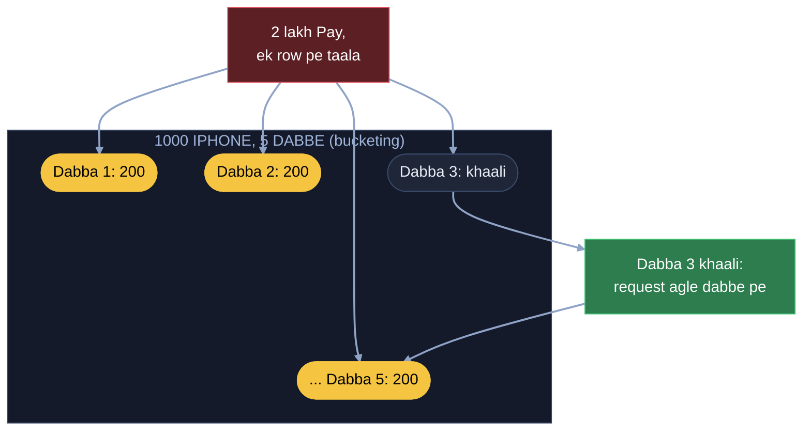
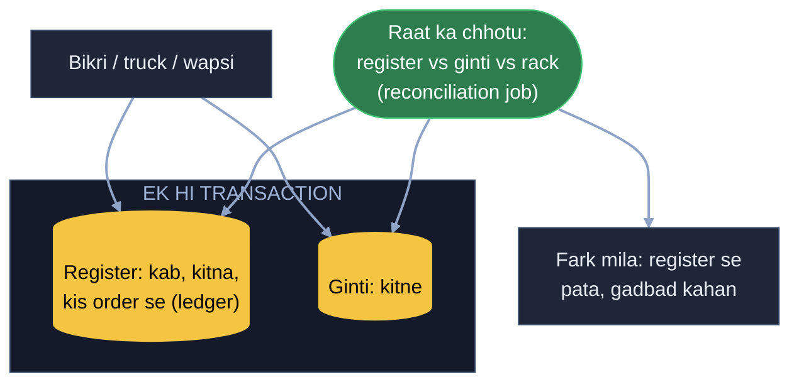
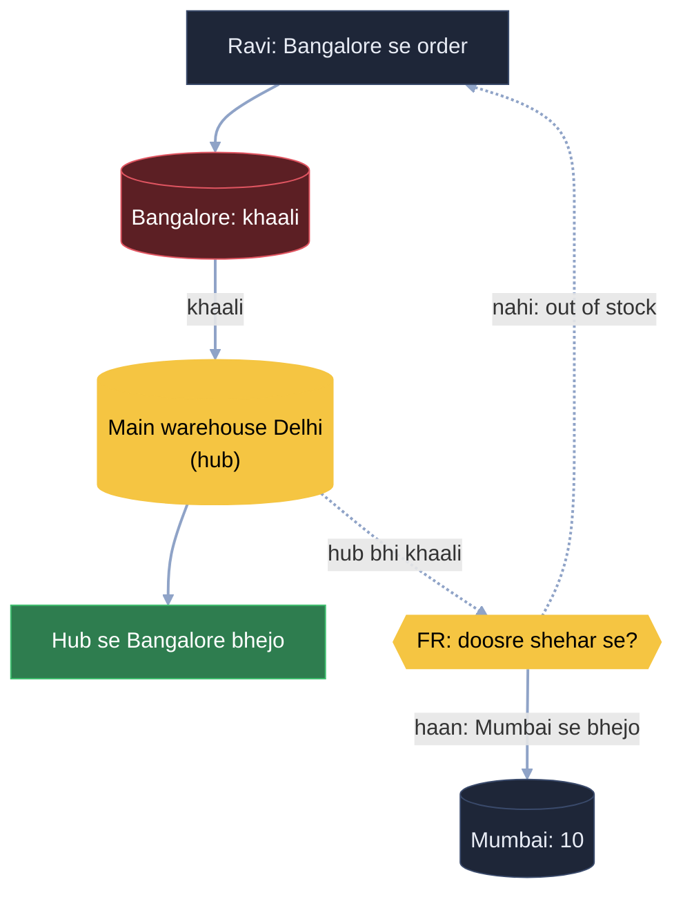
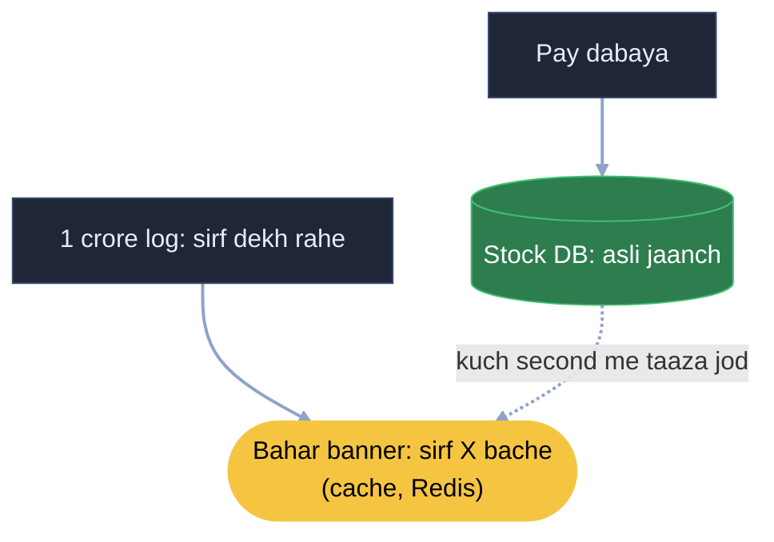
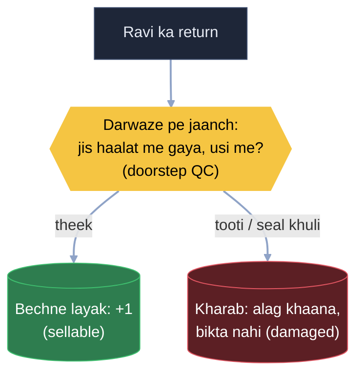
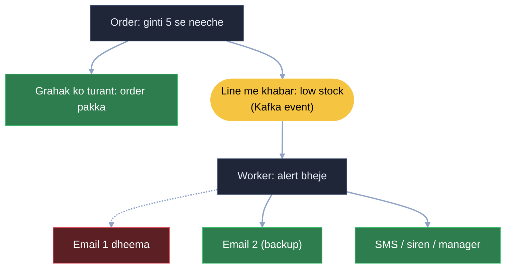

# Inventory system: Ravi ki online dukaan, teen godown ki kahani

Ravi ki Flipkart jaisi online dukaan hai. Maal teen godown me pada hai (Delhi, Mumbai, Bangalore) aur ek main warehouse
Delhi me. Inventory system ka kaam bas ek: har pal sach batana ki kaunsa maal, kis godown me, kitna pada hai. Ye galat
hua to do nuksaan: jo maal hai hi nahi wo bik gaya (overselling, refund, grahak naraaz), ya maal pada-pada sad raha aur
system bol raha "0".

Har kadam = **kahani** (dikkat aur hal, bolne wali bhasha) -> **Asli naam** (interview me yahi shabd) -> tasveer
(kahani ka shabd, bracket me asli naam).

E-com se aaya: wahan "cart sirf list hai, ginti pay pe" aur "counter khaali to doosra counter" padha tha. Yahan wahi
ginti apne aap me poora system hai, saare godown ke saath.

---

## FR / NFR / Numbers (interview me pehle 2 minute)

```
FR      maal aaya to ginti badhao · order pe ghatao (jitna sach me hai) · cancel / wapsi pe badhao
        · kabhi bhi "kitne, kahan" · kam ho to alert
NFR     ginti me galti nahi (pakka na ho to "abhi nahi", galat "haan" nahi) · dekhne me thoda purana chalega,
        ghatana ekdum sahi · har badlaav ka hisaab
Numbers product lakhon, godown kuch hi · aam din ek product pe second me 1-2 order
        · sale ke din ek iPhone pe second me hazaaron "Pay", sab ek hi row pe
```

**Faisla FR se:** yahan consistency availability se upar. Order ke waqt pakka na ho ki maal hai, to "abhi nahi" bolna
behtar, galat "haan" bolne se. Par product page pe "sirf 3 bache" thoda purana chalega, asli jaanch Pay pe.

---

## 1. Battery khatam, payment hua hi nahi (ginti Pay pe, ek hi kaam me)

Ravi ne Delhi ke aakhri iPhone pe "Buy" dabaya, payment page pe pahunchte hi phone ki battery khatam. Payment hua nahi
matlab wo cheez uske cart me hi hai, kharidi nahi gayi. Cart me daalne ka matlab ye nahi ki product kharid liya; jab
tak pay nahi karoge, maal tumhara nahi. Isi waqt Arpan ne app khola, iPhone dabaya aur pay kar diya, to iPhone Arpan
ka. Ravi wapas aayega to use out of stock dikhega, jo hota bhi hai aur aam baat hai.

Aur ghatana ek hi kaam me: "ek kam karo, sirf tab jab kam se kam 1 ho". Pehle padhna, phir sochna, phir likhna alag
kaam kiye to do log ek saath "1 bacha hai" padh lenge aur ek iPhone do ko bik jaayega. Banking me "check aur update ek
saath" jaisa hi.

**Asli naam:** ginti payment pe ghate, Buy pe nahi (koi reserve nahi). Ghatana = atomic conditional update:
`UPDATE stock SET qty = qty - 1 WHERE product = X AND godown = Y AND qty >= 1`. Ek row badli to order pakka, zero row
badli to "out of stock".

### DB kaunsa: SQL ya NoSQL?

Data kya: product, godown, kitne, aur har badlaav ki entry (kab, kitna, kis order se). Kaam kya: ginti ghatana bina
galti ke, "ek kam karo sirf tab jab 1 ho" ek hi baari me, aur ledger + ginti ek saath likhna. Iske liye transaction aur
row lock chahiye, jo SQL ki taakat hai. Isliye Postgres / MySQL. Product page pe padhne ki bheed cache sambhalega
(kadam 5), DB pe nahi aayegi.



## 2. Sale, ek row pe 2 lakh "Pay" (stock ko dabbon me baanto)

Diwali sale, raat 12 baje. Delhi me 1000 iPhone, ek second me 2 lakh log "Pay", sab ek hi row pe "ek kam karo". DB us
row pe taala laga ke ek-ek ko line me chalata hai, log 20 second se spinner dekh rahe. Ek counter pe lambi line lagi
hai aur itna saamaan hi nahi. To 1000 ko baant do, 5 line kar lo, har counter ka apna dabba: 200 ek jagah, 200 ek
jagah. Log apne dabbe se uthayenge. Sab ek hi dabbe se uthayenge to taala dobara ek hi jagah lag jaayega, isliye
alag-alag tukdon me baanto aur har counter apna dabba ghatata rahe.

**Asli naam:** ek row pe sab toot pade = hot row. Stock ko tukdon me baanto = bucketing / sharded counter (har tukda
alag row), taala ek row pe nahi lagta.

**Maan lo Ravi ki request dabba 3 pe gayi, wo khaali ho chuka, baaki dabbon me 150 pade:** out of stock tab dikhega
jab 1000 ke 1000 khatam, ek counter khatam hone pe nahi. Teesre counter pe ghee nahi bacha par baaki pe hai, to grahak
ko mana nahi karte; uski request khud doosre dabbe pe mod do. Grahak ko maal chahiye, use pata hi nahi wo kis dabbe me
hai.
**Asli naam:** khaali bucket -> request agle bucket pe, out of stock = saare bucket 0.



## 3. Rack pe 48, system me 50 (register + raat ka chhotu)

Mahine ke ant me manager rack pe ginta hai: 48 iPhone. System bolta 50. "Ye 2 kab gaye, kis order me, ya kabhi aaye hi
nahi?" Aur hamare paas sirf ek number, kitne = 50. To jaise-jaise iPhone bikta rahe, bill banta rahe, register me
likhte jao: Ravi ne ek iPhone liya, bill ban gaya, usi waqt system me bhi chadha do. Raat ko dukaan pe chhotu chhod
jao: "ye aaj ke bill hain, dekh kisne kya kharida aur system me kitne bache." Phir bhi kabhi fark aaya to register me
sab likha hai: 2 iPhone bike par likhe nahi gaye, ya likha kuch aur gaya. Gadbad dono taraf ho sakti hai, isliye
register hi sach batayega.

**Asli naam:** register = stock ledger (har badlaav ki entry: kab, kitna, kis order se; ginti badalna aur ledger me
likhna ek hi transaction me), raat ka chhotu = reconciliation job (ledger, ginti aur rack ki ginti ka milaan).



## 4. Bangalore khaali, Delhi aur Mumbai me maal (pehle apna shehar, phir main warehouse)

Ravi Bangalore me iPhone order karta hai. Bangalore godown khaali, Delhi me 50, Mumbai me 10. Ek main warehouse hota
hai; Amazon jaisi company ka maal asal me wahin se aata hai, phir chhote godown tak pahunchta hai. Pehle dekho Bangalore
me iPhone hai kya, hai to wahin se. Nahi to main warehouse dekho, wahan hai to wahan se utha ke Bangalore bhej do, Ravi
ko out of stock nahi dikhega. Mumbai ka iPhone Bangalore bhejna ya nahi, ye FR tay karega. FR bole "maal hai to order
poora karo", to Delhi ya Mumbai se bhejo. FR bole har shehar ka maal usi shehar ke liye, to main warehouse aur
Bangalore dono khaali hone pe out of stock dikha do, kyunki kal Mumbai me 10 log aaye to unke liye wahan maal rehna
chahiye.

**Asli naam:** main warehouse + shehar ke godown = hub and spoke, kahan se maal uthana = fulfilment / sourcing rule
(FR se tay: pehle paas wala godown, phir hub, phir doosra shehar sirf agar FR maange).



## 5. 1 crore log sirf dekh rahe (bahar banner)

Sale se ek din pehle iPhone ka page 1 crore log khol rahe, "sirf X bache". Har page khulne pe DB se saare dabbon ka jod
nikal raha. Order koi nahi, sirf log dekh rahe, phir bhi DB pe bojh. Log bas daam / ginti pata karke chale jaate,
dukaan me bheed aur faltu ka drama. To ek banner pe chhapwa ke bahar taang do, padh ke nikal jao, andar mat aao;
kharidna ho tab andar aao. Ya chhotu ko baar-baar andar bhejne ki jagah chhotu ek baar copy pe sab likh ke de de, aur
copy saamne khol ke bata do. Chhotu aaram se ice cream kha raha, DB pe koi nahi ja raha.

**Asli naam:** banner / copy = cache (Redis): "kitne bache" ka jod cache me, har kuch second taaza. Page pe thodi
purani ginti chalti hai (NFR 2), asli jaanch Pay pe DB me (kadam 1).



## 6. Return aate hi +1, tooti screen Priya ko bik gayi (jaanch darwaze pe)

Ravi ne iPhone return kiya, courier ne box godown pe chhoda, aate hi ginti +1. 10 minute me wahi iPhone Priya ko bika:
box khula, screen tooti. To jaanch wahin darwaze pe: delivery wale ko bol do jis haalat me gaya usi haalat me phone
chahiye. Phone khol ke dekho kaisa hai; kuch dikkat hai to return wahin reject. Inventory me maan lene ke baad nahi,
warna doosre user ko bik gaya to Priya naraaz. Badi company jhel le, chhoti company ke liye ye bahut badi dikkat. Ghee
ke dabbe jaisa: koi 2-3 ghante baad lautane aaya, seal khuli, thoda ghee nikla hua, to nahi lenge, use kisi ko bech
nahi sakte. Seal pack hai to lenge, nahi to nahi.

**Asli naam:** return pe doorstep quality check. Ginti sirf sellable stock me badhti hai, kharab maal alag khaane me
(damaged stock), wo bikta nahi.



## 7. 5 se kam, email dheema, har order 8 second atka (line lagwao, kai raaste)

Delhi me iPhone 5 se neeche, purchase team ko email jaana hai taaki naya maal mangaya jaaye. Email ka kaam order wali
request ke andar hi likha tha; email server dheema, sale ke din har order 8 second atka. Grahak ka order email ka
intezaar kyun kare: line lagwao, order turant poora, alert peeche se jaata rahe. Aur ek email service pe mat tiko, 2-3
rakho, ek dheema to doosre pe apne aap chala jaaye. Saath me godown me siren, SMS, store manager tak sabko alert; ek
darwaza band ho to doosre se ghuso.

**Asli naam:** line = Kafka me "low stock" event, worker alert bheje (async, order ko nahi rokta). Kai raaste =
multi-channel (email, SMS, siren) + backup email provider (failover).



---

## Wrap (2 minute me poora design)

Ginti Pay pe ghatti hai, ek hi kaam me ("ek kam karo sirf tab jab 1 ho"), SQL me. Sale ki bheed pe stock dabbon me
baanto, khaali dabba ho to agla dabba, out of stock tabhi jab sab khaali. Har badlaav register (ledger) me, raat ko
chhotu milaan kare. Maal pehle apne shehar se, phir main warehouse se, doosra shehar FR tay kare. Sirf dekhne walon ke
liye bahar banner (cache). Return ki jaanch darwaze pe, ginti sirf bechne layak maal ki. Kam stock ki khabar line me,
order nahi rukta, alert kai raaston se.

---

Notes (Arpan ke shabd) = [INVENTORY_HAND_NOTES.md](INVENTORY_HAND_NOTES.md)
