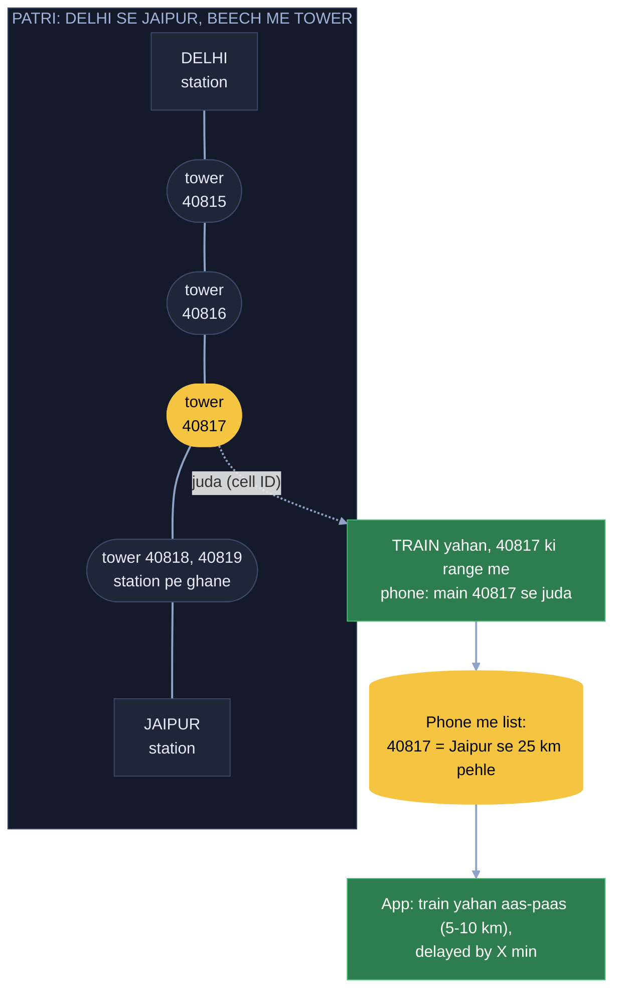
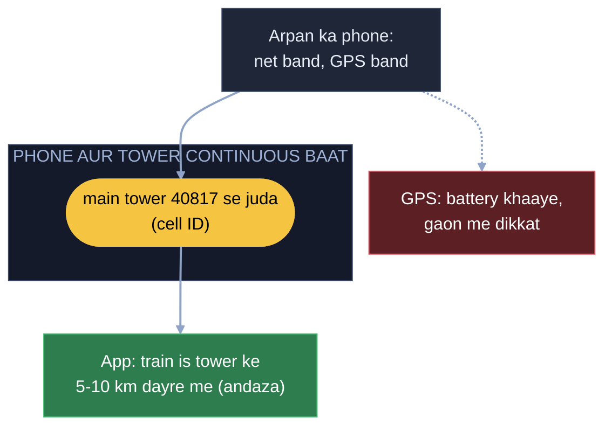
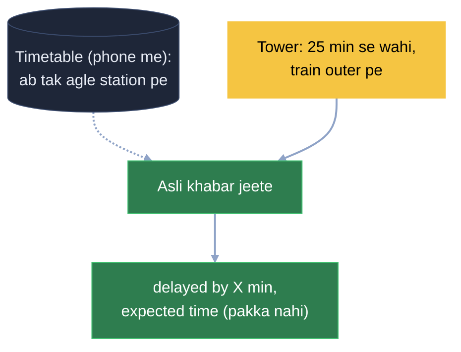
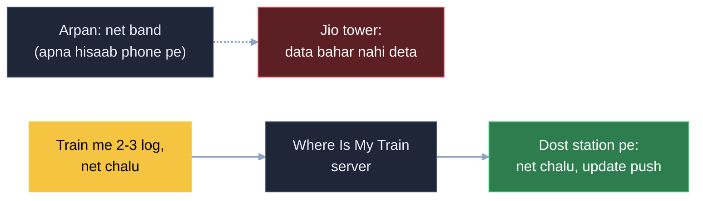
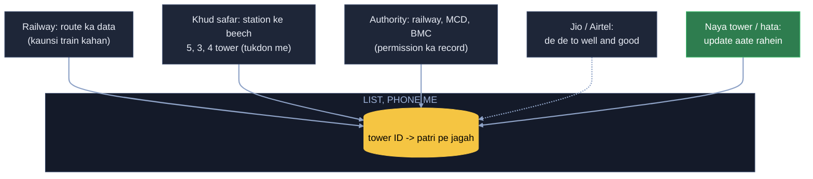
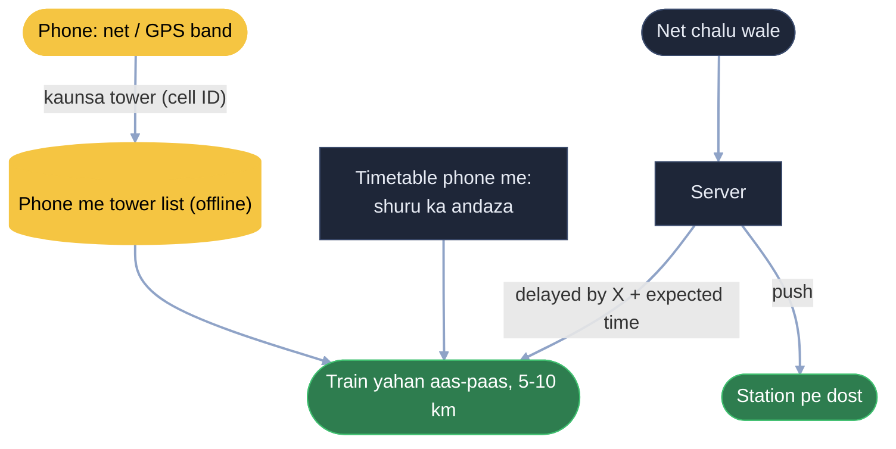

# Where Is My Train: bina net / GPS ke train kahan

Arpan Delhi se Jaipur train me hai. Net band, GPS band. Phir bhi app bata raha hai "train yahan, itni late", aur station
pe khade dost ko bhi dikh raha hai. Where Is My Train bahut chhota app hai; iske HLD me LB, replica DB jaisa kuch bolna
faltu. 100 me se ek app hoga jo ye karta, baaki har jagah net chalta. Kaam ki cheez iska tareeka hai: cell tower.

Har kadam = **kahani** (dikkat aur hal, bolne wali bhasha) -> **Asli naam** (interview me yahi shabd) -> tasveer
(kahani ka shabd, bracket me asli naam).

App 2015 me Bangalore ki Sigmoid Labs ne banaya, 2018 me Google ne kharida. Uber se farak: Uber
bina net ke chalta hi nahi, yahan poora design tower pe tika hai.

---

**Ek nazar: dhaancha + dikkat chain (round me sabse pehle ye, phir FR / NFR isi se):**
```
phone (net / GPS band)  --kaunsa tower juda (cell ID)-->  phone me tower list (offline)  -->  "train yahan aas-paas, 5-10 km"
                                                                 |
            timetable phone me = shuru ka andaza · asli khabar aaye to "delayed by X min" + expected time
            train me jinka net chalu  -->  server  -->  station pe dost ke phone pe push
            list kahan se: route ke tukdon me, railway / shehar / Jio se, naya-hata tower aata rahe

 1   net band, GPS band, train kahan              ->  phone kis tower se juda, list se jagah, range jitna andaza (cell ID)
 2   outer pe 25 min ruki, timetable bole aage    ->  asli khabar jeete, "delayed by X min" + expected (ETA)
 3   Arpan ka net band, Jio data nahi deta        ->  train me jinka net chalu wo bhejein, server dost ko push (crowdsourcing)
 4   tower ki list kahan se                       ->  route ke hisaab se tukdon me jodo, list phone me (offline lookup)
 4b  5 bande saalon, Jio naya tower lagaye        ->  railway se list + updates (data partner, data refresh)
 4c  railway ke paas sab nahi                     ->  shehar ki authority / Jio, jo mile jodo (kai source)
```

## FR / NFR (interview me pehle 2 minute)

```
FR      1  net / GPS band ho tab bhi train kahan, ek andaza dikhe              -> kadam 1
        2  train late ho to "delayed by X min" + expected time                   -> kadam 2
        3  station pe khade dost ko bhi dikhe train kahan                        -> kadam 3

NFR     1  battery na khaaye, gaon me bhi chale                                  -> kadam 1
        2  pakki jagah nahi, range chalegi (station se pehle log taiyaar rahein)  -> kadam 1
        3  dikhaya time expected hai, pakka nahi                                 -> kadam 2
        4  tower ki list taaza rahe (naya tower lage / hate)                     -> kadam 4, 4b, 4c
```
Numbers / API: baad me, saare design ke saath.

Trade-off jo bolne hain: GPS jitni pakki jagah nahi, tower ki range jitna andaza (kabhi train aa gayi, app bole "nahi
aayi") · battery aur bina net ke chalna, badle me thoda kam sahi · dost tak khabar tabhi jab train me kisi ka net chalu.

### Poori tasveer: patri, tower, train



---

## 1. Net band, GPS band, train kahan (phone ka tower, range jitna andaza)

Train me Arpan ka net band, GPS band. Phir bhi app ko batana hai train kahan hai. Where Is My Train dekhega mere phone
se kaunsa tower juda hai. Jaise-jaise train chali, mere cellular me dande aa rahe; mere paas ka tower aur mera phone
aapas me continuous baat kar rahe. Net band hai, usse farak nahi padta; mera sim ka cellular tower connected hai, train
ko wahi chahiye. Yahan WebSocket nahi, cellular tower hai. Isliye kabhi train aa jaati hai par app dikhata hai abhi
nahi aayi: wo andaza lagata hai ki train is 5-10 km ke dayre me kahin bhi, kyunki tower train se kitni door hai wo nahi
pata.

**Asli naam:** har tower ki pehchaan = cell ID (bina net / GPS ke phone ko pata, calls ke liye phone hamesha kisi
tower se juda), tower ki range jitna andaza = accuracy trade-off, pakki jagah nahi.

**Maan lo koi pooche GPS kyun nahi:** GPS on-off hota rehta, battery ke saath chalta, gaon me pahunch gaye to dikkat,
kahin net nahi. Tower to bhar-bhar ke aa rahe. Mujhe bas range chahiye: ye is station se pehle hai, to log taiyaar
rahein.
**Asli naam:** GPS = battery zyada khaata, train ki metal body me signal kamzor (reel ki baat); tower = sasta, hamesha
juda.



## 2. Outer pe 25 minute ruki, timetable bole aage nikal gayi (asli khabar jeete)

Train Rewari se nikli, agla station 40 km door, beech me outer pe 25 minute ruki, phone poore 25 minute ek hi tower se
juda. Timetable ke hisaab se is waqt tak agle station pahunch jaani thi. Aas-paas ka tower app pakad lega aur update kar
dega: ye abhi pahunchi nahi, outer pe khadi hai, aur neeche "train is delayed by 10 minutes", expected time 10 baje tha,
ab 10:15 / 10:30. Zaroori nahi jo train ka data humne store kar rakha, train wahi pahunch jaaye; wo hum update karenge jab
train chalegi. Dost ko expected time dikhega, confirm time nahi.

**Asli naam:** timetable = shuruaat ka andaza (poora timetable phone me offline), train abhi kahan hai aur kahan honi
chahiye thi = delay, dikhaya time = ETA (expected, pakka nahi).



## 3. Arpan ka net band, dost ko khabar kaise (jinka net chalu wahi bhejein)

Arpan ka net band, dost station pe khada, uska net chal raha. Dost ke app ko khabar chahiye "ye train outer pe ruki
hai". Jio ka tower hai aur Where Is My Train alag app; Jio apne users ki information bahar share nahi karega. To train
me aur logon ka net bhi khula hoga aur GPS bhi; 500 me se 499 ka net band nahi. Ek-do-teen aadmiyon ka bhi net on hai
to unse location update ho jaayegi aur info pass on. Jo log is station pe app khol ke pooch rahe, unke app me update
chala jaayega. Mere net band hone se farak nahi, par dost ka net on hona chahiye, kyunki update push hoga.

**Asli naam:** tower ka data operator ke paas, bahar nahi aata. Khabar = train me jinka net chalu, unka app server ko
bheje "is train ka phone tower X pe" (crowdsourcing), server se dost ke phone pe push. Mera apna hisaab mere phone pe
offline.



## 4. Tower ki list kahan se (khud tukdon me, ya permission wali authority)

App ko "tower 40817 = Jaipur se 25 km pehle" jaisi list chahiye. Railway ke paas tower ki list nahi, Jio / Airtel nahi
dete. Ye information hum apne aap se kar sakte hain. App ek jhatke me nahi banta, tukdon me: pehle UP ka, phir Delhi ka,
phir joda. Railway se route ka data mil jaata (kaunsi train kahan chalti). Phir Delhi se Jaipur jaate dekho: is station
ke beech 5 tower, us ke beech 3, us ke beech 4. Station ke paas jaal zyada, gaon ke beech kam, wahan dekhna kahan tower
hai. Ye list app me daalni padegi, warna app chal hi nahi sakta.

**Asli naam:** route-wise data collection, tower -> patri ki jagah wali list phone me offline (lookup).

**Maan lo akele saalon lagenge, aur naya tower lage to list purani:** patri ke paas tower lagane ke liye permission
leni padti, to kisi authority ke paas jaankari pehle se hogi. Railway se meeting: "kis station ke beech kitne tower,
bas" (isme kisi ki private information nahi). List mili, app me daali; tower hata ya laga to wo mail pe bhejte rahein,
app me update. Authority kaun, isme deep nahi, wo design ka part nahi.
**Asli naam:** data partner (permission ka record), updates se list taaza (data refresh).

**Maan lo railway bole "ye data hamare paas nahi, kuch tower private zameen pe":** tower permissible height se upar
hota hai, private zameen pe bhi permission chahiye, to har shehar ki central authority: Delhi me MCD, Mumbai me BMC.
Railway ne 50% di to baaki 50% wahan se; Jio de de to well and good. Kaunsa raasta asal me chalta, wo data public nahi.
**Asli naam:** kai source se list jodna (railway + shehar ki authority + operator).

**Reel me ek aur raasta (reel ka daava, kahin aur se jaancha nahi):** doston ke phone me GPS aur tower ID dono saath
record, map pe tower ne patri ki line kheench di, phir logon ke safar se poora naqsha, sirf 7-8 MB. Patri ek line hai,
to tower badla matlab train aage badhi; station pe tower ghane, wahan andaza lagbhag GPS jitna. App 2015 me Bangalore
ki Sigmoid Labs ne banaya, 2018 me Google ne kharida.



---

## Wrap

Phone hamesha kisi tower se juda (cell ID), net / GPS band bhi -> phone me list "kaunsa tower, patri pe kahan" -> tower
ki range jitna andaza (pakki jagah nahi) -> timetable phone me, asli khabar jeete (delayed by X, expected time) -> dost
tak khabar un logon se jinka net chalu (server, push) -> list khud tukdon me ya permission wali authority se, updates se
taaza.

**Sach kitna pakka:** cell tower + offline timetable + logon se data = app ka apna bayaan aur Wikipedia. Andar ki list
kaise bani, wo public nahi; doston ke phone wali baat reel ka daava hai.

---

## Poora dhaancha ek nazar me



---

Notes (Arpan ke shabd) = [TRAIN_HAND_NOTES.md](TRAIN_HAND_NOTES.md)
