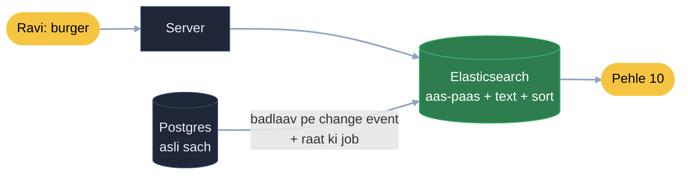

# Yelp search: 5 km ke andar burger

Ravi raat 10 baje app kholta hai aur "burger" likhta hai. Use aas-paas ke burger wale restaurant chahiye, galat spelling
pe bhi, aur band dukaan "Closed" dikhe. Restaurant ki asli jaankari (naam, menu, khula / band) Postgres me hai, search
Elasticsearch karta hai.

Har kadam = **kahani** (dikkat aur hal, bolne wali bhasha) -> **Asli naam** (interview me yahi shabd).

**Pehle se aaya:** Elasticsearch (inverted index, typo, ranking, "DB sach, ES copy") = [Foundations 12](../../FOUNDATIONS/12_elasticsearch_search.md)
· aas-paas ka gola (geohash) = [Uber](../15_uber/15_uber.md) · badlaav pe event = file upload ka S3 event. Neeche sirf naya.

**Ek nazar: dhaancha + dikkat chain (round me sabse pehle ye, phir FR / NFR isi se):**
```
Ravi  -->  server  -->  Elasticsearch (search ki copy: aas-paas + text + sort)  -->  pehle 10
                              ^
                              |  badlaav aate hi change event  (+ raat ki job, jo chhoota wo bhi)
                              |
                          Postgres (asli sach: naam, menu, khula / band)

 1   "burger" pe 8 sec, "burgr" pe zero          ->  aas-paas ke restaurant (geohash, Uber jaisa) + Elasticsearch, kuch bhi likho sahi option (geo filter, fuzzy)
 2   Burger Singh band, search me abhi bhi       ->  Postgres aur ES sync, band dukaan "Closed" dikhe, Zomato jaisa (DB -> search sync)
 3   dopahar ka naya burger, ES ko raat 2 baje   ->  badlaav aate hi event, raat ki job bhi chale (change event, reconciliation)
 4   300 m wali 4.6 star 15ve number pe          ->  sort user chune, server saare pe sort kare, phone ko pehle 10 (server-side sort + pagination)
```

**FR / NFR:** round me Arpan design dekh ke nikalega (abhi tay nahi).
**Numbers (Arpan):** Zomato jaisa app India ke shehron me, worldwide nahi. Ek area me 10-20 hazaar log ek saath search,
itna server sambhal leta; 5 lakh faltu number.



---

## 1. "burger" pe 8 second, "burgr" pe zero (aas-paas + Elasticsearch)

Abhi sirf Postgres hai, 50 lakh restaurant, har ek ke naam aur menu me "burger" dhoondhna (LIKE '%burger%') 8 second,
aur "burgr" likha to ek bhi result nahi. Ravi ka latitude longitude lo, uske aas-paas ke restaurant hi dekho, jaise Uber
me karte. Text dhoondhna Elasticsearch ka kaam: kuch bhi likho, sahi option de deta, "burgr" pe bhi burger.

**Asli naam:** aas-paas = geo filter (geohash / radius), text = Elasticsearch (inverted index), galat spelling pe bhi =
fuzzy search (typo tolerance).

## 2. Burger Singh band, search me abhi bhi (Postgres -> ES sync, "Closed" dikhao)

Burger Singh ne dukaan band ki, Postgres me "closed", par ES ke paas purani jaankari. Postgres aur ES ko sync karo.
Dukaan search se gayab nahi hoti; Zomato jaisa, aati hai par "Closed" dikhti hai.

**Asli naam:** DB -> search index sync (Postgres sach, ES search ki copy), status field (Closed badge), thodi der ES
peeche = eventual consistency.

## 3. Dopahar ka naya burger, ES ko raat 2 baje pata (badlaav pe event)

Sync job raat 2 baje chalti; dopahar 1 baje joda "Paneer Burger" shaam 8 baje search me nahi. Postgres me badlaav aate hi
ek event bhejo jo ES ko update kare, jaise S3 ka "file aa gayi" event. Raat wali job bhi chalti rahe, jo event chhoota
wo pakde. Yahan queue / Kafka nahi; Kafka numbers dekh ke: ek saath ~20 hazaar seedha sambhal jaata, Kafka tab
jab peak pe lakh log ek saath aayein (Arpan).

**Asli naam:** change event (Postgres ke badlaav ko seedha padhna = CDC), raat ki job = reconciliation.

## 4. 300 meter wali 4.6 star 15ve number pe (sort user chune, server kare)

200 restaurant mile, screen pe 10. User sort chunta hai: doori se ya rating se. Sort server karta hai saare 200 pe, phone
ko wahi pehle 10 jaate jo sort ke baad upar aaye. Naam me burger ho ya menu me, sab aate hain, bas neeche-upar.

**Asli naam:** sort param (rating / doori), server-side sort (Elasticsearch me) + pagination.

---

## Wrap

Ravi ki jagah se aas-paas ke restaurant (geo filter) -> Elasticsearch me text, galat spelling pe bhi (fuzzy) -> asli sach
Postgres, ES uski copy: badlaav aate hi change event, raat ki job chhoota pakde; band dukaan "Closed" -> sort user chune,
server saare pe kare, phone ko pehle 10.

Notes (Arpan ke shabd) = [YELP_HAND_NOTES.md](YELP_HAND_NOTES.md)
