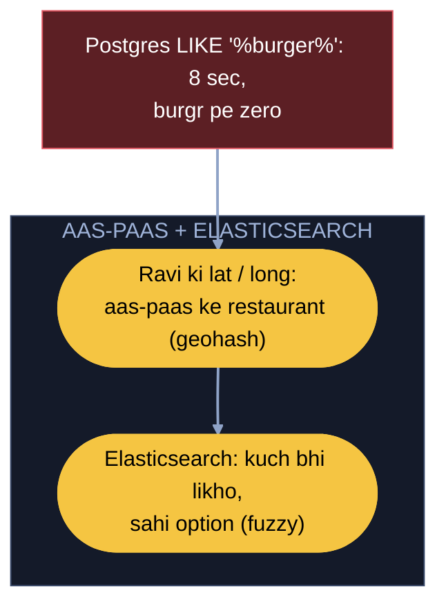
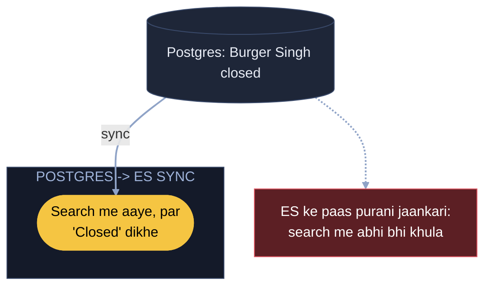
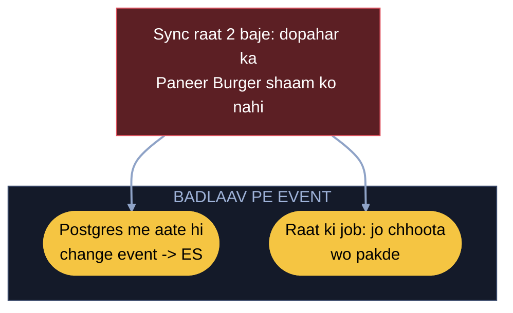
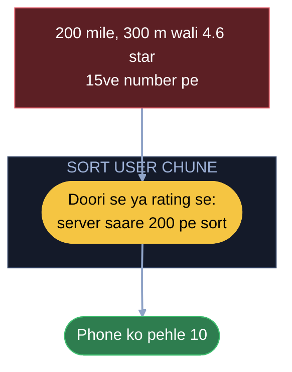
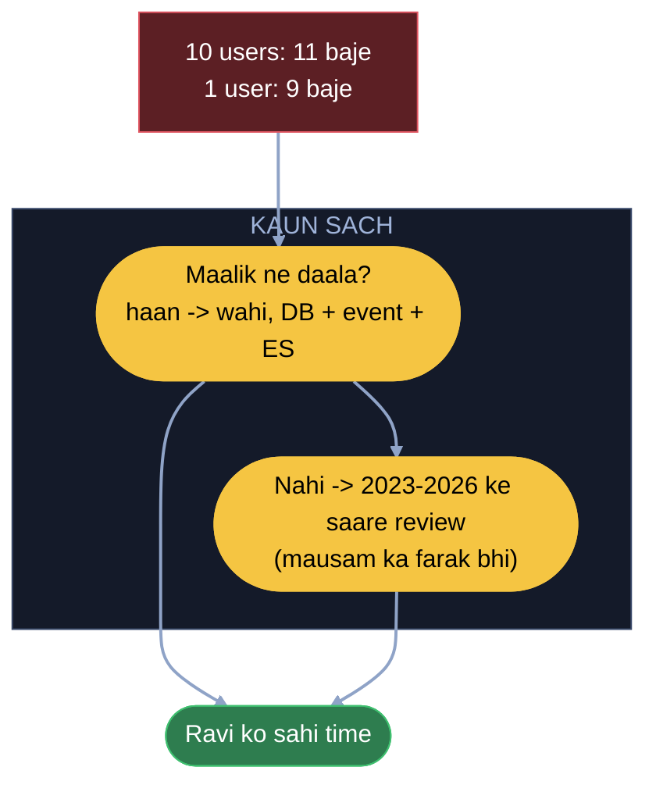

# Yelp search: 5 km ke andar burger

Ravi raat 10 baje app kholta hai aur "burger" likhta hai. Use aas-paas ke burger wale restaurant chahiye, galat spelling
pe bhi, aur band dukaan "Closed" dikhe. Restaurant ki asli jaankari (naam, menu, khula / band) Postgres me hai, search
Elasticsearch karta hai.

Har kadam = **kahani** (dikkat aur hal, bolne wali bhasha) -> **Asli naam** (interview me yahi shabd).

**Pehle se aaya:** Elasticsearch (inverted index, typo, ranking, "DB sach, ES copy") = [Foundations 12](../../FOUNDATIONS/12_elasticsearch_search.md)
· aas-paas ka gola (geohash) = [Uber](../15_uber/15_uber.md) · badlaav pe event = file upload ka S3 event. Neeche sirf naya.

**Ek nazar: dhaancha + dikkat chain (round me sabse pehle ye, phir FR / NFR isi se):**
```
Ravi  -->  server  -->  Elasticsearch (search ki copy: aas-paas + text + sort)  -->  pehle 10
                              ^
                              |  badlaav aate hi change event  (+ raat ki job, jo chhoota wo bhi)
                              |
                          Postgres (asli sach: naam, menu, khula / band)

 1   "burger" pe 8 sec, "burgr" pe zero          ->  aas-paas ke restaurant (geohash, Uber jaisa) + Elasticsearch, kuch bhi likho sahi option (geo filter, fuzzy)
 2   Burger Singh band, search me abhi bhi       ->  Postgres aur ES sync, band dukaan "Closed" dikhe, Zomato jaisa (DB -> search sync)
 3   dopahar ka naya burger, ES ko raat 2 baje   ->  badlaav aate hi event, raat ki job bhi chale (change event, reconciliation)
 4   300 m wali 4.6 star 15ve number pe          ->  sort user chune, server saare pe sort kare, phone ko pehle 10 (server-side sort + pagination)
```

**Arpan ka nichod:** "Yelp = Uber aur search ka mixture. Aas-paas ka salon / restaurant dhoondho, rating padho, wahan chale jao ya contact karo. Uber me driver chalta, yahan dukaan khadi rehti; isliye bas aas-paas + search."

**FR / NFR kahan se:** upar ki dikkat chain dekh ke nikale; har line ke aage likha hai wo kis kadam se aayi.
Arpan: Koi bhi kuch dhoondhe to use aas-paas ka search milna chahiye, jaise Zomato karta; kisi ne kuch dhoondha aur mil gaya aas-paas ki range me, geo filter wahi. Iska FR simple hi hai, aas-paas ka dhoondha mila, bas. Yelp chhota hai, FR / NFR bhi chhote hi banenge. Kadam 1 aur 4 FR me, 2 aur 3 NFR me.
Technical me: FR = geo search (fuzzy bhi) + sort; NFR = DB aur search ka sync (Closed badge, change event + raat ki job).

**FR / NFR (interview me pehle 2 minute):**
```
FR      1  kuch bhi dhoondho (galat spelling pe bhi), aas-paas ki range me mile   -> kadam 1
        2  sort user chune: doori se ya rating se                                 -> kadam 4

NFR     1  band dukaan search me "Closed" dikhe (search thodi der peeche chalega) -> kadam 2
        2  menu / dukaan badle to search me jaldi aaye; event chhoote to raat ki job pakde -> kadam 3
```
**Numbers (Arpan):** Zomato jaisa app India ke shehron me, worldwide nahi. Ek area me 10-20 hazaar log ek saath search,
itna server sambhal leta; 5 lakh faltu number.

**Dhaancha (tasveer):**

```
   +-----------------+     +------+     +---------------------+
   |  User (Ravi)    | --> |  LB  | --> |  Yelp server (3-4)  |
   |  lat / long     |     +------+     +---------------------+
   +-----------------+                     |               |
                                           v               v
                              +-------------------+   +------------------------+
                              |  Elasticsearch    |<--|  DB: AWS RDS Postgres  |
                              |  search + aas-paas|   |  dukaan, menu, time,   |
                              +-------------------+   |  rating (writes kam)   |
                                       ^  event       +------------------------+
                                       +-- badlaav aate hi

   CDN nahi: app sirf US me, worldwide nahi
```

**Round me Arpan:** Yelp aas-paas dhoondhne wala app hai, Zomato jaisa. FR: kuch bhi search karo to aas-paas ka mile, aur user khud sort chune. NFR: dukaan band ho to Closed dikhe, menu badle to update ho. Writes kam hain, trillion writes nahi; isliye NoSQL ki zaroorat nahi, AWS RDS Postgres. Search ka kaam Elasticsearch karega. Ravi lat / long bhejega, aas-paas ke hexagon dekhenge (Uber jaisa), kam mile to ghera bada karte jayenge, phir rating se sort. Yelp Google reviews jaisa hai: users rating aur review se jaankari theek karte rehte. DB me update hua to event Elasticsearch ko.

*Technical me:* "event bhej do ES ko" = change event (DB -> search index sync) · "hexagon bada karte rahenge" = ring badhana (H3 k-ring) · "users ki rating se data theek" = crowdsourced data.

**API (Arpan):** "API yahan koi lambi kahani nahi: user search POST karega, saath me uske coordinates; GET se apne result."

```
API     POST search   -> "burger" + Ravi ke coordinates (lat / long)
        GET  results  -> aas-paas ke, sort kiye hue, pehle 10
```

---

## 1. "burger" pe 8 second, "burgr" pe zero (aas-paas + Elasticsearch)

Abhi sirf Postgres hai, 50 lakh restaurant, har ek ke naam aur menu me "burger" dhoondhna (LIKE '%burger%') 8 second,
aur "burgr" likha to ek bhi result nahi. Ravi ka latitude longitude lo, uske aas-paas ke restaurant hi dekho, jaise Uber
me karte. Text dhoondhna Elasticsearch ka kaam: kuch bhi likho, sahi option de deta, "burgr" pe bhi burger.

**Asli naam:** aas-paas = geo filter (geohash / radius), text = Elasticsearch (inverted index) (bana-banaya: AWS OpenSearch / Elastic Cloud; hum sirf sikhate kya aur kaise dhoondhna, Foundations 12), galat spelling pe bhi =
fuzzy search (typo tolerance).



## 2. Burger Singh band, search me abhi bhi (Postgres -> ES sync, "Closed" dikhao)

Burger Singh ne aaj ke liye dukaan band ki (chhutti), Postgres me "closed", par ES ke paas purani jaankari. Postgres aur ES ko sync karo.
Dukaan search se gayab nahi hoti; Zomato jaisa, aati hai par "Closed" dikhti hai.

**Asli naam:** DB -> search index sync (Postgres sach, ES search ki copy), status field (Closed badge), thodi der ES
peeche = eventual consistency.



## 3. Dopahar ka naya burger, ES ko raat 2 baje pata (badlaav pe event)

Sync job raat 2 baje chalti; paas wale Burger Point ne dopahar 1 baje joda "Paneer Burger", shaam 8 baje search me nahi. Postgres me badlaav aate hi
ek event bhejo jo ES ko update kare, jaise S3 ka "file aa gayi" event. Raat wali job bhi chalti rahe, jo event chhoota
wo pakde. Yahan queue / Kafka nahi; Kafka numbers dekh ke: ek saath ~20 hazaar seedha sambhal jaata, Kafka tab
jab peak pe lakh log ek saath aayein (Arpan).

**Asli naam:** change event (Postgres me badlaav hua to event), raat ki job = reconciliation.



## 4. 300 meter wali 4.6 star 15ve number pe (sort user chune, server kare)

200 restaurant mile, screen pe 10. User sort chunta hai: doori se ya rating se. Sort server karta hai saare 200 pe, phone
ko wahi pehle 10 jaate jo sort ke baad upar aaye. Naam me burger ho ya menu me, sab aate hain, bas neeche-upar.

**Asli naam:** sort param (rating / doori), server-side sort (Elasticsearch me) + pagination.



## 5. Burger Singh ka time: 10 users "11 baje", 1 user "9 baje" (pehle maalik, phir review history)

Yelp me dukaan wala apna page claim karke (phone / email se verify) time aur menu khud badal sakta hai. Maalik ne time
daala hai to wahi sach: DB me likho, change event, Elasticsearch update; users ki baat peeche. Maalik ne nahi daala to
sirf aakhri ek user ya zyada users pe mat jao: 2023 se 2026 tak ke saare review dekho (sardi me jaldi band jaisa farak
bhi), jo sabse theek lage wo time dikhao.

**Asli naam:** source ki priority (owner-verified > crowdsourced), review history se time nikalna.

**Yelp me do raaste (net se jaancha):** (1) maalik apna page claim karta hai, phone / email se verify hota hai, uske baad time aur menu khud badal sakta hai, jab chahe dobara. (2) jis page ko maalik ne claim nahi kiya, uspe users "Edit Business" se badlaav bhejte hain.



---

## Wrap

Ravi ki jagah se aas-paas ke restaurant (geo filter) -> Elasticsearch me text, galat spelling pe bhi (fuzzy) -> asli sach
Postgres, ES uski copy: badlaav aate hi change event, raat ki job chhoota pakde; band dukaan "Closed" -> sort user chune,
server saare pe kare, phone ko pehle 10; time ka jhagda: pehle maalik, phir review history.

---

## Poora dhaancha ek nazar me


---

Notes (Arpan ke shabd) = [YELP_HAND_NOTES.md](YELP_HAND_NOTES.md)
