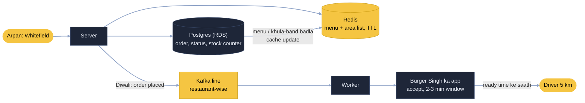

# Zomato (food delivery): Whitefield ke PG se Burger Singh ka burger

Arpan Bangalore me Whitefield ke PG me baitha Zomato kholta hai. Use 15 km ke andar ke restaurant dikhne chahiye, rating ya
doori se sort, aur wo 10 km door "Burger Singh" se burger mangata hai. Peeche teen log hain: user (Arpan), restaurant
(Burger Singh) aur driver.

Har kadam = **kahani** (dikkat aur hal, bolne wali bhasha) -> **Asli naam** (interview me yahi shabd).

**Pehle se aaya:** aas-paas ka area / geohash, driver ka accept + tracking = [Uber](../15_uber/15_uber.md) · ek counter pe
atomic ghatana = [Banking](../13_banking_system/13_banking_system.md), [Inventory](../21_inventory_system/21_inventory_system.md)
· "order placed" dikha ke line = [BookMyShow](../09_bookmyshow/09_bookmyshow.md), [E-commerce](../17_ecommerce/17_ecommerce.md)
· menu / list cache = [Cache](../10_distributed_cache/10_distributed_cache.md). Neeche sirf naya.

**Ek nazar: dhaancha + dikkat chain (round me sabse pehle ye, phir FR / NFR isi se):**
```
Arpan (Whitefield) --> Zomato app --> server --> Redis (menu + area ki restaurant list, TTL)
                                         |          ^  menu / khula-band badle to DB se update
                                         v          |
                                   AWS RDS Postgres (2 replica)  <-- ek counter: Burger Singh ke aaj ke burger
                                         |
                    Diwali pe: Kafka line (restaurant-wise) --> worker --> Burger Singh ka app --> driver (5 km)

 0   menu baar-baar DB se                         ->  menu Redis me, menu badle to job DB se cache update kare (cache + write pe update)
 1   15 km ke restaurant kaise                    ->  lat / long se gola, area ki ek list cache me, TTL, band = "closed" nishaan (area list cache)
 2   Neha kinare pe, Whitefield bahut bada        ->  bade area ke andar chhote area, har ek ki apni list (grid / geohash cell, Uber jaisa)
 3   order Burger Singh tak                       ->  accept -> notification -> ready -> 5 km ke driver -> delivering (order status flow)
 4   burger ready, driver 15 min door             ->  quantity se ready time, driver ko wahi time bhejo (prep-time dispatch)
 5   Burger Singh chup, na accept na reject       ->  2-3 min window, phir order fail, paisa nahi kata / wapas (accept timeout)
 6   Diwali, Burger Singh pe 2 min me 500         ->  subah stock poocho, zyada ko gate pe mana, andar walon ki Kafka line (capacity gate + queue)
 7   349 pe Arpan + Rahul ek pal me               ->  ek hi counter, check + ghatao ek saath, pehle wale ko (atomic decrement)
 8   address khaali wala order, saari line atki   ->  3 baar retry, phir alag line, alert; line chalti rahe (retry limit + DLQ, reel se)
```

**Arpan ka nichod:** "Yahan do system design hain: ek user ke order ka (Arpan wala), ek restaurant aur driver ka (Zomato andar wala). User ko driver kaun hai ye sab nahi dikhta, restaurant ko dekhna padta. Zomato andar kya karta mujhe nahi pata, docs padh ke jawab nahi dunga; main hota to ye karta."

**FR / NFR kahan se:** food delivery ka main kaam hi requirement (Arpan). "Driver tez aaye" FR / NFR me nahi, wo design
ka part nahi; door se aa raha to late aayega. Rating / doori se sort aur 15 km tak = interviewer se poocha.

**FR / NFR (interview me pehle 2 minute):**
```
FR      1  aas-paas (15 km) ke restaurant dikhao, rating ya doori se sort        -> kadam 1, 2
        2  menu dekho, order karo, khana pahunche                                -> kadam 0, 3

NFR     1  driver ko track kar sake                                              -> kadam 3 (tracking Uber wali)
        2  khana kaisa pahunche: door se aaye to user ko bata do, thoda thanda ho sakta -> kadam 4
```
**Numbers (Arpan):** Bangalore me ~5,000, average 8-10 hazaar DAU; India me 60-80 hazaar ya 1 lakh tak; Diwali pe peak
~50 hazaar ek saath. Bahut bada scale nahi, isliye NoSQL / Cassandra nahi: simple Postgres (AWS RDS, 2 replica).

### DB kaunsa: SQL ya NoSQL?
Data kya: restaurant, menu, order, order ka status, aaj ka stock. Kaam kya: order aur stock ki ginti sahi rahe (do log
aakhri burger na le jaayein), aur scale itna bada nahi. Isliye SQL (Postgres, AWS RDS): transaction, aur RDS replica /
backup khud sambhal leta. Cassandra / MongoDB / DynamoDB ki zaroorat nahi, wo itne bade likhne ke liye bane hain jo yahan nahi.



---

## 0. Menu baar-baar DB se (menu Redis me)

Pehla dhaancha: user -> Zomato app -> server -> AWS RDS Postgres. Har restaurant ka ek menu hota hai, aur menu roz nahi
badalta (Diwali / Navratri pe alag). Har baar DB se laane ka matlab nahi; Diwali pe 50 hazaar log aaye to DB bekaar ka bojh
uthayega sirf menu dikhane ke liye. Menu ko DB se aage ek dabbe (Redis) me rakho, aur DB me menu badle to job cache me
update kar de.

**Asli naam:** cache (Redis), write pe cache update (writes kam, reads zyada).

## 1. 15 km ke restaurant kaise (area ki ek list cache me)

App khula, location on, GPS se lat / long aaya. Uske chaaron taraf 15 km ka gola, gole ke andar ke restaurant dikhao; band
wale list se hatte nahi, "closed" dikhte hain (khula / band ka waqt onboarding pe hi pata). Whitefield me Arpan, Rahul, Neha,
Ravi sabko wahi list; har baar DB pe jaana bekaar, to list ek dabbe me rakho, TTL ke saath. DB me kuch badla (restaurant
achanak band) to dabbe me use "closed" mark karo. Dabba expire ho to ek hi server lock leke DB se laaye, baaki wahi le lein.
Band hone wala ho to banner "jaldi order karo".

**Asli naam:** geo / radius search, area list cache (Redis) + TTL, write pe cache update, cache stampede pe lock, fan-out
(list app me push, ek aur raasta).

## 2. Neha kinare pe, Whitefield bahut bada (area ke andar area)

Kinare wale ki bhi ek hi location hoti hai, uske lat / long se list. Whitefield bahut bada hai (ITPL ek chhor, doosra,
teesra), to bade area ke andar chhote area kaato; har chhote area ki apni ek list. Har user ki alag list nahi, cell ki list.
Ye Uber me ho chuka.

**Asli naam:** grid / geohash cell, cell ke naam pe cache key.

## 3. Order Burger Singh tak (order status flow)

Onboarding pe restaurant se sab tay: roz ki capacity, out of stock ho to app me update karna. Arpan ka order Burger Singh
ke app pe gaya, unhone accept kiya, Arpan ko notification. Khana ban raha to restaurant 5 km ke andar ke driver bulata
(10 km door, 3 km kam). Driver ne accept kiya, pickup kiya, status "delivering". Tracking Uber wali. Pay = PSP, uspe yahan
kuch naya nahi.

**Asli naam:** order status flow (placed -> accepted -> ready -> delivering -> delivered, state DB me), notification /
webhook, driver dispatch (radius).

## 4. Burger ready, driver 15 min door (prep-time se bulao)

Driver ka aana order ki quantity pe depend karta. Restaurant jaanta hai kitni der lagegi (1 burger 5 min, 30 burger 1
ghanta), aur driver ko request ke saath quantity aur ready time bhejta; driver usi hisaab se aata hai, taaki khana ready
hote hi utha le. 30 burger me user ko pata hai time lagega, kuch thande bhi ho sakte; perfect system nahi.

**Asli naam:** prep-time estimate se driver dispatch.

## 5. Burger Singh chup (accept timeout)

Na accept, na reject. User ko atka ke nahi rakh sakte: order 2-3 min (ya 1-1.5 min) restaurant ki screen pe, user ko gola
"abhi final nahi". Window me accept nahi to order fail, "dobara try karo". Order place tabhi jab restaurant accept kare, to
paisa kata hi nahi; kata hai to refund. Restaurant ka app hi band ho to order hota hi nahi.

**Asli naam:** accept timeout + auto-cancel, accept ke baad hi paisa (warna refund).

## 6. Diwali, Burger Singh pe 2 min me 500 (capacity gate + Kafka line)

50 hazaar ek saath seedha server aur Postgres pe = app hang. Diwali ki subah restaurant se stock poocho (Burger Singh:
300-350). 500 aaye to 350 hi andar, baaki 150 ko pehle hi "out of stock" (baad me fail + refund se bachna). Har restaurant
ki apni line; andar walon ko "order placed" dikhao aur Kafka me daalo, worker peeche se ek-ek order restaurant tak le jaata
(accept, ready, driver).

**Asli naam:** capacity gate, restaurant-wise queue (Kafka, key = restaurant id), async processing.

## 7. 349 pe Arpan + Rahul ek pal me (atomic decrement)

Diwali pe kai server; dono server ne ginti 349 ek hi pal me padhi aur dono andar, 351. Ilaaj: ginti ka counter ek hi
(Redis ya Postgres), aur padhna + ghatana ek hi kaam me. Redis ek baar me ek command chalata; Postgres me `UPDATE ... SET
bacha = bacha - 1 WHERE bacha >= 1`. Jo pehle pahuncha usko burger, doosre ko "out of stock". Bilkul ek pal me aaye to
bhi ek ko hi milega, kismat se.

**Asli naam:** atomic decrement / conditional update (Redis DECR / Lua), first come first served.

## 8. Address khaali wala order, saari line atki (retry limit + DLQ, reel se)

Dinner rush, "order confirmed" message kisi ko nahi. Ek order ka address khaali: worker fail, message line me wapas, phir
fail; line kram se chalti, to peeche wale atke (poison message). Retry se network ki gadbad theek hoti, kharab data nahi.
Ilaaj: retry ki had (jaise 3), phir message alag line (dead letter queue) me, line chal padi; DLQ pe alert, team baad me
dekhe. Pech: kram wali line se hataya to kram toot sakta, usi order ke baaki message bhi parking me ([Kafka](../12_message_queue_kafka/12_message_queue_kafka.md) 8 / 8b).

**Asli naam:** poison message, retry limit (SQS maxReceiveCount; Kafka me N retry ke baad DLQ topic + offset commit),
dead letter queue (DLQ), DLQ alert.

---

## Wrap

Arpan ki location se 15 km ka gola, area ke andar chhote area, har cell ki list Redis me (TTL, band = closed) -> menu bhi
Redis me, DB badle to update -> order Burger Singh ke app pe, accept ki 2-3 min window, warna fail -> accept ke baad
quantity se ready time, utne time pe 5 km ka driver -> delivering, tracking Uber wali -> Diwali pe subah stock, gate pe
capacity, andar walon ki Kafka line -> aakhri burger ek hi counter pe atomic ghatao -> kharab order line na roke: 3 retry, phir DLQ + alert. Do system: user ka order, aur
restaurant + driver ka.

Notes (Arpan ke shabd) = [ZOMATO_HAND_NOTES.md](ZOMATO_HAND_NOTES.md)
