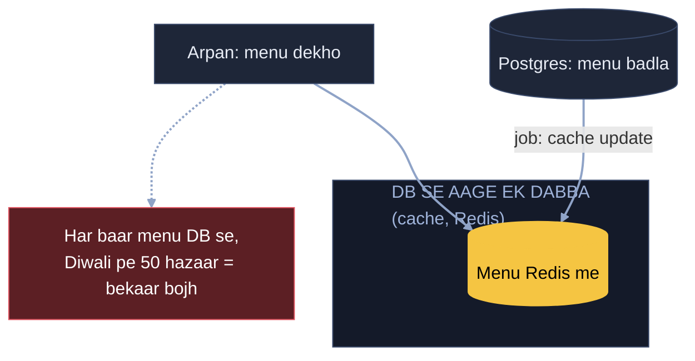
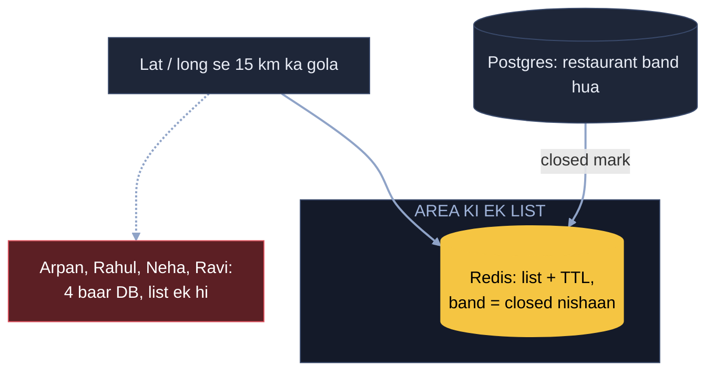
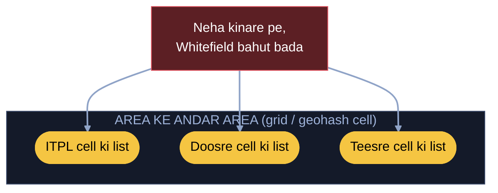
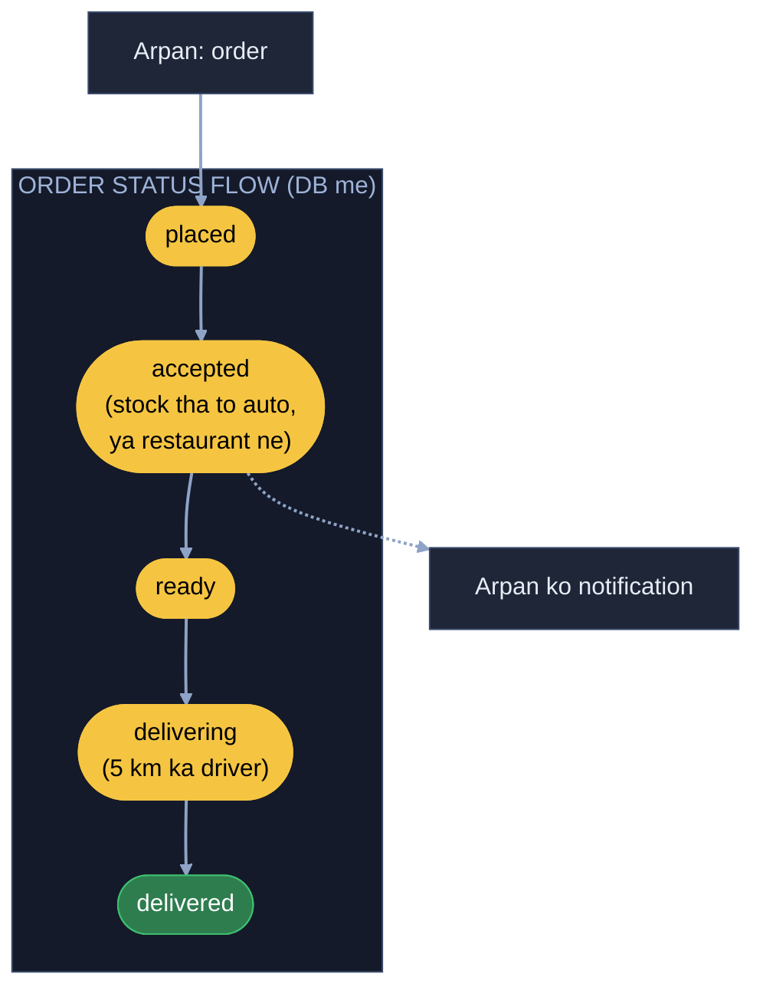
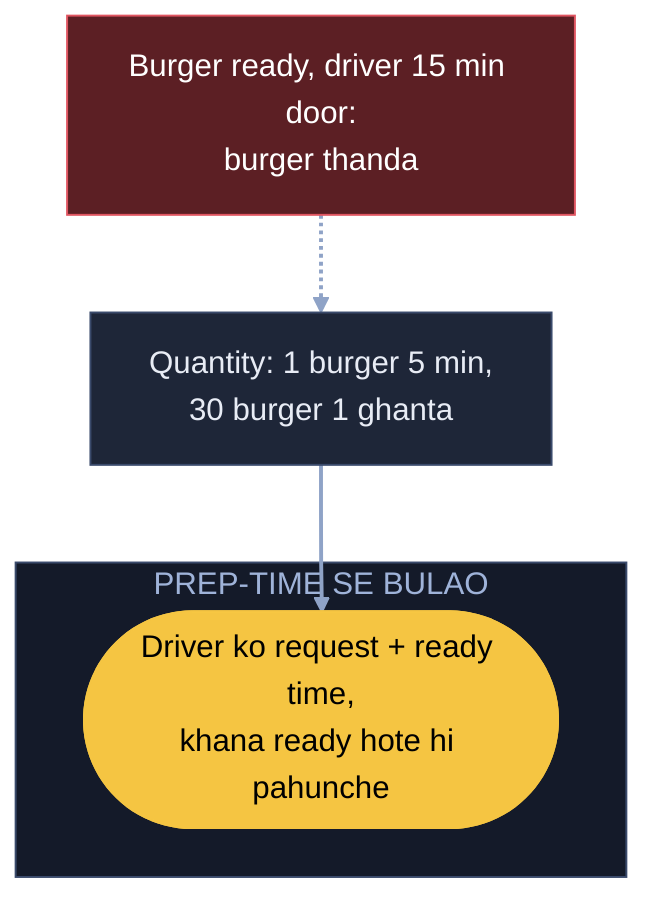
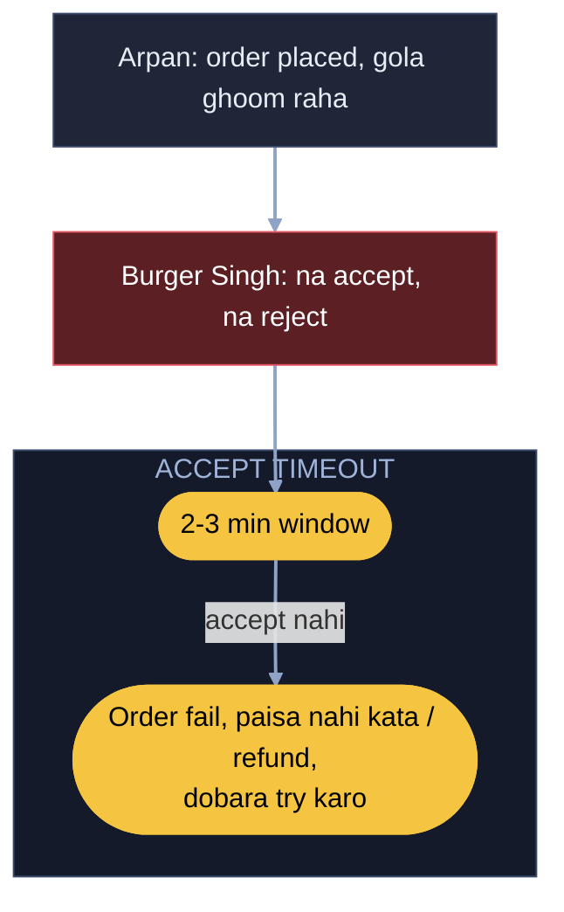
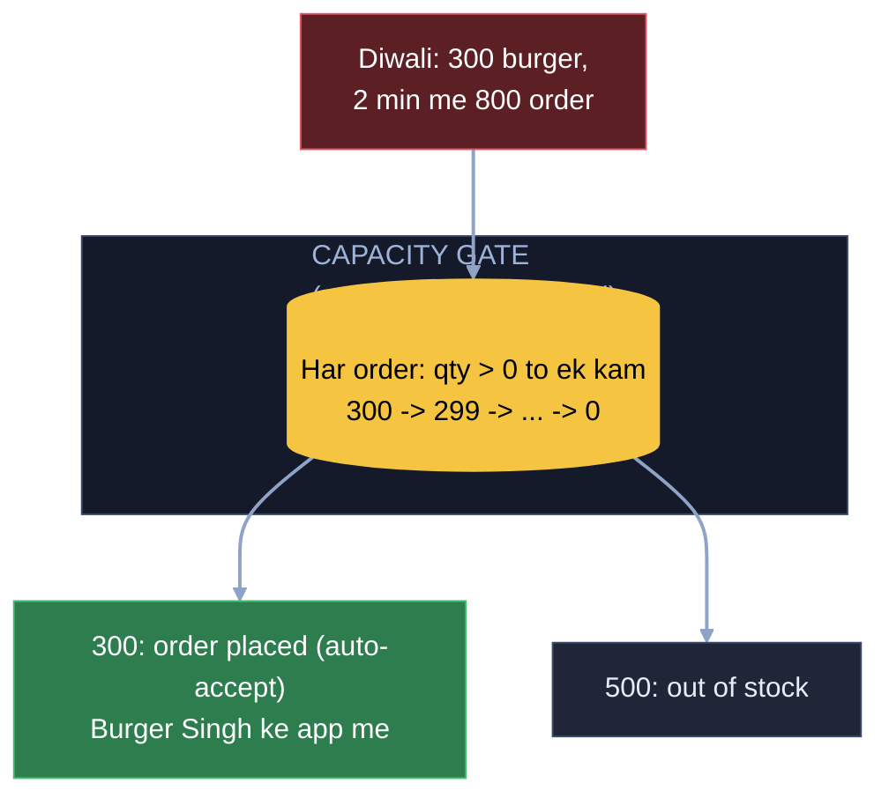
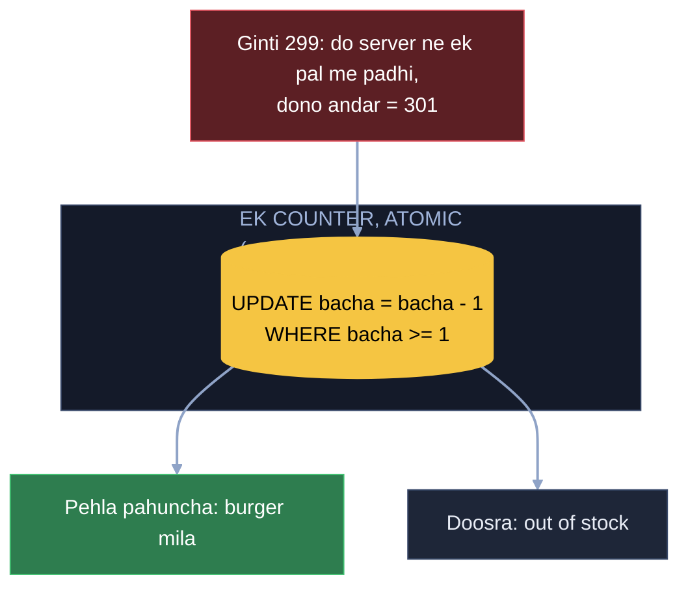
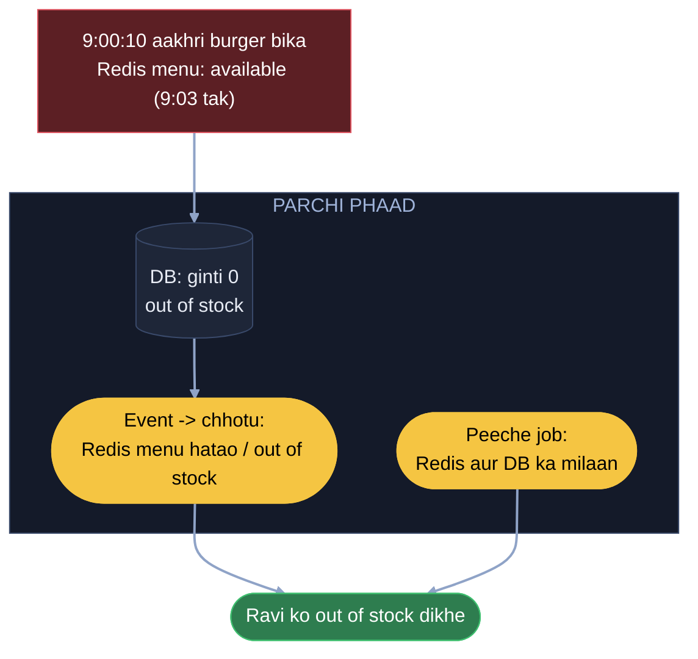
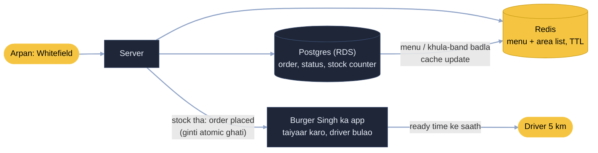

# Zomato (food delivery): Whitefield ke PG se Burger Singh ka burger

Arpan Bangalore me Whitefield ke PG me baitha Zomato kholta hai. Use 15 km ke andar ke restaurant dikhne chahiye, rating ya
doori se sort, aur wo 10 km door "Burger Singh" se burger mangata hai. Peeche teen log hain: user (Arpan), restaurant
(Burger Singh) aur driver.

Har kadam = **kahani** (dikkat aur hal, bolne wali bhasha) -> **Asli naam** (interview me yahi shabd).

**Pehle se aaya:** aas-paas ka area / geohash, driver ka accept + tracking = [Uber](../15_uber/15_uber.md) · ek counter pe
atomic ghatana = [Banking](../13_banking_system/13_banking_system.md), [Inventory](../21_inventory_system/21_inventory_system.md)
· "order placed" dikha ke line = [BookMyShow](../09_bookmyshow/09_bookmyshow.md), [E-commerce](../17_ecommerce/17_ecommerce.md)
· menu / list cache = [Cache](../10_distributed_cache/10_distributed_cache.md). Neeche sirf naya.

**Ek nazar: dhaancha + dikkat chain (round me sabse pehle ye, phir FR / NFR isi se):**
```
Arpan (Whitefield) --> Zomato app --> server --> Redis (menu + area ki restaurant list, TTL)
                                         |          ^  menu / khula-band badle to DB se update
                                         v          |
                                   AWS RDS Postgres (2 replica)  <-- ek counter: Burger Singh ke aaj ke burger
                                         |
                    order: counter pe ginti ghatao (stock ho to) --> order placed --> Burger Singh ka app --> driver (5 km)

 0   menu baar-baar DB se                         ->  menu Redis me, menu badle to job DB se cache update kare (cache + write pe update)
 1   15 km ke restaurant kaise                    ->  lat / long se gola, area ki ek list cache me, TTL, band = "closed" nishaan (area list cache)
 2   Neha kinare pe, Whitefield bahut bada        ->  bade area ke andar chhote area, har ek ki apni list (grid / geohash cell, Uber jaisa)
 3   order Burger Singh tak                       ->  accept (auto / restaurant) -> notification -> ready -> 5 km ke driver -> delivering (order status flow)
 4   burger ready, driver 15 min door             ->  quantity se ready time, driver ko wahi time bhejo (prep-time dispatch)
 5   (khud accept wala restaurant) chup rahe      ->  2-3 min window, phir order fail, paisa nahi kata / wapas (accept timeout)
 6   Diwali, 300 burger, 2 min me 800 log         ->  har order pe ginti atomic ghatao, stock tha to order placed (auto-accept), 0 pe out of stock; Kafka nahi (capacity gate)
 7   299 pe Arpan + Rahul ek pal me               ->  ek hi counter, check + ghatao ek saath, pehle wale ko (atomic decrement)
```

**Arpan ka nichod:** "Yahan do system design hain: ek user ke order ka (Arpan wala), ek restaurant aur driver ka (Zomato andar wala). User ko driver kaun hai ye sab nahi dikhta, restaurant ko dekhna padta. Zomato andar kya karta mujhe nahi pata, docs padh ke jawab nahi dunga; main hota to ye karta."

**FR / NFR kahan se:** food delivery ka main kaam hi requirement (Arpan). "Driver tez aaye" FR / NFR me nahi, wo design
ka part nahi; door se aa raha to late aayega. Rating / doori se sort aur 15 km tak = interviewer se poocha.

**FR / NFR (interview me pehle 2 minute):**
```
FR      1  aas-paas (15 km) ke restaurant dikhao, rating ya doori se sort        -> kadam 1, 2
        2  menu dekho, order karo, khana pahunche                                -> kadam 0, 3
        3  driver ko map pe track kar sake (Uber wali tracking)                  -> kadam 3
        4  restaurant kitni door hai (jaise 15 km), app pe pehle se dikhe        -> kadam 1
        (pehle sawaal: restaurant khud accept kare ya stock dekh ke auto-accept? hamara: stock ho to auto-accept, warna out of stock.)
        (pehle sawaal: order ka paisa PSP (Razorpay jaisa) se; uska andar ka kaam design ka hissa nahi.
         Interviewer se poochho: PSP ka timeout kitna, ya PSP scope se bahar? Wo bole "30-60 sec bahut" to wahi timeout,
         uske baad FAILED aur alag column "kitni der baad kata" (BMS 6c jaisa))

NFR     1  door se aaya khana thoda thanda ho sakta, garam ka jhootha vaada nahi -> kadam 4
        2  aakhri plate do logon ko na bike: ginti ek jagah, "bacha >= 1 to ghatao" ek saath    -> kadam 7
```
**Numbers (Arpan):** Bangalore me ~5,000, average 8-10 hazaar DAU; India me 60-80 hazaar ya 1 lakh tak; Diwali pe peak
~50 hazaar ek saath. Bahut bada scale nahi, isliye NoSQL / Cassandra nahi: simple Postgres (AWS RDS, 2 replica).

**Dhaancha (tasveer):**

```
   +-----------------+     +------+     +--------------------+     +---------------+     +---------+
   | User (Arpan)    | --> |  LB  | --> | App server (2-3)   | --> | Local cache   | --> |  Redis  |
   | Whitefield,     |     +------+     | har shehar ka alag |     +---------------+     | menu,   |
   | address bhara   |                  +--------------------+                           | TTL     |
   +-----------------+                           |                                       +---------+
                                                 v                                            ^
                                   +----------------------------+                             |
                                   | DB: AWS RDS Postgres       | -- menu / stock badla: event (parchi phaad)
                                   | menu, ginti (stock),       |
                                   | order  + replica           |
                                   +----------------------------+

   Auto-accept: restaurant ka POS (UrbanPiper jaisa) Zomato se juda; andar ka hissa design se bahar
```

**Round me Arpan:** App kholo to aas-paas ke restaurant aur menu dikhe, rating ya doori se sort, keemat dikhe, order aur pay, out of stock pehle hi dikhe. NFR: door se khana thanda ho sakta hai, aakhri order do logon ko na bike. Address hamesha bhara hota (use my location), design pe asar nahi. 2-3 server, LB, replica; har shehar ka alag, 10-20 lakh order bhi AWS RDS sambhal leta. 15 km ka gola geohash / hexagon se. Feed ke liye fan-out (Twitter jaisa) bhi soch sakte, par restaurant itne nahi, isliye Redis. Menu Redis me TTL (3-4 min), chhotu dobara laaye; menu badle to DB se event, Redis update. Aakhri burger: atomic transaction, check aur ghatao ek saath. Auto-accept POS integration se hota hai (net pe dekha), wo Zomato aur vendor ke andar ka, design me nahi.

*Technical me:* "fan-out vs Redis" = push model vs pull + cache · "TTL + chhotu dobara le" = cache-aside with TTL · "DB se event, Redis update" = write pe cache invalidation.

### DB kaunsa: SQL ya NoSQL?
Data kya: restaurant, menu, order, order ka status, aaj ka stock. Kaam kya: order aur stock ki ginti sahi rahe (do log
aakhri burger na le jaayein), aur scale itna bada nahi. Isliye SQL (Postgres, AWS RDS): transaction, aur RDS replica /
backup khud sambhal leta. Cassandra / MongoDB / DynamoDB ki zaroorat nahi, wo itne bade likhne ke liye bane hain jo yahan nahi.

---

## 0. Menu baar-baar DB se (menu Redis me)

Pehla dhaancha: user -> Zomato app -> server -> AWS RDS Postgres. Har restaurant ka ek menu hota hai, aur menu roz nahi
badalta (Diwali / Navratri pe alag). Har baar DB se laane ka matlab nahi; Diwali pe 50 hazaar log aaye to DB bekaar ka bojh
uthayega sirf menu dikhane ke liye. Menu ko DB se aage ek dabbe (Redis) me rakho, aur DB me menu badle to job cache me
update kar de.

**Asli naam:** cache (Redis), write pe cache update (writes kam, reads zyada).



## 1. 15 km ke restaurant kaise (area ki ek list cache me)

App khula, location on, GPS se lat / long aaya. Uske chaaron taraf 15 km ka gola, gole ke andar ke restaurant dikhao; band
wale list se hatte nahi, "closed" dikhte hain (khula / band ka waqt onboarding pe hi pata). Whitefield me Arpan, Rahul, Neha,
Ravi sabko wahi list; har baar DB pe jaana bekaar, to list ek dabbe me rakho, TTL ke saath. DB me kuch badla (restaurant
achanak band) to dabbe me use "closed" mark karo. Dabba expire ho to ek hi server lock leke DB se laaye, baaki wahi le lein.
Band hone wala ho to banner "jaldi order karo".

**Asli naam:** geo / radius search, area list cache (Redis) + TTL, write pe cache update, cache stampede pe lock, fan-out
(list app me push, ek aur raasta).



## 2. Neha kinare pe, Whitefield bahut bada (area ke andar area)

Kinare wale ki bhi ek hi location hoti hai, uske lat / long se list. Whitefield bahut bada hai (ITPL ek chhor, doosra,
teesra), to bade area ke andar chhote area kaato; har chhote area ki apni ek list. Har user ki alag list nahi, cell ki list.
Ye Uber me ho chuka.

**Asli naam:** grid / geohash cell, cell ke naam pe cache key.



## 3. Order Burger Singh tak (order status flow)

Onboarding pe restaurant se sab tay: roz ki capacity, out of stock ho to app me update karna. Arpan ka order Burger Singh
ke app pe gaya, unhone accept kiya, Arpan ko notification. Khana ban raha to restaurant 5 km ke andar ke driver bulata
(10 km door, 3 km kam). Driver ne accept kiya, pickup kiya, status "delivering". Tracking Uber wali. Pay = PSP, uspe yahan
kuch naya nahi.

**Asli naam:** order status flow (placed -> accepted -> ready -> delivering -> delivered, state DB me), notification /
webhook, driver dispatch (radius).



## 4. Burger ready, driver 15 min door (prep-time se bulao)

Driver ka aana order ki quantity pe depend karta. Restaurant jaanta hai kitni der lagegi (1 burger 5 min, 30 burger 1
ghanta), aur driver ko request ke saath quantity aur ready time bhejta; driver usi hisaab se aata hai, taaki khana ready
hote hi utha le. 30 burger me user ko pata hai time lagega, kuch thande bhi ho sakte; perfect system nahi.

**Asli naam:** prep-time estimate se driver dispatch.



## 5. Burger Singh chup (accept timeout)

(Jab FR me restaurant khud accept dabaye; auto-accept wale design me ye scene nahi banta.)
Na accept, na reject. User ko atka ke nahi rakh sakte: order 2-3 min (ya 1-1.5 min) restaurant ki screen pe, user ko gola
"abhi final nahi". Window me accept nahi to order fail, "dobara try karo". Order place tabhi jab restaurant accept kare, to
paisa kata hi nahi; kata hai to refund. Restaurant ka app hi band ho to order hota hi nahi.

**Asli naam:** accept timeout + auto-cancel, accept ke baad hi paisa (warna refund).



## 6. Diwali, 300 burger, 2 min me 800 log (capacity gate, Kafka nahi)

Subah Burger Singh ne app me bataya aaj 300 burger; 9 baje 2 min me 800 log order dabate. Onboarding pe aur roz
restaurant batata aaj kitni capacity, to 300 hi andar. Har order pe ginti dekho: hai to atomic transaction me ek kam
(300 -> 299 -> ... -> 0); 0 hote hi agle ko out of stock, order hi nahi. Kafka ki zaroorat nahi: Postgres / AWS RDS ye
milli second me kar leta, 1 lakh pe bhi; Kafka tab jab 10-20 million ek saath. Stock tha to usi pal order placed, Burger
Singh ke app me "Arpan ka order, taiyaar karo, driver bulao". Accept ka button nahi (100 ek saath aaye to 100 baar
dabayega?): stock hai to order hoga hi, Burger Singh cancel nahi kar sakta. Maal khatam to restaurant out of stock laga de.

**Asli naam:** capacity gate, atomic conditional update (`UPDATE ... SET qty = qty - 1 WHERE qty > 0`), auto-accept (asal
Zomato partner app me accept hota, kai restaurant POS se auto-accept lagaate); is scale pe queue (Kafka) zaroori nahi.



## 7. 299 pe Arpan + Rahul ek pal me (atomic decrement)

Diwali pe kai server; dono server ne ginti 299 ek hi pal me padhi aur dono andar, 301. Ilaaj: ginti ka counter ek hi
(Redis ya Postgres), aur padhna + ghatana ek hi kaam me. Redis ek baar me ek command chalata; Postgres me `UPDATE ... SET
bacha = bacha - 1 WHERE bacha >= 1`. Jo pehle pahuncha usko burger, doosre ko "out of stock". Bilkul ek pal me aaye to
bhi ek ko hi milega, kismat se.

**Asli naam:** atomic decrement / conditional update (Redis DECR / Lua), first come first served.



## 8. Aakhri burger bik gaya, Redis ka menu abhi "available" (event se parchi phaad)

9:00:10 pe aakhri burger bika, Redis ka menu TTL 9:03 tak "available" dikhata. Ginti Redis me nahi rakhte, sirf menu;
ginti DB me (bahut saare restaurant ki ginti Redis me = Redis bahut bada). DB me out of stock hote hi event jaata,
chhotu Redis ko bolta parchi phaad de: menu hatao ya out of stock karo. Peeche ek job Redis aur DB ka milaan karti;
TTL khatam pe naya menu aa hi jaata. Ravi ne beech me dabaya bhi to DB ka atomic check (kadam 7) order rok deta.

**Asli naam:** cache invalidation (event se), source of truth DB, reconciliation job.



---

## Wrap

Arpan ki location se 15 km ka gola, area ke andar chhote area, har cell ki list Redis me (TTL, band = closed) -> menu bhi
Redis me, DB badle to update -> order: stock tha to usi pal placed (auto-accept; khud accept wale restaurant me 2-3 min window, warna fail) ->
quantity se ready time, utne time pe 5 km ka driver -> delivering, tracking Uber wali -> Diwali pe subah stock, har order pe
ginti atomic ghatao, 0 pe out of stock (Kafka nahi) -> aakhri burger ek hi counter pe atomic ghatao. Do system: user ka order, aur
restaurant + driver ka.

---

## Poora dhaancha ek nazar me



---

Notes (Arpan ke shabd) = [ZOMATO_HAND_NOTES.md](ZOMATO_HAND_NOTES.md)
